# New Theory of the Rotation of Bodies
By M. Poinsot

### INTRODUCTION

Here is one of the questions that has most often occupied my mind, and, if I may be permitted to speak thus, one of the things I have most desired to know in dynamics.

Everyone has a clear idea of the motion of a *point*, that is to say, the motion of a corpuscle assumed to be infinitely small, which in thought is reduced to a mathematical point. For then nothing remains but to represent the line, straight or curved, that this point can describe, and the velocity with which it moves along this line. But when it comes to the motion of a *body of sensible magnitude and arbitrary figure*, it must be admitted that one has only a very obscure idea of it.

In truth, this idea seems at first to clarify or naturally resolve itself into two others. For if one focuses on observing a single point of the body, one can follow, on the one hand, the motion of this point, which can only describe a certain curve in space; and, on the other hand, the motion of the body, which can only turn at the same time about this point, as around a fixed center. But this second motion—that of a body movable about a point upon which it is free to pirouette in every direction—itself presents only a very obscure idea.

It is not that, by referring the points of the body to fixed planes or coordinate axes in space, analysts have failed to find the *differential equations* of this motion, or even failed to *integrate* these equations (or at least reduce their integrals to *quadratures* in the simple case of a body free from external action). Euler and d'Alembert, at nearly the same time and by different methods, were the first to resolve this important and difficult problem of Mechanics; and we know that since then, the illustrious Lagrange took up this famous problem anew to deepen and develop it in his own manner—that is to say, by a sequence of analytical formulas and transformations presenting great order and symmetry. But it must be admitted that in all these solutions, one sees scarcely anything but calculations, without any clear mental picture of the body's rotation. One may well, by these more or less lengthy and complicated calculations, determine the place where the body will be at the end of a given time; but one does not see at all how the body gets there: it is lost entirely from view, whereas, for complete mental satisfaction, one would wish to observe it and follow it, so to speak, with one's eyes throughout the entire course of its rotation.

Now, it is this clear idea of rotational motion that I have endeavored to discover, in order to place before our eyes what no one had yet represented.

The result is an entirely new solution to the problem of the rotation of a body left to itself, whether it turns freely about its center of gravity, or about any other fixed point about which it is constrained to move: a true solution to the problem, in that it produces an intuitive image, and in that one sees the motion of the body with as much clarity as the motion of a point. And if, from this geometric demonstration of the rotation of bodies, one wishes to proceed to calculation to measure all the various properties or affections of this motion, one has only direct and always clear formulas, because each of them is merely the expression of a dynamical theorem of which one has a clear idea, and which proceeds straight to its object. Thus, our analysis presents this further advantage: everything is expressed and developed using only the immediate data of the problem, without any mixture of extraneous angles or coordinates that do not belong to the nature of the question, and which arise solely from the indirect method employed to resolve it. For it is an observation we may make across all mathematical research: auxiliary quantities and the long, arduous calculations into which one is drawn are almost always proof that our mind has not, from the outset, considered things in themselves and from an immediate viewpoint, since so many artifices and detours are required to arrive there; whereas everything is shortened and simplified as soon as one places oneself at the true point of view.

I therefore believed that a solution so novel, and so suited to shedding new light on the most difficult questions of dynamics, could serve the real advancement of science, and thus deserved the attention of geometers. It is this philosophical consideration that above all determined me to compose the work that follows, of which I presented a brief summary to the Academy at the time [*].

I divide it into *three parts*: in the first, after considering the motion of bodies in itself, I seek the forces capable of producing it, in order to determine conversely what motion a body must take by virtue of arbitrary given forces, which is the natural problem of dynamics; in the second part, I give the solution to the problem of the rotation of free bodies; and in the third, I develop the calculations pertaining to this solution.

[*] *Meeting of May 19, 1834.*

## FIRST PART
### CHAPTER ONE. — ON THE MOVEMENT OF BODIES CONSIDERED IN ITSELF.

#### I. — Idea of simple rotation and angular velocity.
1. The only rotational movement of which we have a clear idea is that of a body turning on a fixed, *immobile* axis, or one whose direction remains the same both in the body and in space. For we clearly see all the different circles that the points of the body describe in planes perpendicular to this axis: and it is evident that all these simultaneous movements are possible, I mean that they can be executed together without the mutual disposition of the points, or what can be called the *figure* of the body, being in any way changed.

2. We also have a clear idea of the quantity or measure of this rotation. For, since all the points describe similar arcs of circles in the same time, that is to say, of lengths proportional to their radii, the ratio of the velocity of a point to the radius of the circle it describes is the same for all points of the body; and it is this constant ratio which makes the measure, or what is called the *angular velocity* of the rotation. This angular velocity is therefore nothing else than the absolute velocity of any point of the body taken at a unit distance from the axis of rotation: so that, naming the velocity `θ`, we have `θ r` for the velocity of a point taken at the distance `r` from the same axis.

#### II. — Composition of rotational movements.
3. It can be seen with the same clarity that similar rotations, which any causes whatsoever would tend to impress upon a body around different axes passing through a single point, are composed exactly by the same law as simple forces applied at this point. This is what the theory of *couples* makes manifest by considering several couples applied on a homogeneous *sphere*. For it is evident, by the perfect regularity of the body, that each couple, if it acted alone, would make the sphere turn on the diameter perpendicular to the plane of this couple, and, consequently, on the axis of the couple itself, and with an angular velocity proportional to its *moment*; that, consequently, if all the couples act at once, as their effect is the same as that of the resultant couple, the sphere must turn on the axis of this couple with an angular velocity proportional to its moment. From which we see that rotational movements are composed and decomposed exactly by the same laws as couples, and therefore as simple forces.

4. But this composition of rotational movements must here be demonstrated by pure geometry alone, since, in these first principles, we are concerned only with the movement of bodies considered in itself—that is to say, abstracting from the forces that produce it and the nature of the body that receives it. But in order to have expressions here as clear as in the theory of couples, we shall likewise represent rotations by simple terminated line segments `Op`, `Oq`, etc., taken along their axes; and each of these lines, such as `Op`, will represent both the axis and the magnitude of this rotation `p`, and will further indicate its direction by this convention: placing oneself at the extremity `p` regarded as the north, looking straight ahead toward the point `O` regarded as south (the midday), the rotation will proceed from left to right, as the motion of the Sun appears to our eyes.

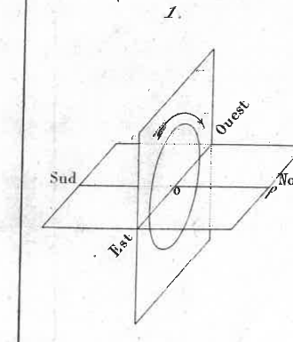

#### III. — Parallelogram of rotations.
5. If, by any two causes, a body tends simultaneously to take two rotations `p` and `q`, represented by the two sides `Op`, `Oq` of a parallelogram `Opθ q`, the body will take a single rotation `θ` represented by the diagonal `Oθ` of this parallelogram.

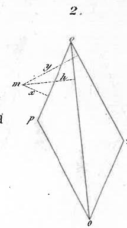

In fact, consider any point `m` of the body, taken in the plane of the parallelogram, and, for example, toward the right in the supplement of the angle formed between the two sides; and let us call `x` and `y` the two perpendiculars dropped from this point `m` onto these sides. It is clear that, by the rotation `p` alone, point `m` tends to rise above the plane with a velocity `p x` (n° 2); and that, by the single rotation `q`, it tends to rise with a velocity `q y`, and that thus, by virtue of the two causes acting at once, it has, along the normal, the velocity `p x + q y`. Now, naming `h` the perpendicular dropped from point `m` onto the diagonal `θ`, we always have the equation:

`p x + q y = θ h`

as is known by a very well-known theorem of geometry. Therefore the velocity that the point `m` takes is equal to `θ h`, that is to say, the velocity it would have if the body turned on the diagonal with the angular velocity `θ`. And since the same thing can be said of any other point in the plane, and the movement of the plane carries that of the body with it, we can say that *any point whatsoever* of the body takes, by the two rotations `p` and `q`, the same movement that it would take by the single rotation `θ`. Therefore, etc.

*Remark.*

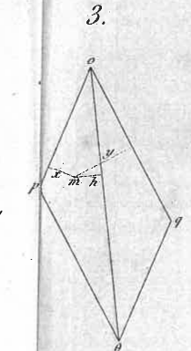

It is solely to abridge the demonstration that I took point `m` in the supplement of the angle formed between the two sides of the parallelogram. If this point were taken between the sides themselves, one would find that while it rises above the plane with velocity `p x`, it descends below it with the velocity `q y`: such that its velocity along the normal would be the difference `p x - q y`. But, by the same theorem of geometry, we would then have:

`p x - q y = θ h`

that is to say that the point always has the same velocity `θ h` as if the body were rotating on the diagonal.

6. Furthermore, this gives us the idea of a more general theorem of geometry than the preceding one, and of which the latter is in some way only a particular case.

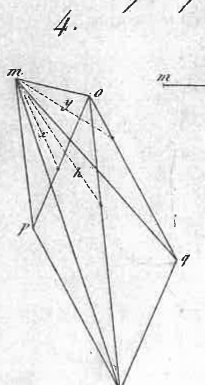

For, suppose the point `m` taken anywhere in space, and name `x`, `y` and `h` from Fig. 4. the three perpendiculars dropped from this point onto the two sides `p` and `q`, and the diagonal `θ` of the parallelogram `p O q θ`; you will likewise have `p x`, `q y` and `θ h` for the velocities that the three rotations `p`, `q` and `θ` would tend to impart to point `m`. But here these velocities, instead of being in the same direction, would be respectively perpendicular to the planes of the three triangles `m Op`, `m Oq`, `m Oθ`: the lines representing them therefore form the same angles between themselves as the planes of these triangles; and they are moreover proportional to their respective areas.

Now, since point `m`, by virtue of the two rotations `p` and `q`, must move as it would by virtue of the simple rotation `θ`, it follows that the line `θ h` must be the diagonal of the parallelogram constructed on the other two `p x` and `q y`.

We therefore have this theorem of geometry:

If, from any point `m` in space, as a vertex, three triangles are drawn having as their bases the two sides `Op`, `Oq` and the diagonal `Oθ` of the parallelogram, there is always the same relation between the areas of these three triangles as between the sides and the diagonal of a parallelogram constructed under the mutual inclinations of these three planes.

Thus the first two triangles combine in some way to form the third, just as two forces proportional to the areas of these triangles, and having the same inclination between them, would combine to form their resultant.

7. And now observe that this theorem, derived from dynamic considerations, is immediately apparent from geometry. For, instead of the three triangles, consider the three parallelograms or rhombi made on the same side `Om`, supported on the same bases `Op`, `Oq`, `Oθ`, and whose areas are measured by `p x`, `q y`, `θ h`. It is evident that these rhombi, which form the two adjacent planes with the diagonal plane of the same rhomboid, being seen as supported on the common base `Om`, are to each other as their heights, and, consequently, as the three lines that would result from the intersection of the rhomboid by a plane perpendicular to the edge `Om`. Now

### Page 15

These lines evidently form the two sides and the diagonal of a parallelogram constructed under the mutual inclinations of the three planes. Therefore, etc.

Currently, if one imagines that point `{m}` descends from space, perpendicularly to the plane of the parallelogram, and to fall into the supplement of the angle `angle {p} O {q}` of the two sides, or its opposite at the vertex, it is visible that the mutual inclination of the two triangles `{m} O {p}`, `{m} O {q}` decreases, and finally becomes zero; and then the triangle `{m} O θ` constructed on the diagonal becomes equal to the sum of the other two, just as the diagonal of a parallelogram becomes equal to the sum of the two sides that comprise it, when the inclination of these sides becomes zero.

If point `{m}` descends similarly to fall into the angle `angle {p} O {q}` itself, or into its opposite at the vertex, it is visible that the mutual inclination of the two triangles `{m} O {p}`, `{m} O {q}` increases and finally becomes equal to two right angles: and then the triangle `{m} O θ` constructed on the diagonal becomes equal to the *difference* of the other two; just as the diagonal of a parallelogram becomes equal to the *difference* of the two sides when their mutual inclination becomes equal to two right angles.

Thus, this well-known theorem, which Lagrange attributes to Varignon, and which he regards as a beautiful theorem of geometry, is only a particular case of ours: and as the latter is very easy to demonstrate directly, one can reciprocally derive from it a demonstration of the parallelogram of rotations, even clearer than the first, since one takes point `{m}` whose movement is examined wherever one wishes, without needing to assume that this point is located in the plane of the axes of the two component rotations.

COROLLARY.

8. From this parallelogram of rotations, it is clear that one can extend to the composition of as many rotations as desired, `O {p}`, `O {q}`, `O {r}`, etc., and thus arrive at their general resultant `O θ` by composing them successively two by two, in the manner of simple forces applied to a point.

And this similarity of composition is not limited to rotations about different axes that intersect at the same point; but, what is very noteworthy, it extends to rotations about axes that would be situated in any way in space: a new theory that deserves to be developed.

IV. — Composition of two rotations about two parallel axes.

9. Two rotations `{p}` and `{q}`, of the same direction, about two parallel axes, compose into a single rotation `θ` equal to their sum `{p} + {q}`, about an axis parallel to the first two and which divides their mutual distance in the inverse ratio of the two component rotations `{p}` and `{q}`.

### Page 16

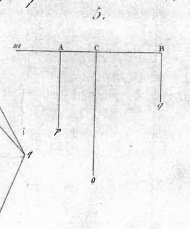

Let `Ap` and `Bq` be the two parallel lines, drawn from points `A` and `B` on the same side of space, representing the two rotations of the same direction `p` and `q` in question, and let's consider any point `m` taken outside these parallel axes, but in their plane, to the right. If we name `x` and `y` the two perpendiculars dropped from this point `m` onto the lines `Ap` and `Bq`, it is clear that, by rotation `p`, point `m` tends to rise above the plane with velocity `p x`, and that, by rotation `q`, it tends to rise with velocity `q y`; and thus, by both rotations simultaneously, it has, along the normal, the velocity `p x + q y`. Now, if we draw the parallel `C θ` between `Ap` and `Bq`, and if we name `h` the perpendicular dropped onto it from point `m`, we will have `x - h` for its distance to the parallel `Ap`, and `h - y` for its distance to the parallel `A q`. If we therefore assume `C θ` is drawn such that the two distances are in inverse proportion of `p` to `q`, we will have
`x - h : h - y :: q : p` or `p x + q y = (p + q) h`.

Now `(p + q) h` expresses the velocity that point `m` would acquire by a single rotation `θ = p + q`, around the axis `C θ`.

Therefore, by virtue of the two parallel rotations of the same direction `p` and `q`, the movement of any point in the plane, and consequently, the movement of the body, is the same as if the body simply rotated with an angular velocity `θ` equal to `p + q`, on a parallel axis that divides the mutual distance of the first two in inverse proportion to the two component rotations `p` and `q`.

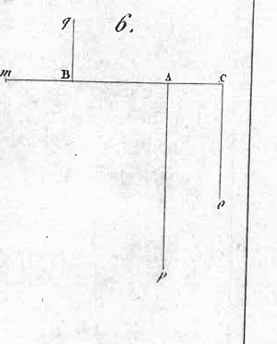

10. If the two parallel rotations `p` and `q` were of opposite directions, we would similarly see that they compose into a single `θ` equal to their difference `p - q`, and around a parallel axis `C θ` whose position would be found in the same way as the resultant of two parallel and opposite forces `p` and `q`. Thus, by naming `i` the distance of `C θ` to the first axis `Ap` for example, and `D` the mutual distance of `Ap` and `A q`, we would have
`i = D cdot {q} over {p - q}`.

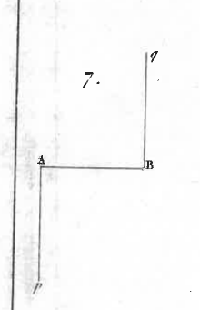

11. If `p` and `q` differed very little from each other, the resultant rotation `θ = p - q` would be very small, and the distance `i` of its axis to the first `Ap` would be very large; so that if `p` and `q` become perfectly equal, we find around an axis located at an infinite distance: which teaches us nothing new, or rather warns us that, in this singular case, there is, strictly speaking, no resultant rotation, and that the body's movement must change its nature. This is, in fact, what happens; for we will see that, from these two parallel, equal, and opposite rotations, only a pure translation movement in space can result for the body.

### Page 17

10
V. — On couples of rotations.

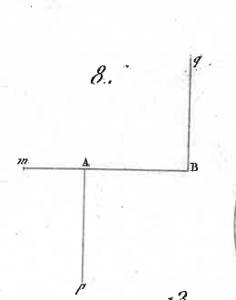

12. Two rotations `p` and `-p`, equal and opposite in direction, about two parallel axes, together form what I call a couple of rotations: it can be seen a priori that such a couple is irreducible, or that it forms, so to speak, a rotation sui generis, which can never be reduced to a simple rotation about any axis whatsoever.

The movement resulting from a couple of rotations `p` and `-p` is a pure translation of all points of the body along lines perpendicular to the plane of this couple, and with a common velocity measured by the moment of the couple, that is to say, by the product `p D` of one `p` of the two rotations, multiplied by the distance `D` separating their parallel axes.

And, indeed, consider any point `m` of the body, taken in the plane of this couple, at a distance `x` from the first axis `p`, and, consequently, at a distance `x - D` from the second `-p`. By rotation `p`, point `m` rises perpendicular to the plane with velocity `p x`; by rotation `-p`, it lowers in the opposite direction with velocity {p (x - D)}: so that it has, along the normal, the velocity {p x - p (x - D) = p D}. Therefore, as `x` no longer appears in this expression, all points of the plane, and, consequently, all those of the body have the same velocity `p D` perpendicular to the plane of the couple. Therefore, etc.

13. It is seen from this that a couple of rotations can be rotated and translated as desired within its plane, or in any other parallel plane, without the body's movement being changed; and furthermore, that this couple can be transformed into another composed of new rotations `p'` and `-p'`, with a new arm `D'`, provided that the moment `p' D'` is equal to the first `p D`.

14. From this property and the parallelogram of simple rotations, it can be immediately concluded that couples of rotations, situated as desired in any planes, can always be composed into a single one by the same law as couples of forces, and, consequently, as simple forces acting on a point: in a word, all theorems concerning ordinary couples can be applied to these new couples, without exception.

15. Moreover, this would be seen in a new light if one were to consider the cause capable of imparting to the body the same movement that results from a couple of rotations. For, as this movement is merely a pure translation in space, it is clear that it could be produced by a simple force applied to the body's center of gravity, in a direction perpendicular to the plane of the couple, and by taking this force equal to the product of the moment of this couple by the entire mass of the body in question. All couples of rotations could thus be replaced by as many forces

### Page 18

proportional applied to the body's center of gravity. From this, for these couples, a composition results that is exactly the same as that of forces around a point. But in this theory of movement considered in itself, everything must be derived from geometry, without borrowing anything from dynamics.

VI. — General composition of rotations around axes situated as desired in space.

16. Let us first consider a simple rotation `p`, around an axis `Ap` passing through any point `A` of the body. If, at another point `O`, chosen anywhere, we imagine two opposite rotations `p'` and `-p'`, equal and parallel to the first `p`, it is clear that these two rotations cancel each other out, and that the body's movement is not changed. But then, instead of the simple proposed rotation `p`, we can see: `1°` a rotation `p'` equal, parallel and in the same direction, but whose axis passes through `O`; `2°` a couple `(p, -p')` formed by the two remaining parallel rotations `p` and `-p'`. If, for more clarity, we transport this couple elsewhere in any plane parallel to its own, which is permissible, there will remain, at point `O`, only the rotation `p'`, which is, so to speak, the proposed rotation `p` transported parallel to itself.

It can therefore be said that a rotation can be transported parallel to itself to any point in space, provided that one considers the couple of rotations that arises from this displacement, and whose moment or measure is the product of the proposed rotation by the path its axis has traversed.

17. This being established, let there be as many rotations as desired, `p, q, r,` etc., around axes `Ap, Bq, Cr,` etc., situated in any manner in space; if they are all transported parallel to themselves to any point `O` in space, they will combine there into a single `θ`, which can be called the resultant rotation; and all the couples of rotations they produced in their translation will combine into a single `(p, -p)` which can be called the resultant couple. This is a general reduction exactly the same as that of forces, and from which a completely similar theory can be derived.

Thus, just as any number of forces can always be reduced to a single force passing through a given point, and to a single couple of two equal, parallel and opposite forces; similarly, any number of rotations, around different axes situated in any manner in space, can always be reduced to a single rotation around an axis chosen at will, and to a single couple of two equal and opposite rotations, around two parallel axes.

And it is evident, as in the theory of forces, that the resultant rotation—

### Page 19

The resultant rotation θ will always be the same, regardless of the point or center O chosen for transporting the rotations: if the position of this point is varied, the resultant θ will only translate parallel to itself in different locations in space; but the plane and the magnitude of the couple of rotations ( ρ, -ρ ) will necessarily change.

18. If a general reduction is desired where there is nothing arbitrary, one can always choose point O such that the plane of the resultant couple is perpendicular to the axis of the resultant rotation. Indeed, everything being first reduced to the rotation θ and the couple of rotations ( ρ, -ρ ) relative to any point O in space, decompose the couple ( ρ, -ρ ) into two: one ( ρ prime, -ρ prime ), in a plane perpendicular to the axis O θ; the other ( ρ prime prime, -ρ prime prime ), in a plane passing through this axis. If you transport the rotation θ into this plane and parallel to itself up to O prime, such that the couple produced ( θ, -θ ) is equal and opposite to the couple ( ρ prime prime, -ρ prime prime ), and consequently destroys it, only the rotation θ around the new axis O prime θ will remain, with the couple ( ρ prime, -ρ prime ) in a plane perpendicular to the same axis, which was to be found; and this singular axis O prime θ, which is determined exactly like the one I named in statics the central axis of moments or couples of forces, can also be called the central axis of couples of rotations.

Thus, any system of rotations is always reducible to a single rotation around a certain determined axis, and to a couple of rotations located in a plane perpendicular to this axis. And it is clear that this resultant couple is the minimum of all those that would be found relative to all points or centers O that would be taken outside this central axis. For, if the rotation θ were transported anywhere else, it would produce a couple ( θ, -θ ) perpendicular to the couple ( ρ prime, -ρ prime ); and these two couples being rectangular to each other, their composition would yield a resultant couple superior to the couple ( ρ prime, -ρ prime ).

19. As a couple of rotations is equivalent to a pure translation of the body along the perpendicular to the plane of this couple, it follows that the entire movement of a body, by virtue of as many rotations as desired, is reduced, in the final analysis, to rotating about a certain line and simultaneously sliding along this line: which is, as we shall see later, the most general movement a body can have in absolute space.

20. If the minimum resultant couple is zero, the entire movement reduces to a simple rotation: if the resultant is zero, it reduces to a simple translation; and reciprocally, each of these reductions cannot occur without the assumed condition being met. Finally, for all rotations of the system to cancel each other out, and thus for the entire movement

### Page 20

of the body reduces to zero, it is necessary that the resultant and the resultant couple are both zero at the same time, and this, no matter where in space all the rotations have been transported.

Remark.

One sees the perfect symmetry of this composition of rotations and that of forces: they are almost identical; for, if one had originally given the name *force* to the cause capable of turning about an axis, one would have had for these new forces an entirely similar statics. Only, in the latter, simple forces (always considered as transported to the center of gravity of the body) would have corresponded to our couples in ordinary statics, and couples would have corresponded to our simple forces. But it was, I believe, more natural, I mean more in conformity with the nature of the human mind, to begin, as has been done, by giving the name *force* to the cause capable of a pure translation, and then to see in the *couple* the cause capable of a pure rotational movement.

However, it is a very remarkable thing that the same book, written on the science of forces, could, without ceasing to be exact and to treat the same science regularly, be understood in two different ways, depending on whether one attaches to the word *force* the idea of a cause of translation, or the entirely different idea of a cause of rotation. We can return elsewhere to this singular point of philosophy.

31. We have just seen everything concerning the idea of simple rotation about an axis, and the composition of similar rotations about axes situated in any manner in space. But we must now form an idea of the movement of a mobile body about a fixed point on which it seems to pirouette in all directions.

VII. — Idea of rotation about a point.

32. The movement of a body rotating about an immobile axis being the only one of which we have a clear idea, it is therefore to this idea that we must try to reduce that of the movement of a body pirouetting in any manner about a fixed point or center `O`.

Now I say that this movement, whatever it may be, if one considers it only for an instant, is nothing other than a simple rotation about a certain axis passing through point `O` and whose direction remains immobile during that instant. Indeed, let us consider two arbitrary points `A` and `B` of the body, which, with the center `O`, form the triangle `OAB`. However the body moves, it is certain that after an instant, it will be found that point `A` has arrived somewhere else at `A'`, and point `B` at `B'`, such that triangle `OAB` will have taken in space the infinitely close position

### Page 21

OA'B'. Now it is clear that this movement could be produced by two successive rotations: one `p`, around the common intersection `OS` of the two planes of these triangles, which would bring triangle `OAB` into the same plane as its equal `OA'B'`; the other `q`, around the perpendicular `OH` to this plane, which would bring point `A` to `A'`, and consequently, `B` to `B'`. But these two rotations `p` and `q` around two axes that intersect at point `O`, can always be reduced to a single `θ` around an axis `OI` passing through the same point. Therefore, in whatever way a body moves around a fixed point, its movement can only be, at the instant under consideration, a simple rotation of this body around an axis passing through this point, and which remains immobile in the body and in space during this instant.

From this, we can conclude that, in the next instant, it is likewise a simple rotation, but around another axis; and so on from one instant to the next: so that the movement of the body can be considered as a sequence of these simple movements, each of which presents only a clear idea to the mind. Thus, to form an idea of the movement of a point along a curve, one represents this point as describing the successive sides of an infinitesimal polygon imagined inscribed in this curve. We therefore have this theorem:

23. The movement of a body rotating in any manner about a fixed point is nothing other than a rotation of this body about an axis that always passes through the fixed point, but whose direction changes from one instant to the next, and which, for this reason, is called the INSTANTANEOUS AXIS. And this instantaneous axis in the rotation of a body is precisely like the tangent to a curve in the movement of the point that describes it.

24. It must be noted that this instantaneous axis changes position both within the body and in space simultaneously: for, as it is simultaneously immobile within the body and in space during the duration of an instant, and since at the end of this instant, it is assumed to be in another position, it is clear that it can no longer be in the same place neither in absolute space nor within the body: and one can even add that the angle it describes in space, which constitutes its absolute movement, is the same as the angle it describes within the body, which constitutes its relative movement.

Therefore, when we see a body rotate about an axis that is invariable in position within the body, but variable in position in space, we must conclude that this axis is not the instantaneous axis around which the rotation actually occurs: for the instantaneous axis could not remain immobile within the body without also remaining immobile in space.

### Page 22

VIII. — A tangible image of this rotation.

Although the preceding analysis is exact, and I have striven to make it clear, it must be admitted that the idea of a body rotating on an axis that constantly varies is still a little obscure; I mean that one does not clearly see what happens to the body, and that it is difficult to follow it in the course of this kind of changing rotation. It is therefore necessary to try to clarify this idea further, and to present to the mind a clearer and more tangible image.

25. Now we have just demonstrated that any movement of a body around a fixed point can only be a rotation of this body on a certain axis that changes position from one instant to another. Therefore, since this instantaneous axis always passes through the fixed point, it is evident that it can only describe in space a certain conical surface whose vertex is at this point; and similarly, it is evident that it can only describe within the body another conical surface of the same vertex.

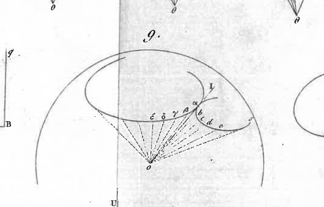

Let `O` therefore be this common vertex, and `OI` the instantaneous axis in the current position that we are considering; and let us conceive from the center `O` and any radius `OI` a sphere described which cuts the two conical surfaces along two curves which will serve as the bases of these two surfaces. Of these two curves, the first `σ` is fixed in absolute space, and the second `s` is fixed in the body, and, consequently, mobile with it in space.
Let us divide the time `t` into infinitely small equal particles `dt` which we shall call instants; and let there be marked, on the fixed curve `σ`, the successive points `α`, `β`, `γ`, `δ`, etc., where the pole `I` of the axis of rotation passes from one instant to another. Let us join `I α`, `α β`, `β γ`, etc., by arcs of great circles, and consider the curve as a spherical polygon with an infinity of sides `I α`, `α β`, etc.

If we now divide the other curve `s`, which serves as the base for the mobile cone, into arcs of great circles `I α`, `ab`, `bc`, etc., respectively equal to the former, it is clear that at the first instant `dt`, the body rotating on `OI` brings the point `a` of the body onto the point `α` of space; that in the next instant, the body rotating on `O α` brings the point `b` of the body onto the point `β` of space; and so on from one instant to another: so that the curve `s`, which serves as the base for the mobile cone, applies one after another all its various elements onto the respectively equal elements of the other curve `σ`, which serves as the base for the fixed cone in question. From this I conclude that the movement of the body could be produced by the mobile cone rolling, without slipping, on the fixed cone in question.

### Page 23

26. We therefore have this new theorem:
In whatever manner a body moves by rotating around a fixed point, this movement can be nothing other than that of a certain cone, whose vertex is at this point, and which currently rolls, without slipping, on the surface of another fixed cone of the same vertex.
I mean that the mobile cone, considered as attached to the body and carrying it along, if it rolls on the other cone which is fixed in absolute space, will cause the body to describe the precise movement it is assumed to have; that the line of contact of these two cones will be, at every instant, the axis around which the body rotates at that instant, or what is called the instantaneous axis: from which we see how this axis is at once mobile within the body and in absolute space; describing in space the surface of the fixed cone, and within the body, the surface of the mobile cone we have just spoken of.

27. Such is, I believe, the highest point of clarity to which one can bring the idea, so complex and obscure, of the movement of a body rotating in any manner around a fixed center. There is no movement of this nature that cannot be exactly produced by rolling a certain cone on another fixed cone of the same vertex; so that, if one imagines all possible cones that could thus roll, one upon the other, one obtains a faithful image of all possible movements of which a body is capable around a point about which it has the freedom to pivot in all directions.
And even if it were a discontinuous rotational movement, that is to say, where the axis of rotation, instead of changing position by imperceptible degrees, would suddenly jump from one position to another by a finite angle, one could also imitate the movement of the body, by taking, instead of two cones, two pyramids of the same vertex, and with respectively equal faces, and rolling one upon the other, in such a way that the mobile pyramid, turning on the common edge, would apply, one after the other, all its different faces on the respectively equal faces of the fixed pyramid. This is, in fact, what results from the very demonstration I gave above.

Remark I.
28. Moreover, it is good to note, in this demonstration, that if I took, on the instantaneous axis OI, a line OI of constant length, it was solely to better fix the ideas, by showing the two curves described by the instantaneous pole as being traced on the same sphere. But it is evident that the demonstration would proceed in the same way by taking on the instantaneous axis a line OI of variable length, following any arbitrary law, and considering the two curves described by its extremity I, one within the body, the other in absolute space. We would always have the same two conical surfaces, but terminated here by these two new curves.

### Page 24

which would serve as their bases; and one would likewise see that the mobile curve applies, one after another, all its successive elements onto the respectively equal elements of the fixed curve: from which the exact same theorem would be derived.

Remark II.

29. It may also not be useless to make a remark on the clear idea that must be attached to words when one speaks of the movement of the instantaneous axis, or when one uses some other term that implies the mobility of this axis, either in the body or in space. This is merely a way of expressing oneself. The instantaneous axis does not move: for it is by its nature immobile for an instant, and at the end of this instant, it is another line that in turn becomes the axis of rotation. But by imagining the set of all these lines, drawn in advance, some in the body and others in space, and giving them the common name of instantaneous axis, one can naturally speak of the surface described by this axis, instead of speaking of the surface formed by the succession of all these lines, each of which must in turn become the axis of rotation. And similarly, instead of the angle `d φ` between two consecutive generators of this surface, one can speak of the angle described in an instant `dt` by the instantaneous axis, and thus name the ratio `{{d φ} over {dt}}` the angular velocity with which this axis simultaneously traces the two conical surfaces in question: It is in the same sense that one names the ratio `{ds} over {dt}`, or the ratio `{d σ} over {dt}` which is equal to it, the velocity with which the instantaneous pole `I` moves along the two curves `s` and `σ`, one in the body and the other in space, although the point of the body which at this moment forms the instantaneous pole has no velocity by its nature. For this point of the body, as long as it forms the pole, is immobile; and as soon as it moves, it is no longer the pole of rotation.

IX. — On the different things that can naturally be considered in the study of the movement of a body around a point, and on the mutual dependence of these things.

30. If the two curves `s` and `σ`, which serve as bases for the two conical surfaces, are given, along with the angular velocity `θ` of rotation around the instantaneous axis `OI`, it is evident that the movement of the body will be entirely determined.

If, with the angular velocity `θ` always known, only one of these two curves is given along with the velocity of the pole that describes it, the other curve will necessarily be given.

Suppose, for example, that the fixed curve `σ` is given along with the velocity

### Page 25

`{d σ} over {dt}`
of the instantaneous pole I along this curve. As the body rotates about OI with a given angular velocity `θ` also given, it is clear that the point of the body which, at the end of the instant `dt`, must fall onto the fixed curve `σ` to become in turn the instantaneous pole, is a point already determined in the body; and the same applies to the other points of the body that successive rotations must bring one after another, as poles, onto the fixed and given curve `σ`: from which it is seen that the other curve `s`, which marks the path of the pole within the body, is entirely determined.

And conversely, if, instead of the fixed curve `σ`, we are given the mobile curve `s`, with the velocity `{ds} over {dt}` and the rotation `θ`, we will similarly see that the fixed curve `σ` will be entirely determined in space.

51. In general, in the study of the movement of a body around a fixed point, several simple quantities naturally present themselves for consideration, such as the angular velocity `θ` of rotation around the instantaneous axis OI; the angular velocity `ω` with which this axis traces the two conical surfaces S and Σ that it describes simultaneously, one inside the body, the other in absolute space; the radii of curvature `r` and `ρ` of these two surfaces; the angular movements `p` and `π` of the pole, one around the axis OP of the osculating cone of the mobile surface S, and the other around the axis O`Pi` of the osculating cone of the fixed surface Σ; etc. And if, of these different things, any three are known, it can be said that the others are also known, and that the movement of the body is entirely determined.

A clear idea of these mutual relations can be formed by taking a constant length {OI = 1} on the instantaneous axis, and considering the two curves `s` and `σ`, described by the pole I, as two spherical polygons with an infinite number of sides.

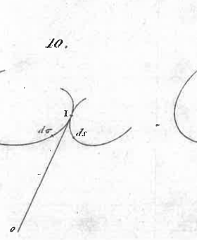

For, during the instant `dt`, where the pole remains immobile at I, the side `ds` of the mobile spherical polygon `s` describes,

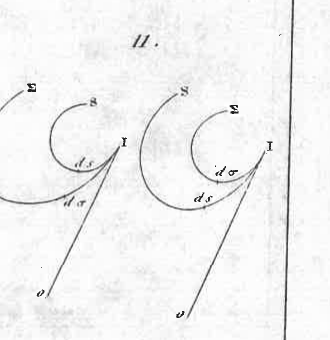

 to lie on the equal side `d σ` of the fixed polygon `σ`, an angle formed by the sum of the exterior angle `d θ` of the mobile polygon and the exterior angle `d σ` of the fixed polygon, or by the difference of these two angles, if the two curves `s` and `σ` have their convexities turned in the same direction. The angular velocity `θ`, around the instantaneous axis OI, is therefore expressed by the sum or by the difference of these two angles, divided by the element `dt` of time; so that we have

`{θ} = {d θ +- d σ} over {dt}`

(the sign `+-`, depending on whether the two curves `s` and `σ` have, at the point of contact I,

### Page 26

their convexities opposite to each other, or turned in the same direction).
Now, the exterior angle of the spherical polygon `s` is nothing other than the exterior dihedral angle, formed by the extension of one face with the next face, in the central pyramid of which this spherical polygon is the base; and this dihedral angle being equal to that formed between the two perpendiculars raised on the adjacent faces, has for measure `{ds} over {r}`, if `r` is named as the radius of curvature of the conical surface at point I under consideration. We therefore have
`de = {ds} over {r}`

and we similarly have
`de = {dσ} over {ρ}`

by naming `ρ` the radius of curvature of the other surface at the same point I: from which it follows, by substituting these values into the preceding equation,
`0 = {ds} over {r dt} +- {dσ} over {ρ dt}`

But `{ds} over {dt}` (or `{dσ} over {dt}`, which is always equal to it) marks the angular velocity with which the instantaneous axis OI simultaneously traces the two conical surfaces; by therefore making
`{ds} over {dt} = {dσ} over {dt} = ω`

we have
`0 = ω ({1} over {r} +- {1} over {ρ})`

which gives a very simple relation between the rotation `θ`, the angular motion `ω` of the instantaneous axis, and the radii of curvature `r` and `ρ` of the two conical surfaces it describes.

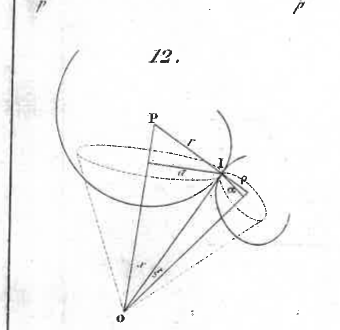

32. If we assume these two radii of curvature `IP = r`, `IΠ = ρ` (Fig. 12) are drawn, and if we join OP and OΠ, we will have the axes of the two right and circular osculating cones of the two surfaces; and the two perpendiculars dropped from pole I onto these two axes OP and OΠ will be the radii `a` and `α` of the circles that serve as bases for these osculating cones.

Now we have, from the figure,
`r^2 = {a^2} over {1 - α^2}`
`ρ^2 = {α^2} over {1 - α^2}`

Thus, one can introduce into the preceding equation, instead of the radii of curvature `r` and `ρ` of the two cones, the radii `a` and `α` of the two circles which

### Page 27

serve as bases; and the equation becomes
`θ = {ω} over {a} sqrt{1 - a^2} +- {ω} over {a} sqrt{1 - a^2}`

But with `ω` being the angular velocity of the instantaneous axis on the surface of the cone, it is clear that `{ω} over {a}` is the angular velocity of the projection of this axis OI onto the base, and, consequently, it is the angular motion of pole I around the axis OP of this cone; and, similarly, `{ω} over {a}` is its angular motion around the axis OII of the other cone. If we therefore designate these two angular motions by `p` and `π`, or if we set `{ω} over {a} = p`, `{ω} over {a} = π`, we first derive the proportion
`p : π :: a : a`

and then, according to the preceding equation,
`θ = p sqrt{1 - a^2} +- ω sqrt{1 - a^2}`

From this, we see that the angular motions of the pole, around the axes of the osculating cones, are nothing other than the rotation `θ` decomposed into two `p` and `π` around the same axes: for, OI being equal to `1`, it is clear that by naming `x` and `ξ` the inclinations of OI on the axes OP and OII, we have
`a = sin x`
`a = sin ξ`

so that the two preceding relations are equivalent to this series of equal ratios:
`p : π :: sin ξ : sin x : sin(x + ξ)`

which shows that `p` and `π` are the two sides of a parallelogram whose `θ` is the diagonal.

33. We thus see how these various quantities are linked together, and can be found when three of them are known as functions of time.

If these three given quantities are constant, all the others are also constant; and the motion of the body is that of a right circular cone rolling uniformly on a fixed, equally right and circular cone.

Thus, the Earth rotates in one day on its axis OI, while this axis describes, in the opposite direction, a right cone around the OII axis of the ecliptic, at an angle `ξ` of `26 deg 8 '`, and with an angular velocity `π` measured by the retrograde motion of the equinoxes, which is approximately `42` centesimal thirds per day. We therefore know the rotation `θ` around the instantaneous axis, the fixed cone `Σ` that this axis describes in space, and the angular velocity `π` it has in this motion. We can therefore determine within the Earth the cone S which, rolling on the

### Page 28

first Σ, and within its surface, would cause the Earth to describe the precise motion observed there. For, taking the day as the unit of time, we will have `θ` = 2 `π` = 400 degree, `π` = 42'' and sin `ξ` = sin 26 degree 8', and the preceding equations give

tan `ξ` = {`π` sin `ξ`} over {`θ` + `π` cos `ξ`} = {42'' sin 26 degree 8'} over {400 degree + 42'' cos 26 degree 8'}

from which we conclude the radius sin `ξ` of the small circle serving as the base for this mobile cone S: which gives approximately 1.684 m in length to the small circumference that the instantaneous pole of Earth's rotation describes daily on its surface (all this, moreover, under the hypothesis of perfectly uniform diurnal rotation and precession).

X. — Idea of the most general motion a body can have in absolute space.

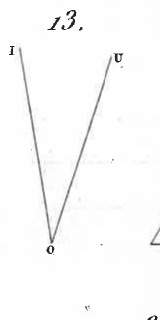

34. Consider any point O of the body, and its current velocity `u` (Fig. 13) in space; it is clear that the entire motion of the body, whatever it may be, can be seen at this instant as composed of: 1° a simple translation that would carry all molecules with the same velocity `u` along lines parallel to the direction of this velocity; and 2° a simple rotation `θ` around a certain axis OI passing through the point O under consideration. For, by virtue of the first of these two movements, point O will be carried in space to the very place where it should be at the end of an instant; and by the second around a well-chosen axis OI, the body can reach any position supposed for it at the end of the same instant.

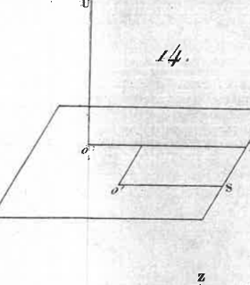

Now, if the direction OU of the translation `u` were perpendicular to the axis OI of the rotation `θ`, the entire motion could be reduced to a simple rotation `θ` around a certain axis O'S parallel to OI (Fig. 14). For, draw a plane perpendicular to OU along OI, and suppose that in this plane, and on the side of the axis where the rotational velocity of the molecules is opposite to their translational velocity, a point O' is taken at a distance `x` = {u} over {`θ`} from this axis OI; it is evident that this point O' will have zero velocity `x``θ` - `u` in space, and the same will apply to all points of the body located on the line O'S parallel to OI. Therefore, in the particular case where OU is perpendicular to the instantaneous axis OI, the double motion of the body reduces to a simple rotation around a certain determined axis O'S, which is called the spontaneous axis of rotation.

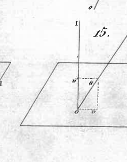

Currently, if OU is not perpendicular to OI (which is the more general case, Fig. 15.), imagine that the translational velocity `u` is decomposed into two, one `v` perpendicular to OI, and the other `v'` parallel to the same axis. The first

### Page 29

22

velocity `{v}`, combined with rotation `θ`, will result in a spontaneous rotation around a certain axis parallel to `OI`, as we have just seen; and the second velocity `{v}'` will transport all points of the body in a direction parallel to this spontaneous axis. Thus, in the most general case, the entire movement of a body reduces to rotating on a certain axis and simultaneously sliding along this axis: so that this movement is exactly the same as that of a screw turning in its nut. All points of the body therefore describe, on concentric cylinders, small helical arcs, all having the same pitch. In the next instant, it is another screw, with another axis and a different pitch; and so on from one instant to the next: from which one sees how the simultaneous curves described by all points of the body are formed, and along which they move as if in so many curvilinear channels where they would be confined.

35. The movement of translation, by which all points of a body are carried along equal and parallel lines in space, is perfectly understood; the movement of rotation around an axis that remains immobile is understood with equal clarity: but the movement resulting from the combination of these two for each point of the body, and it is the coexistence of these two movements in a single one, that I wanted to show in the well-known movement of a screw currently turning in its nut.

Sometimes the pitch of this screw is zero, and everything reduces to a simple rotation around a certain axis which is called the spontaneous axis of rotation. But, in general, the pitch of the screw is not zero, and there is no properly speaking spontaneous axis; that is to say, in the body, there is no line whose points remain immobile for an instant: but there is always what could be called a spontaneous sliding axis; that is to say, there is always in the body a straight line whose points have no other movement than a simple translation along this line.

36. Such is therefore the nature of the movement of solid bodies and the clear idea one can form of it at every instant. If a body pirouettes in any manner on a fixed point, it is a certain mobile cone that rolls at that instant on another fixed cone of the same vertex: and all varieties of this type of movement are given by the varieties of conical surfaces that one can consider, and among which one must include the plane, which is the simplest of all, the cylinder, which is a cone whose vertex is at infinity, and even the straight line, which is also a particular case of conical surfaces. Finally, if a body moves in any manner in space, it can be seen at every instant as a certain screw currently turning in its nut. And as it is also to this movement that can be reduced

### Page 30

23

arbitrary rotations (No. 19), one can conclude that, by simple rotations on different axes, one can give a body the most general movement of which it is susceptible.

CHAPTER II. — OF FORCES CAPABLE OF A GIVEN MOVEMENT.

37. After having considered the movement of bodies in itself, one must seek the forces capable of producing it, in order to see reciprocally what movement a body must take by virtue of any given forces, which is the natural problem of dynamics.

And first I recall the precise idea that must be attached to the word *force* in the theory of movement. By *force* I mean any cause capable of imparting a uniform and rectilinear movement to a free body, considered as a material point, that is to say as a point where a certain quantity of matter is conceived to be concentrated. The direction and sense of the movement of this point constitute the direction and sense of the *force*; and the magnitude of this *force* is measured by the product of the mass by the imparted velocity.

38. This definition of force being established, I say that, whatever the movement of a body in space, there are always forces which, being applied to this body supposed at rest, are capable of producing the movement observed in it. And indeed, in this movement, each molecule `d m` of the body having a certain velocity `u` in space, it is evident that this molecule could be regarded as at rest, but suddenly animated by a force `u d m` which would produce its velocity. Therefore, if one considers the infinity of similar forces `u d m` applied to all the respective molecules of the body, one will certainly have forces capable of producing the given movement on the body. Therefore, if one imagines that, by the static laws of the composition of forces, all these elementary forces `u d m` have been reduced to other forces `P`, `Q`, `R`, etc., one will have another system of forces equally capable of the given movement.

39. But there is an essential difference to note between the system of forces `u d m` applied to all the elements of the body, and the forces `P`, `Q`, etc., to which they would have been reduced by composition. If the movement produced is the same in both cases, the internal state of the body will not be the same at the first instant. For it is evident that the elementary forces `u d m`, being individually applied, each to each of the molecules of this body, are capable of producing the given movement in it, even assuming that these molecules are not linked together at the first instant; and, consequently, without first exciting, in the bonds that unite them, any sudden compression or traction that would tend to break them. Under the action of these

### Page 31

24

elementary forces `{u} {dm}`, the movement of the body is therefore spontaneous; that is to say that the body's connections are not necessary at the first instant; and if, in the course of the movement, these connections are found to be stretched, it can only be by the centrifugal forces that arise from the curvilinear movements that the molecules are obliged to follow due to their mutual connection. But if, instead of these elementary forces `{u} {dm}`, their reduced forms `P, Q, etc.` are applied to the body, it must necessarily be assumed that the molecules are linked together from the first instant, so that these forces `P, Q, etc.` can actually be decomposed into the elementary forces `{u} {dm}` alone capable of the body's spontaneous movement. Thus, under the action of forces `P, Q, etc.`, the body's connections are necessary at the first instant; for they begin by experiencing an abrupt and finite action which they must first resist: and everything then proceeds as in the first case, where the connections suffer only the tensions that arise at each instant from the centrifugal forces.

40. This distinction we have just made, which is null regarding the movement produced on the body, is therefore essential regarding the initial internal state of this body: for it can be affected, at the beginning, in as many different ways as different systems of forces can be applied to it, equally capable of imparting to it the movement that animates it. But, if we consider only the movement of the body, without concerning ourselves with the sudden shocks or tensions it may experience internally, and which it must destroy by its solidity, it is permissible to compose the elementary forces `{u} {dm}`, and thus reduce them to others, such as, for example, to a single force and a single couple, the whole of which will also be capable of the given movement: this is what we will do in the following articles; after which we will similarly reduce the centrifugal forces arising from rotation.

I. — Forces capable of pure translational motion.

41. If a body has only pure translational motion in space, so that all molecules advance in the same direction, with the same velocity `u`, along parallel straight lines, it is clear that all the elementary forces `{u} {dm}` by which these molecules are animated are also parallel, in the same direction and proportional to the respective masses `{dm}` of these molecules. Now we know that such forces are always reducible to a single force `R`, parallel and in the same direction, equal to their sum `∫ {u} {dm}`, and passing through the center of gravity of the body.

Therefore, conversely, if any force `R` is applied to the center of gravity of a solid body, as it can always be decomposed into parallel forces of the same direction, applied to the molecules of this body, and proportional to the masses of these molecules, the effect of this force `R` will be to

### Page 32

transport all parts of the body, following its own direction, and with a common velocity `u = R over m`, that is to say, equal to the magnitude of this force divided by the entire mass `m` of the body in question. Which was, so to speak, self-evident.

42. If this force `R`, always passing through the center of the body, changed direction and magnitude at every instant by the action of some external accelerating force passing through the same center, the body's motion would nonetheless be a pure translational motion; I mean that the body would have no rotation on itself. All points of this body would describe, it is true, curved lines; but all simultaneous elements of these described curves would be equal and parallel to each other: so that by observing any plane attached to the body, and consequently moving with it in space, this plane would always be found parallel to itself throughout the motion.

II. — Forces capable of pure rotation about a given axis.

43. Let us suppose that a body rotates, at the instant under consideration, around a given axis `OZ`, with an angular velocity `θ`; it is clear that, in this motion, any molecule `dm`, taken at a distance `r` from this axis `OZ`, has a velocity `θ r`, directed along the tangent of the circle that this molecule tends to describe. Thus, the force animating it has the same direction, and it is expressed by `θ r dm`. All molecules of the body are given by similar forces `θ r dm`, proportional to their masses `dm` and their distances `r` from the axis of rotation, and following directions that are simultaneously perpendicular to these distances and to the direction of the given axis: and it is a matter of seeing how all these elementary forces can be reduced to others with an equivalent effect, that is to say, equally capable of the rotation `θ` of the body around the free and given axis `OZ`.

Reduction of these forces.

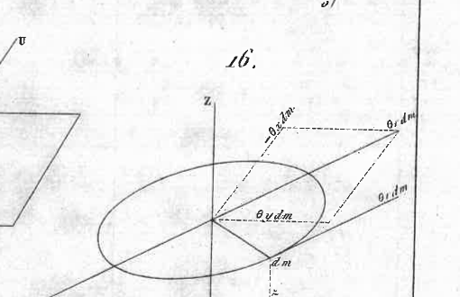

44. To perform this reduction in an easy and calculation-appropriate manner, let two other axes `OX` and `OY` be drawn through any point `O` on this axis, perpendicular to each other and to it; and let `x, y, z` be the coordinates of the molecule `dm` relative to these axes (Fig. 16).

I conceive the force `θ r dm` decomposed into three others `X, Y, Z` parallel to the three axes; which obviously gives for the first `X = θ y dm`, for the second `Y = - θ x dm`, and for the third `Z = 0`.

If these forces are transported parallel to themselves to point `O`, two forces first arise,

`X = θ y dm`
`Y = - θ x dm`

### Page 33

applied at O along the axes OX and OY themselves; then, three couples L, M, N around the respective axes x, y, z, and whose moments are expressed by `(Y z - Z y)`, `(Z x - X z)`, `(X y - Y x)`; which gives, by substituting their values for X, Y, Z,

`L = - θ x z dm`
`M = - θ y z dm`
`N = θ (y^2 + x^2) dm = θ r^2 dm`

Thus, if we perform the same transformation for each force `θ r dm`, and if we denote by the sign `∫` the sum of all terms similar to the one written under this sign, all forces `θ r dm` capable of the given rotation `θ` will be reduced to the following forces and couples, namely:

1°. Two forces `X = θ ∫ y dm`, `Y = - θ ∫ x dm`, one along OX, the other along OY, forces that can be reduced to a single P, perpendicular to OZ, and whose value will be

`P = θ sqrt{ (∫ x dm)^2 + (∫ y dm)^2 }`

or, if we wish, by naming D the perpendicular dropped from the center of gravity of the body onto the OZ axis, we will have, for the value of this force, the simpler expression

`P = θ m D`

2°. Two couples `L = - θ ∫ x z dm`, `M = - θ ∫ y z dm`, around the first two axes OX and OY, couples that can be reduced to a single K, whose plane passes through OZ, and whose moment is

`K = θ sqrt{ (∫ x z dm)^2 + (∫ y z dm)^2 }`

3°. And finally we will have the couple N whose moment is

`N = θ ∫ (x^2 + y^2) dm = θ ∫ r^2 dm`

and which acts in a plane perpendicular to the given OZ axis. Thus, by taking the five integrals

`∫ x dm`, `∫ y dm`, `∫ x z dm`, `∫ y z dm`, `∫ (x^2 + y^2) dm`

which must be extended to the entire mass m of the body, we will completely determine the force P, the couple K and the couple N, the ensemble P, K, N being capable of the rotation `θ` around the given OZ axis.

COROLLARY I.

48. If this OZ axis passes through the center of gravity of the body, we will have

`∫ x dm = 0`, `∫ y dm = 0`, whence `P = 0`;

### Page 34

and all forces will be reduced to the two couples K and N, or, if one wishes, to their resultant

`G = sqrt{K^2 + N^2}`.

From which I conclude that the forces capable of rotating a body about an axis passing through its center of gravity are always reducible to a couple. Whereupon it is good to note that this couple G is not perpendicular to the axis of rotation, since it forms with this axis OZ an angle whose co-sine `K over {sqrt{K^2 + N^2}}` cannot be zero unless `K = 0`.

COROLLARY II.

46. But if it happens that this axis OZ is one of the principal axes of the body, we will have, as is known,

`∫ x z dm = 0`, `∫ y z dm = 0`;

and then the couple K will be zero, and all forces will be reduced to the single couple `N = ∫ r^2 dm`, which is perpendicular to the given axis OZ. From which I conclude that the forces capable of rotating a body about one of its principal axes are always reducible to a couple perpendicular to this principal axis.

And conversely, any couple N perpendicular to one of the principal axes is always decomposable into elementary forces `θ r dm` capable of rotating about this axis with an angular velocity `θ = N over {∫ r^2 dm}`; for such forces `θ r dm` would reduce to a couple `θ ∫ r^2 dm` of the same magnitude and position as the given couple N.

We therefore have this simple and easy-to-remember theorem:
If a couple is applied to a free body in a plane perpendicular to one of its principal axes, its effect will be to rotate the body about this axis itself with an angular velocity equal to the moment of this couple, divided by the moment of inertia of the body about this principal axis.

COROLLARY III.

47. By this single particular theorem, one can immediately find the effect of a couple G applied to the body in any desired plane. For, by decomposing this given couple into three other couples L, M, N perpendicular to the three principal axes of the body, and naming A, B, C the three moments of inertia corresponding to these axes, we will have

`P = L over A`, `q = M over B`, `r = N over C`,

for the three respective rotations p, q, r that these couples tend to produce

### Page 35

28
around the same axes: so that if we compose these three rotations into a single θ, we will have the axis and the magnitude of the rotation to which the proposed couple G tends to give rise at the first instant; which is, as we see, of the greatest simplicity.

GENERAL COROLLARY.
Of forces capable of any movement; and, reciprocally, of the movement that a body takes by virtue of any given forces.

48. According to what has just been said, it is very easy to find the force and the couple whose combination is capable of any given movement. For, whatever this movement may be, you can always conceive it as decomposed into two: one, which consists of a pure translation equal and parallel to the movement of the body's center of gravity; and the other, in a simple rotation around an axis passing through the same center. We will therefore only have to take the force R capable of the first of these two movements, and the couple G capable of the second, and the problem will be solved.

49. Reciprocally, whatever forces are applied to a body, imagine them all transported parallel to themselves to the point that constitutes the center of gravity of this body: they will combine there into a single R, and all the couples resulting from their translations will combine into a single G.

Now the resultant R, being applied to the center of gravity of the body, tends to impart to all molecules a common velocity `u` = {R} over `m`, and in the very direction of this force R.

The couple G tends to impart to the body a rotation θ around a certain axis OI, passing through the same center, and which will be determined as stated above.

Remark.
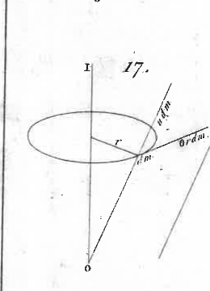

50. Each molecule `dm` is therefore animated by two forces, one `udm` parallel to R, the other θ `rdm` perpendicular both to the axis OI and to its distance r from this axis. Thus, this molecule describes, at each instant `dt`, the diagonal of the parallelogram constructed on the two infinitely small lines `udt` and θ `rdt` which represent the spaces due to these forces.

Such will therefore be the movements of all the molecules of the body; and all these simultaneous movements are possible, I mean that they can exist together without the mutual arrangement of the molecules being altered in any way. For all the component movements `udt`, considered separately, are evidently possible; and the same applies to all the movements θ `rdt`. Now it is clear that, by these two movements executed one after the other, one would bring about

### Page 36

each molecule of the body at the end of the diagonal of the parallelogram constructed on the two lines `θ u dt`, `θ r dt`, and, consequently, at the very place where it would arrive by following this diagonal. Thus, all compound movements are possible together, and effectively take place along the respective diagonals of these infinitely small parallelograms. And if one wishes to represent all the molecules of the body, it has been seen (no. 34) that these are small arcs of helices all described with the same pitch on concentric cylinders around a certain axis `O'S`, which is not the instantaneous axis `OI`, but which is always parallel to it, and which I have named the spontaneous sliding axis.

III. — Centrifugal forces arising from rotation.

51. We have considered above (no. 43) the finite forces `θ r dm`, by which all the molecules of a body are animated when this body rotates with an angular velocity `θ` around a given axis `OZ`.

But from this very rotation, at each instant, for each molecule `dm`, an infinitely small force arises, which tends to move this molecule away from its center of rotation, and which is thus called the centrifugal force.

52. To form a clear idea of this force, it must first be noted that a free molecule `dm`, animated by the sole force `u dm` along the tangent of a circle, cannot strictly describe an arc of this circle, however small it is supposed to be, unless it is at each instant attracted towards the center by a certain force which retains it on the circumference; otherwise, this molecule would move along the tangent with the velocity `u` imparted to it. This force, which is called centripetal, is of the same kind as gravity, and it is measured in the same way, that is to say, by the velocity `u` that it would cause the mobile to acquire in the unit of time, if it always acted equally upon it; I mean if, at each of the equal instants, it added an equal degree of velocity to the mobile. In a movement of this nature, the acquired velocity is therefore proportional to time, so that `f t` is the expression of this acquired velocity at the end of time `t`; and `{1} over {2} f t^2` for the space through which the mobile would have descended towards the center at the end of this same time `t`.

As for the magnitude `f` of this centripetal force, it evidently depends on the velocity `u` along the tangent and on the radius `r` of the described circle; and it is very easy to determine it. For, without the accession of this accelerating force, the material point would move instantaneously along the tangent by a space `u dt`, and would thus be distant from the circumference by a small distance equal to the exterior part `e` of the secant drawn from this point through the center of the circle. For the material point not to leave the circumference, it is therefore necessary that the space `{1} over {2} f dt^2`, which the force `f` is capable of making it descend in an in-

### Page 37

stant `dt`, is precisely equal to this exterior part `e`. Now, by geometry, the exterior part of the secant is equal to the square of the tangent divided by the entire secant; so that we have, to determine `f`, the equation
`1/2 f.dt^2 = {u^2 dt^2} over {2r + e}`
or
`f = {u^2} over {2r + e}`
whence, neglecting `e`, which is an infinitely small quantity of the second order with respect to lines `r`, `u` and `f`, we derive
`f = {u^2} over {r}`

Thus, the centripetal force necessary for a free point to rotate in a circle with a tangential velocity `u` is expressed by the square of this velocity, divided by the radius `r` of the circle it describes. And it is evident that the same expression applies to any curvilinear motion, by taking `u` as the velocity of the moving point, and `r` as the radius of the osculating circle of the curve at the point under consideration.

In our example, the tangential velocity `u` is expressed by `θ r`; its square is `θ^2 r^2`; and dividing by `r`, we find
`f = θ^2 r`
for the expression of the centripetal force of a point rotating with an angular velocity `θ` in a circle of radius `r`.

53. This being established, if to each tangential force `dm.θ r`, which animates each molecule of the body, we were to add the appropriate centripetal force, which I represent by `- dm.θ^2 rdt` (giving it the sign `-`, because it tends to decrease the distance `r` to the OZ axis), it is clear that the ensemble of these molecules, and consequently, the body itself, would rotate around the OZ axis with the angular velocity `θ`; and this, in an entirely free manner, I mean, even if the molecules of this body were not linked to each other, and consequently, without this rotation being able to affect in any way the internal state of the body.

In the question at hand, each molecule `dm` is pushed only by the tangential force `dm.θ r`, and there is no centripetal force `- dm.θ^2 rdt` intervening to make it rotate freely around the OZ axis. But I consider that if this force `- dm.θ^2 rdt` is not present, nothing prevents us from assuming it, provided that we also assume another equal and opposite force `+ dm.θ^2 rdt`. Thus, for the sole impulsive force `dm.θ r`, it is always permissible to substitute the set of three forces
`θ r dm`, `- dm.θ^2 rdt`, `+ dm.θ^2 rdt`.

But then one can imagine that during the instant `dt`, the first two

### Page 38

31

forces are used to freely rotate the molecule by a circular arc `θ r dt`, while the third force `+ dm θ^2 r dt` pulls this same molecule in the direction it tends to move away from the center; and this is precisely what I call the centrifugal force born from the body's rotation. All molecules are therefore pulled at every instant by similar forces, solely due to the rotational movement: real forces, which affect the internal state of the body through the tensions they produce on the bonds, whatever they may be, that hold the molecules.

Reduction of centrifugal forces to a single force and a single couple.

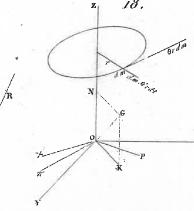

54. All centrifugal forces arising from the rotation `θ` being thus represented by `dm θ^2 r dt` (Fig. 18), they have, to within a factor of `θ dt`, the same expression as the finite forces `θ r dm`, by which the molecules are currently animated. But, instead of acting along the tangents, they act along the radii of the described circles; and they are thus perpendicular to these first forces `θ r dm`, and to the given axis OZ. If we reduce them in the same way, by transporting them to the same point O, they will give for their resultant `π`, analogous to the resultant P of the first forces,

`π = θ^2 sqrt( (∫ x dm)^2 + (∫ y dm)^2 ) = θ P`

and for their resultant couple `χ`, analogous to couple K, and likewise passing through the given axis OZ,

`χ = θ^2 sqrt( (∫ xz dm)^2 + (∫ yz dm)^2 ) = θ K`

and there will be no couple analogous to couple N around OZ, since the directions of these centrifugal forces all pass through the OZ axis itself.
55. Such are therefore the values of the accelerating force and the accelerating couple that result from the centrifugal forces. As for the position of this force `π`, and that of the couple `χ`, they are seen almost immediately. For, as all centrifugal forces `dm θ^2 r`, which give the resultant `π`, are respectively perpendicular and proportional to the impulse forces `θ r dm` which give the resultant P, it is evident that `π` is perpendicular to P.

For the same reason, the axis of the accelerating couple `χ` is perpendicular to that of couple K; and as it is perpendicular to OZ, which is the axis of couple N, it is also perpendicular to the axis of couple G, which is the resultant of N and K: we can therefore say that the axis of the couple `χ` due to centrifugal forces is perpendicular both to the axis of rotation `θ` and to that of the impulse couple G.

Thus, P and G being two lines which, starting from point O, represent, one the direction and magnitude of force P, the other the axis and magnitude

### Page 39

of the couple G, whose set P and G is capable of rotation θ around the free axis OZ; if we name i the inclination of G to the axis of this rotation θ (which gives `K = G sin i`), we have, for the accelerating force and couple π and χ arising from centrifugal forces, these very simple expressions

`π = θ P`, `χ = θ G sin i`

π being perpendicular to both P and the axis θ, and χ being perpendicular to both G and the same axis θ.

Remark.

56. As for the directions of these forces and couples, they are very easy to recognize. For it can be noted that if the direction of each centrifugal force made a quarter of a revolution in the same direction as the body rotates, it would become of the same direction as the impulse force. Therefore, the two lines Oπ and Oχ, which correspond to the resultant and the resultant couple of the centrifugal forces, must be positioned relative to the lines OP and OK, which correspond to the impulse forces, such that if Oπ and Oχ were to rotate by a right angle in the same direction as the rotation θ, the line Oπ would lie on OP and the line Oχ on OK. From this, the precise positions that must be given to the lines used in the figure, to completely represent the forces and couples under consideration, are clearly seen. It is seen that if θ changes sign, as P and K will also change, π and χ should not change: and this is indeed what should be, for it is evident that the centrifugal forces are the same, whether the body rotates in one direction or in the opposite direction.

Corollaries.

57. When the OZ axis of rotation passes through the center of gravity of the body, we have

`∫ x dm = 0`, `and ∫ y dm = 0`, `and therefore`, `π = 0`

and all centrifugal forces reduce to the couple χ.
If, moreover, the OZ axis is one of the three principal axes of this body, we have

`∫ x z dm = 0` `and ∫ y z dm = 0`, `and therefore`, `χ = 0`

and all centrifugal forces balance each other.
And conversely, there is only one such axis around which the centrifugal forces arising from rotation can mutually counterbalance each other. For equilibrium, we must have `π = 0` `and` `χ = 0` : now 1° π cannot be zero unless we have simultaneously `∫ x dm = 0` `and` `∫ y dm = 0`, that is to say, unless the OZ axis passes through the center of gravity; 2° χ cannot be zero unless we have simultaneously `∫ x z dm = 0` `and` `∫ y z dm = 0`, that is to say, unless the OZ axis is one of the principal axes.

### Page 40

*Remark.*

58. It is seen from this that in mechanics, the principal axes of a body can be sought through two different considerations, which immediately lead to the same equations. For one can ask: around which axis must a body rotate so that the actual forces `θ r dm` animating its molecules reduce to a couple `N` perpendicular to this axis? or else, around which axis must the body rotate so that the centrifugal forces `θ^2 r dm` arising from the rotation mutually balance each other?

Now, by representing this unknown axis by the line `OZ`, and considering two other arbitrary axes `OX` and `OY` perpendicular to each other and to it, it is found that, in both cases, one must first have `∫ x dm = 0` and `∫ y dm = 0`, from which it follows that the unknown axis must pass through the body's center of gravity; and then, that one must have `∫ x z dm = 0` and `∫ y z dm = 0`, from which the direction of this axis is derived. Thus, the two problems can only lead to the same axes. Moreover, we will see later, by geometry, that in any body whatsoever, there always exist three axes of this nature which are rectangular to each other.

59. If the body is not free, but is constrained to rotate about a fixed point `O`, there is no need to satisfy the first two conditions `∫ x dm = 0` and `∫ y dm = 0`: for, with point `O` being fixed, the two forces `P` and `π` applied there are destroyed. It is therefore sufficient to make either the couple `K` or the couple `χ = θ K` zero, which amounts to the same thing, and leaves only the two conditions `∫ x z dm = 0`, `∫ y z dm = 0` to be fulfilled. Now these equations also lead to three determined axes, rectangular to each other: so that at any point `O` of a solid body, there are also three principal axes, that is to say, each of which possesses this double property: 1° that if the body rotates about this axis, and all forces `θ r dm` are reduced to a single force `P` applied at `O` and a single couple `N`, this couple is perpendicular to the axis in question; 2° that, if the centrifugal forces `θ^2 r dm` are similarly reduced, the resulting couple `χ` is zero of itself: but the resultant `π` will not be zero here, nor will the force `P`, and the fixed point `O` will be obliged to destroy this finite force `P` and to bear the pressure `π dt`.

60. In all cases, it is sufficient to know the three principal axes that intersect at the body's center of gravity, and which are called the natural axes of rotation. For once these axes and the moments of inertia `A, B, C` associated with them are known, it is very easy to find the expression for the body's moment of inertia about another axis drawn arbitrarily through the same center: and from there, one can pass, by another even simpler expression, to the moment of inertia relative to any axis parallel to that one. It is a purely geometric theory that I will develop in some detail in the following chapter.

### Page 41

But before concluding this one, I want to say a few words about the rotation of a body on a *fixed axis*, in order to clearly show, 1° the *percussions* that this axis must experience, at the first instant, from the impulsive forces applied to the body; 2° the *pressures* that this axis will have to withstand, throughout the movement, to resist the centrifugal forces that arise at every instant of the rotation.

Finally, returning to the general properties of the movement of an *entirely free* body, I will show, in a new paragraph, that the principle of the *conservation of forces* and the principle of the *conservation of couples* could have been derived, as corollaries, from the theory of centrifugal forces.

IV. — On the movement of a body around a *fixed axis*.

61. Whatever forces are applied to this body, they can always be reduced to a single R applied at any point O on the fixed axis, and to a single couple G.

Now, it is evident that the force R passing through a point on the fixed axis is destroyed, and that, consequently, this axis OZ first receives at point O a percussion represented by the given force R; or, if one wishes, by naming α the inclination of R to OZ, this fixed axis receives two percussions, one `R cos α` in the direction of its length, and the other `R sin α` in a perpendicular direction.

Next, by designating ν as the inclination of the axis of couple G to the same fixed axis, this couple can be decomposed into two: one `N = G cos ν`, perpendicular to the fixed axis; the other `N' = G sin ν`, in a plane passing through this axis. Now it is visible that this latter couple N' is destroyed: so that the fixed axis must still experience the percussion of a couple `N' = G sin ν`.

Thus, these are two percussions entirely useless for the movement of the body, and which can only shake the fixed axis: from which it is seen that if one has no other object than to rotate the body, by carefully managing the supports, it is good to use only forces that have a zero resultant, and give only a couple perpendicular to the fixed axis.

But that's not all: for the couple `N = G cos ν` remains, from which the movement of the body will originate; and, although this couple is perpendicular to the fixed axis itself, and thus appears no longer to strike it, it will nevertheless be unable to rotate the body on this axis without first causing two percussions of the same kind as the first ones; and this is what we will see clearly in the problem that follows.

### Page 42

35
PROBLEM.

62. Suppose a body at rest, movable around a fixed axis OZ, is struck by a couple N perpendicular to this axis, and we ask: 1° the angular velocity θ that this body must acquire; 2° the percussion that the fixed axis must receive at the first instant; 3° the continuous pressure it will have to bear, during the course of the movement, due to the centrifugal forces arising from the rotation.

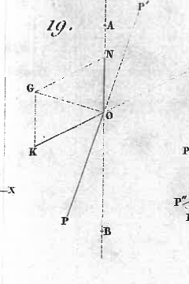

Let a line ON, terminated at any point O on the fixed axis OZ, be taken, representing both the axis and the magnitude of the impulse couple applied to the body (Fig. 19).

Let two terminated lines OP and OK, starting from the same point O and in the plane perpendicular to OZ, represent, one the force P, and the other the couple K, which, combined with the given couple N, would be capable of making the body rotate about OZ spontaneously, that is to say, even assuming this axis were free, and, consequently, without causing it the slightest percussion.

This being established, I imagine that force P is applied to the body, and at the same time force P' equal and opposite; furthermore, that couple K is applied, and couple K' equal and opposite: it is clear that the state of the body is not changed. But now, instead of viewing this body as struck by the single given couple N, I can consider it as struck simultaneously by the three couples N, K, K' and the two forces P and P'.

Now, by hypothesis, the couples N, K, and the force P, combined together, are capable of making the body rotate about the axis OZ with an angular velocity
`θ = N over {∫ r^2 dm}`
without causing the slightest percussion to this fixed state. Therefore, 1° the body will actually acquire this determined rotation θ; for the remaining force and couple P' and K', both passing through the fixed axis, can be regarded as destroyed by the resistance of this axis. Therefore, 2° this fixed axis will experience two percussions, one represented by the force P' applied at point O, the other by the couple K', whose plane passes through the same axis; and we will have, for these two types of percussions:

`P' = -P = -θ sqrt { (∫ x dm)^2 + (∫ y dm)^2 }`
`K' = -K = -θ sqrt { (∫ x z dm)^2 + (∫ y z dm)^2 }`

What was first to be found.

63. If the axis OZ, instead of being fixed throughout its entire length, were simply held by two fixed points A and B, and one wished to find the two individual percussions felt by these points, one would decompose force 3.

### Page 43

P' in two other applied parallels, one at point A, the other at point B; then the couple K' would be changed into another equivalent one applied at a right angle to AB; and, by reducing the two forces found at A to a single one, and similarly the two forces found at B to a single one, we would have the two individual percussions that the proposed couple N produces at the first instant on the two fixed points A and B.

64. It is evident that the percussions in question are only felt by the fixed axis at the first instant: for once the axis has destroyed the force P' and the couple K', the body is no longer solicited for movement except by the couples N, K and the force P. Now, this system of forces being capable of rotating spontaneously on OZ, that is to say, even if OZ were not fixed, it is manifest that the resistance of this axis has nothing more to destroy, and that it receives no further percussion.

It is seen, therefore, that if one wishes to spare the fixed axis of rotation as much as possible, without regard to the expenditure of forces, one must apply forces that reduce themselves to force P and to couple G resulting from N and K. This ensemble P and G, or its equivalent P, N, K, will cause rotation on the fixed axis without causing it any percussion. One can imagine that, in the case in question, things happen in this way: one can see couple N as being used to cause rotation on the axis, while force P and couple K are used to support this axis, or, if one wishes, to destroy the two percussions — P and — K that would come to it from couple N, if this couple acted alone.

Thus, when one wishes to spare the resistance of the axis as much as possible, one must apply the system of forces represented by N, P and K: but if one wishes to spare the expenditure of forces, one must apply only couple N; and then the axis receives two percussions — P and — K, which it is obliged to destroy.

65. After the destruction of couple K' and force P' by the fixed axis, the body therefore tends to rotate *freely* on this axis with the angular velocity θ. But from this rotation then arise the centrifugal forces θ^2 rdm, whose effect must be examined; this is the third point of our demonstration. Now it is evident that all these forces, being directed towards the fixed axis, will be destroyed at every instant: from which I conclude first that the rotation θ of the body will be uniform; that, throughout the movement, the fixed axis will only have to bear the pressures due to the centrifugal forces; and that this axis must be held in all directions, to resist these pressures which continually change directions due to the body's own movement. Now we have seen that the centrifugal forces θ^2 rdm are reducible to a single one,

`π = θ P = θ^2 sqrt( (∫ x dm)^2 + (∫ y dm)^2 )`

### Page 44

and to a single couple,
`χ = θ K = θ^2 sqrt{ (∫ x z dm)^2 + (∫ y z dm)^2 }`

such that the axis is loaded, at each instant `dt`, with a pressure `π dt` applied at `O`, and a couple `χ dt` continuously passing through this axis: pressures which can be reduced, as above, to two forces applied at points `A` and `B` if the axis is only held by two fixed points. Etc., etc.

Remarks.

In the movement I have just considered, it is quite clear that the force `P` and the couple `G`, by which the body is animated at each instant, always remain the same in magnitude and position within the body. The two lines `OP` and `OG` that represent them merely rotate, so to speak, with the body and with the same angular movement `θ`, around the fixed axis.

If this axis were suddenly to become free, and the body thus abandoned to itself, it is known, by the general principles of dynamics, that `P` and `G` would likewise be conserved in magnitude and position, no longer within the body, but in absolute space. Now I want to show here that these two principles, which can be called the conservation of forces and the conservation of couples, could have been derived, as simple corollaries, from the theory of centrifugal forces: a delicate deduction which seems curious enough to me not to be omitted in a work on rational Mechanics.

V. — Conservation of forces and conservation of couples in the movement of a free body.

From the exact analysis of centrifugal forces, one can draw these two beautiful consequences: that the centrifugal forces arising from the movement of a body can never alter either the magnitude or the direction of the primitive impulsive forces that set the body in motion. I mean that if, at any given time, one seeks the resultant and the resultant couple of the finite forces animating the body at that time, one will find the same force and the same couple, located in the same places in space. These properties are, it is true, only a corollary of this principle, or of this general law of dynamics, by which the forces animating all the molecules of any system, variable or not, always yield, relative to the same point in space, the same resultant `R` and the same resultant couple `G`, provided that the system is abandoned to itself, that is to say, considered free from all obstacles and all extraneous accelerating forces. This general principle also holds, as is known, when there are, between the molecules of the system, any forces of attraction or repulsion, provided that these forces are reciprocal, that is to say, two by

### Page 45

two equal and opposite; because, in this case, these forces would separately yield a resultant and a resultant couple both equal to zero, and could not disturb either the magnitude or the position of R and G. This conservation still holds, but for the couple G only, in the particular case of external accelerating forces all tending towards the same fixed point in space, and when this fixed point is taken as the center to which all moments of the system are referred: because all these accelerating forces only produce zero couples relatively to this point, and the resultant couple G is still conserved. But if there are other external forces than those I have just mentioned, neither the resultant R nor the resultant couple G are conserved during the motion. It can be seen, in the first Memoir accompanying our Éléments de Statique, the very simple demonstration of this general principle, which is, moreover, itself only a natural consequence of this fundamental law of motion, called the law of inertia.

In our example of a free solid body, which has received arbitrary impulses and is then left to itself, it therefore seems evident that the conservation of the impulse force R and impulse couple G must take place: because no accelerating force is assumed to come from outside; and if centrifugal forces are considered, these are merely passive forces arising from the mutual connection of the molecules; and it is quite clear that such forces cannot alter either the resultant or the resultant couple of the system. However, as these centrifugal forces do not balance each other on the body, there remains here a certain obscurity regarding the conservation of force R and couple G, since at each instant `dt` a force `π dt` and a couple `χ dt` are born which are not zero by themselves. It is therefore not useless to enter here into a more complete explanation, and to show how this force and couple, born from centrifugal forces, can never disturb either the magnitude or the position in space of the resultant R and the resultant couple G. And this even seems all the more curious to examine, as not only do these centrifugal forces not disturb R or G, but they are even necessary for their conservation: so that if, at each instant, one were to destroy the force `π dt` and the couple `χ dt`, R and G would no longer conserve their position in absolute space.

Demonstration.

Whatever the motion of a body, we have seen that this motion can be considered, at each instant `dt`, as composed of a rotation `θ` around a certain determined axis ON, and a translation `μ` parallel to this axis which we have named the spontaneous sliding axis. Let P, K, N therefore be the force and the two couples capable of this rota-

### Page 46

tion ` θ ` on the axis ON, and Q the force which, applied to the center of gravity g, would be capable of the actual translation u along the direction of the same axis. By naming m the mass of the body, and setting ` gO = a `, we will have

` P = m a ` and ` Q = m u `

as we said above.

This being established, after an instant ` dt `, the body will have descended along ON, by a space ` OO' = u dt `, and at the same time it will have rotated around ON by an angle ` θ dt `. 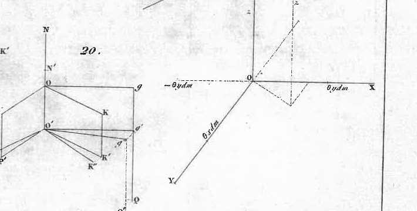

Let us therefore suppose that in this movement it carried with it all the lines OP, OK, ON, Og that are considered in the figure (Fig. 20). It is clear that by virtue of the first movement, all these lines will first have descended into the parallel positions O'P', O'K', O'N', O'g' ; and that by virtue of the second, they will have rotated together by the same angle ` θ dt `, to come into the positions O''P'', O''K'', O''N'', O''g'' : so that the extremities P', K', g' will have described similar arcs

` P''P' = P θ dt `, ` K''K' = K θ dt `, ` g''g' = a θ dt `

But, after this instant, centrifugal forces will have arisen: 1° a force ` π dt = P θ dt `, perpendicular to P', and which, combined with P', will bring this force back to its place in O'P' ; 2° a couple ` χ dt = K θ dt `, perpendicular to K', and which, combined with K'', will bring this couple back to its place in O'K'. Thus, after an instant, the forces and couples animating the body will be represented by the lines O'P', O'K', O'N' and g'Q'. Now I say that this set of forces and couples is exactly the same as that which was considered at the beginning, that is to say that it can actually be represented by the same lines OP, OK, ON, gQ situated in the same places in absolute space.

And first, the thing is evident for the two couples represented by the lines O'K', O'N' ; for, according to the property of couples, it is indifferent whether they are represented by these two lines or by the two lines OK, ON which are respectively equal and parallel to them. There remain therefore the two forces P' and Q', applied, one in O', the other in g'', which must be shown to be reducible to the two respectively equal and parallel forces P and Q, applied in O and in g. Now P' can be transported parallel to itself from O' to O, provided that the couple ` (P, - P) ` applied on ` OO' = u dt ` is added: similarly Q' can be transported from g'' to g', provided that the couple ` (Q, - Q) ` is added to the lever arm ` g''g' = a θ dt `. But it is clear that these two couples, which are parallel and of opposite sense, have equal moments: for because of ` P = m a ` and ` Q = μ `, the moment ` P times OO' ` of the first is ` m a . u . dt `, and the moment ` Q times g''g'' ` of the second is ` μ . a . θ dt `, which amounts

### Page 47

to the same: thus the two couples `(P, -P)` and `(Q, -Q)` cancel each other out, and the two forces `P'` and `Q'` are reduced to the two forces `P` and `Q`.

Thus the system of forces and couples animating the body after an instant returns to the same state as that which animated it at the beginning of this instant; from which it can be concluded that this conservation of forces and couples holds throughout the entire duration of time; which is the general principle that was to be demonstrated.

One can even see how things proceed from one instant to another. For after an instant, the body having changed its position in space, and the forces having retained their own, the body no longer presents itself in the same manner, and its movement will change, meaning it will occur around some other spontaneous sliding axis *on*. But since this movement will be due to the same system `(P, K, N, Q)`, this system is necessarily reducible to a similar system `(p, k, n, q)` capable of this movement around the new axis *on* in question. Now, by the same preceding demonstration, this second system would also be conserved for an instant: therefore, since it is reducible to the first `(P, K, N, Q)`, the latter is conserved in the same way, meaning it can represent the forces and couples animating the body, not only after the first, but also after the *second* instant, and so on to infinity; from which it is seen how this conservation of forces and couples must extend throughout the entire course of the movement.

And conversely, if one were to start from this general principle (whose direct demonstration is very easy), one would be led, by an inverse approach, to recognize that, from the very movement of a solid body, certain infinitely small forces must necessarily arise, such that, when combined at each instant with the acquired forces, the principle of conservation in question is rigorously observed: and thus, for these infinitely small forces, the same expressions `π dt`, `χ dt` would be found, which were derived from the theory of centrifugal forces. Moreover, it is not surprising that the same result is obtained by both methods, since both equally stem from this fundamental law called the law of inertia.

CHAPTER III. — ON THE THEORY OF MOMENTS OF INERTIA.

I. — On the moments of inertia of a body of any shape around different axes that intersect at the same point.

66. Let, through the point or center under consideration, three rectangular axes `x`, `y`, `z` to which the different points of the body are referred; let `h` be any straight line passing through the origin, and forming with these axes the three angles

### Page 48

respective `α`, `β`, `γ`: we propose to find the expression for the moment of inertia with respect to this given line of inclination on the three fixed coordinate axes `x`, `y`, `z`.

This moment of inertia is nothing other than the sum of the products of each particle of the body by the square of its distance to the axis under consideration. Thus, by naming `dm` one of these particles, `r` its distance to the given line `h`, we have, for the moment of inertia of this particle, {r^2 dm}, and for the moment of inertia of the entire body, `∫ r^2 dm`, representing by `∫ r^2 dm` the sum of all similar products to {r^2 dm} that can be formed by considering all the molecules of the body.

Now, `x`, `y`, `z` being the coordinates of any particle `dm`, and `delta` its distance to the origin, we will have
`delta^2 = x^2 + y^2 + z^2;`

and for the distance `r` of this particle to the given axis `h`, we will have
`r = delta sin φ,`

`φ` being the mutual inclination of `delta` and `h`; we therefore have
`r^2 = delta^2 sin^2 φ = delta^2 (1 - cos^2 φ),`

and, as we have, by geometry,
`cos φ = x over delta cos α + y over delta cos β + z over delta cos γ,`

we will find, by substituting this value (and observing that we always have the relation `cos^2 α + cos^2 β + cos^2 γ = 1`),
`r^2 = cos^2 α (y^2 + z^2) + cos^2 β (x^2 + z^2) + cos^2 γ (x^2 + y^2) - 2 (cos α cos β xy + cos α cos γ xz + cos β cos γ yz),`

and, consequently, multiplying everything by `dm`, and applying the `∫` sign,
`∫ r^2 dm = cos^2 α ∫ (y^2 + z^2) dm + cos^2 β ∫ (x^2 + z^2) dm + cos^2 γ ∫ (x^2 + y^2) dm - 2 (cos α cos β ∫ xy dm + cos α cos γ ∫ xz dm + cos β cos γ ∫ yz dm),`

which gives the moment of inertia relative to the proposed axis, by the inclinations `α`, `β`, `γ`, of this axis on the three given fixed axes `x`, `y`, `z`, and by the six integrals
`∫ (y^2 + z^2) dm, ∫ (x^2 + z^2) dm, ∫ (x^2 + y^2) dm,`
`∫ xy dm, ∫ xz dm, ∫ yz dm,`

relative to the same axes: integrals that can be regarded as currently determined by the known position of the body, and which I will represent by the six respective constants
`A, B, C, L, M, N;`

so that, by simply denoting by `H` the moment of inertia `∫ r^2 dm`

### Page 49

relative to the line h, we will have the equation
`H = A cos^2 α + B cos^2 β + C cos^2 γ - 2 (l cos α cos β + m cos α cos γ + n cos β cos γ),`
where A, B, C represent the moments of inertia relative to the coordinate axes x, y, z.

Of the system of lines or axes h, around which the moment of inertia of the body always has the same value H.

67. If in the preceding equation we consider H as a given constant, and the angles `α`, `β`, `γ` as variables, we will obviously have the equation of the conical surface formed by the set of lines h around which the moment of inertia of the body always has the same value H. Now it is easy to see that this is a conic surface of the second order whose vertex is at the origin; but, to better recognize this surface, I will refer it to the rectangular coordinates x, y, z.

For this, I consider any of its points taken on the generator h, at a distance from the origin marked by
`h = sqrt{x^2 + y^2 + z^2};`
it is evident that we have
`cos α = x over h`, `cos β = y over h`, `cos γ = z over h`,

and, if we substitute into the preceding equation, we get, for the equation of the surface referred to the coordinates x, y, z,
`(H - A) x^2 + (H - B) y^2 + (H - C) z^2 + 2 l x y + 2 m x z + 2 n y z = 0,`
which evidently belongs to a conic surface of the second order referred to its center or vertex as the origin of the coordinates.

68. Thus, in any body of any shape, and at any point of the body or space, there is always a set of axes around which the moment of inertia of the body always has the same value; and this set of axes of equal moments forms the surface of a cone of the second order.

Of the principal axes of inertia.

69. We can further simplify the equation of the surface I am considering, by changing the current coordinates to others of the same origin and also rectangular to each other, and by making the three rectangles of these new coordinates disappear in the transformed equation. This transformation, as is known from analytical geometry, is always possible; and the equation of the surface then contains only the three squares of the coordinates: it is

### Page 50

reduced to its simplest form, and the conic surface is referred, as they say, to its center and its axes or rectangular diameters.

If, therefore, from the beginning, instead of taking three arbitrary axes, we had taken the three diameters I have just mentioned, and if we had similarly sought the surface formed by the locus of lines of the same moment of inertia H, we would have found exactly the same equation, and entirely reduced to its simplest form. Now, with respect to three arbitrary axes, this equation is, as we have seen, of the form
`(H - A) x^2 + (H - B) y^2 + (H - C) z^2 + 2(lxy + mxz + nyz) = 0`,
where A, B, C, l, m, n denote the six integrals `∫ (y^2 + z^2) dm`, etc., `∫ xydm`, etc., relative to the axes under consideration. But since this equation, referred to the particular three diameters in question, must no longer contain the `xy, xz, yz` rectangles of the coordinates, it follows that, relative to these same diameters, the integrals `l, m, n`, that is to say `∫ xydm`, `∫ xzdm`, `∫ yzdm`, would all three be found equal to zero.

70. Therefore, for the same reason that there are, for a conic surface of the second order, three rectangular axes with respect to which the coefficients of the three rectangles `xy, xz, yz` are zero in the equation of this surface, there are, in a body of any shape, and at any point in space one wishes to consider, three rectangular axes with respect to which the three integrals `∫ xydm`, `∫ xzdm`, `∫ yzdm`, relative to these axes, are equal to zero.
And these three axes, which are called the principal axes of the body, are nothing other than the three rectangular diameters of the conic surface of the second order formed around the origin, as its vertex, by the locus of lines around which the body always has the same moment of inertia.

How the principal axes are determined.

71. One can therefore determine the position of the three principal axes of a body, exactly as one determines that of the three rectangular axes or diameters of a second-order surface.
Thus, one will take the general equation of the conic surface I have just mentioned, relative to three arbitrary axes passing through the point under consideration. One will seek the values of the six integrals A, B, C, l, m, n relative to these axes; and one will assign to H any value it may have, such as `H = A`, or B, or C, or any other. This done, one will seek, by the ordinary transformation of coordinates, three new axes with the same origin, and with respect to which the equation becomes of the form
`P x'^2 + Q y'^2 + R z'^2 = 0`

### Page 51

and these three rectangular axes will be the three principal axes of inertia in the body under consideration.

72. In a plane conic section, the search for the two axes depends on a second-degree equation: but, in a second-order surface, the search for the three principal axes or diameters depends on a third-degree equation. Thus, in general, the three principal axes of inertia of a body of any shape can only be found by the actual resolution of a third-degree equation, or by the trisection of the angle.

73. But if one of these axes is known, the other two can be found by a second-degree equation or by the bisection of the angle.

For let `z` be an axis for which `m` and `n` are, that is to say `∫ x z dm` and `∫ y z dm`, both zero. The equation of the conic surface will reduce to this:
`(H - A) x^2 + (H - B) y^2 + (H - C) z^2 + 2 l x y = 0`

Now, in the `xy` plane, two new axes `x'` and `y'` can be found, also rectangular, for which the `x'y'` term of the coordinates disappears from the transformed equation. If `ω` denotes the inclination of `x'` to `x`, we have
`x = x' cos ω - y' sin ω`
`y = x' sin ω + y' cos ω`

and substituting these values into the equation, we find for the coefficient of the `x'y'` term,
`(A - B) 2 sin ω cos ω + 2 l (cos^2 ω - sin^2 ω)`

or
`(A - B) sin 2 ω + 2 l cos 2 ω`

which, when set to zero, gives us the very simple equation to determine `ω`
`tan 2 ω = {2 l} over {B - A}`

Thus, relative to the three axes `x'`, `y'` and `z`, which are rectangular to each other, the equation of the conic surface will be reduced to the form
`P x'^2 + Q y'^2 + R z^2 = 0`

and these three axes will thus be the three principal axes of the body under consideration, so that we will have
`∫ x'y' dm = 0, ∫ x'z dm = 0, ∫ y'z dm = 0`

It is seen that the last two equations agree with the two that were assumed, namely: `∫ x z dm = 0, ∫ y z dm = 0`: for, by the form of the above expressions for `x` and `y`, in terms of `x'` and `y'`, or vice versa, it is easy to see that `∫ x'z dm = 0` and `∫ y'z dm = 0` entail the two equations `∫ x z dm = 0` and `∫ y z dm = 0`, and vice versa; and this even, independently of the inclination `ω` of `x` to `x'`.

### Page 52

**45**
Properties of the three principal axes.

74. If we refer all the particles of the body to the three principal axes, we will then have, by always naming H the moment of inertia relative to a line h passing through the origin at angles `α`, `β`, `γ` with these same axes,
`H = A cos^2 α + B cos^2 β + C cos^2 γ`
where A, B, C are the values of the moments of inertia of the body relative to the three principal axes.

From this very simple expression, it first follows that the moment of inertia H will always be an average quantity between the principal moments A, B, C. For, suppose these three quantities are arranged in order of magnitude `A < B < C`, I say that A is the smallest value that H can obtain, and C is the largest.

Indeed, because of
`cos^2 α + cos^2 β + cos^2 γ = 1`
the preceding expression can be put in the form
`H = A + (B - A) cos^2 β + (C - A) cos^2 γ`
and `(B - A)` and `(C - A)` are both positive by hypothesis; therefore we always have
`H > A`.

If we assume that H reaches this minimum value A, it becomes
`0 = (B - A) cos^2 β + (C - A) cos^2 γ`
an equation that cannot hold unless we have
`cos β = 0`, `cos γ = 0`, and consequently `cos α = 1`,
which causes h to coincide with the principal axis of moment A itself.

Thus, among all the axes that can be drawn through the origin, the axis of minimum moment of inertia is unique, and it is the first principal axis.

Now, if we put the expression for H in the form
`H = C + (A - C) cos^2 α + (B - C) cos^2 β`,
we see similarly that `(A - C)` and `(B - C)` are both negative by hypothesis; therefore we always have `H < C`. Thus, the general value of H is always intermediate between A and C, as I had stated. If we assume that H reaches this maximum value C, it becomes
`0 = (A - C) cos^2 α + (B - C) cos^2 β`,
an equation that cannot hold unless we have
`cos α = 0`, `cos β = 0`, and, consequently, `cos γ = 1`,
which causes h to coincide with the principal axis of moment C.

### Page 53

Thus, the axis of *maximum* moment of inertia is also a unique axis; and it is the second principal axis of the body.

Finally, if we put the expression for H in the form
`H = B + (A - B) cos^2 α + (C - B) cos^2 γ`

we see that `(A - B)` being negative and `(C - B)` positive, the value of H can be above or below B, depending on whether `(C - B) cos^2 γ` is greater or smaller than `(B - A) cos^2 α`. If we assume that H takes the value B, we get
`0 = (A - B) cos^2 α + (C - B) cos^2 γ`

an equation that simply gives, between the angles `α` and `γ`, the condition
`cos γ over cos α = +- sqrt{(B - A) over (C - B)}`

or, between the coordinates `z` and `x` of any point taken on the line `h`, the equation
`z over x = +- sqrt{(B - A) over (C - B)}`

There is therefore an infinity of axes of mean moment of inertia B; and we see that all these axes form two planes passing through the principal `y`-axis or the axis of moment B, and making two equal angles to the right and left on the `xy`-plane, whose tangent is `sqrt{(B - A) over (C - B)}`.

Among all these axes of the same moment of inertia B, there is one distinguished from all the others; it is the one that is simultaneously in both of the two planes I have just mentioned, or that is simultaneously perpendicular to the first two principal axes: this is the third principal axis of the body.

This axis, as we see, does not possess, like the other two, a property of *maximum* or *minimum*. It is not a unique axis with respect to the magnitude of the moment of inertia associated with it, but it is unique with respect to its particular position among all those of the same moment of inertia B.

Simplest equation of the conical surface formed by the set of axes around which the moment of inertia of the body has the same value.

75. Relative to the three principal axes `x, y, z`, the conical surface formed by the set of axes `h` of the same moment of inertia H has the very simple equation,
`(H - A) x^2 + (H - B) y^2 + (H - C) z^2 = 0`

where we have just seen that, if `A < B < C`, the moment H is always between A and C.

### Page 54

First, let `H < B`.
If we cut the conic surface by a plane perpendicular to `x`, and whose equation is `x = a`, we get, for the section projected in its entirety onto the `yz` plane,
`(H - B) y^2 + (H - C) z^2 = (A - H) a^2`
the equation of an ellipse, since `(H - B)`, `(H - C)` and `(A - H)` are all three of the same sign.

Thus, all axes of moment of inertia H equal to each other and less than B, form the surface of a right cone with an elliptical base around the principal axis of minimum moment of inertia A.

Second, let `H > B`.
Similarly, by cutting the conic surface by a plane perpendicular to `z`, and whose equation is `z = c`, we see that all axes of moments H equal to each other, and greater than B, form the surface of a right cone with an elliptical base, around the `z` axis of maximum moment of inertia C.

Finally, if we assume `H = B`, the equation of the surface becomes
`(B - A) x^2 + (B - C) z^2 = 0,`
which gives
`z over x = +- sqrt {B - A} over {C - B}`
which corresponds to two planes passing through the `y` axis of the mean principal moment, and inclined to the `x` axis of the minimum moment by an angle whose tangent is `z over x = sqrt {B - A} over {C - B}` ; which perfectly agrees with what we said above.

These two planes, in the four corners they form around the axis of the mean moment of inertia B, encompass the entire surface of the body, or more generally encompass all space. In the two corners opposite the apex, where the axis of minimum moment A passes, all axes drawn to the surface have moments H less than B and greater than A, which is the smallest of all.

In the other two corners, where the axis of maximum moment C passes, all axes drawn from the center to the surface have moments H greater than B and less than C, which is the largest of all.

Finally, in the very planes that form the four corners, all axes have moments of inertia equal to B.

If, as happens in bodies of revolution and in an infinity of others, two of the three moments of inertia A, B, C were equal to each other,

### Page 55

The conical surfaces I spoke of would be those of right cones with a circular base around the third principal axis, and the two other planes would merge into a single one perpendicular to the same axis: so that all possible axes drawn in this plane would be principal axes of equal moment of inertia.

If the three moments of inertia A, B, C were equal to each other, as in the sphere and in an infinity of other bodies, all possible axes would be principal axes of the same moment.

76. From the general expression

`H = A cos^2 α + B cos^2 β + C cos^2 γ`

it still results in easy and very important consequences for simplifying the consideration of the movement of a body of any shape. Indeed, it is seen from this expression that if two arbitrary bodies had the same moments of inertia A, B, C with respect to their principal axes x, y, z, these two bodies would also have the same moment of inertia H with respect to any other line h making the same angles α, β, γ with the principal axes. Therefore, when only the moments of inertia are considered, one can always abstract from the body's shape, or rather, one can always assume it reduced to that of some more regular body such as an ellipsoid, or even a simple rectangular parallelepiped, which would have the same principal moments of inertia.

Suppose, for example, two free bodies that would have the same center of gravity, the same principal axes, and the same moments of inertia with respect to all possible axes passing through the center. If two couples of the same magnitude and direction were simultaneously applied to them, their rotation, which at every instant depends only on the moments of inertia relative to the different axes passing through the center of gravity, would be exactly the same throughout the entire course of the movement: so that these two bodies would follow the same rotations without harming or favoring each other in any way. Thus, the movement of an irregular body projected in any manner into space is the same as that of a simple rectangular rhomboid, or of the assembly of three rectilinear rods crossing at right angles at their midpoints, or of any other regular body that would have the same principal moments of inertia. By this consideration, the problem of the rotation of bodies is clarified, by substituting a simpler and easier to conceive figure, just as in translational motion the body is reduced to a single point which is the center of gravity.

But there is yet a much clearer expression for everything concerning the moments of inertia of a body, as we shall see in the second part of this work.

### Page 56

49

Meanwhile, it must be shown how one can find the moment of inertia of a body about any axis, when the axes and the principal moments of inertia A, B, C, which relate to the center of gravity of this body, are known.

77. We have already seen that, for any axis `h` passing through the center of gravity, the moment of inertia `H` would be expressed by the formula
`H = A cos^2 α + B cos^2 β + C cos^2 γ`

`α`, `β`, `γ` being the inclinations of this axis to the three principal axes of the body. Now it is easy to find the moment of inertia of a body about any axis `h'`, from the moment of inertia `H` about a parallel axis passing through the center of gravity of this body.

And, indeed, let `r'` be the distance of a molecule `dm` of the body to the axis `h'` under consideration, `r` its distance to the parallel axis passing through the center, and `D` the mutual distance of these two axes; we will have; in the triangle formed by the three lines `r'`, `r` and `D`,
`{r'}^2 = r^2 + D^2 - 2 D r cos φ`

`φ` being the inclination of `r` to `D`. We will therefore have
`∫ from {} to {} {r'}^2 dm = ∫ from {} to {} r^2 dm + M D^2 - 2 D ∫ from {} to {} r cos φ dm`
or else
`H' = H + M D^2 - 2 D ∫ from {} to {} r cos φ dm`

But `r cos φ` marks the distance of the molecule `dm` to the plane that would be drawn through the center of gravity perpendicularly to the line `D`; we therefore have, since this plane passes through the center, `∫ from {} to {} r cos φ dm = 0`, and consequently,
`H' = H + M D^2`

that is to say, the moment of inertia of a body about an axis drawn as desired in space is found by taking the moment of inertia about a parallel axis drawn through the center of gravity, and adding to it the product of the mass by the square of the distance from this center to the external axis under consideration.

78. It is seen from this that the moments of inertia of a body for all parallel axes `h'` which are at an equal distance `D` from the center of gravity of this body, or which form the surface of a right and circular cylinder around this center.

If one conceives this cylinder described, and if one makes it rotate around the same center, in an infinity of different positions, the moments of inertia of the body relative to the generatrices `h'` will indeed have the same value on each cylinder, but they will vary in magnitude from one cylinder to another. But if one rotates the cylinder in question such that its axis describes the conical surface corresponding to the equation
`A cos^2 α + B cos^2 β + C cos^2 γ = H = constant`

### Page 57

the moments of inertia of the body will be equal with respect to all the generatrices of this infinity of cylinders.

But the system of all these lines does not yet exhaust the infinity of axes around which the body can have the same given moment of inertia. For, if we vary both H and D such that the sum `H + m D^2` remains constant, we see that there will still be an infinity of systems of axes like the preceding ones, and around which the body will have the same moment of inertia. When we consider only axes that intersect at any given point O, all axes of a given moment of inertia form a second-order conical surface described around this point. When we consider only axes parallel to each other, all axes of a given moment of inertia form the surface of a right cylinder with a circular base around the body's center of gravity. But when we look indiscriminately at all possible axes in space, there is an infinity of infinities that correspond to the same given moment of inertia. All these lines, nevertheless, do not fill all space; for, H' being given, and H being necessarily comprised between the smallest A and the largest C of the three principal moments A, B, C, it is clear that the line D can only vary between certain limits which are
`D = sqrt{{H'-C} over {m}}`
and
`D' = sqrt{{H'-A} over {m}}`

Thus, by conceiving around the body's center of gravity two spheres described with radii D and D', none of the axes that can correspond to the same moment of inertia H' can enter the sphere with radius D, nor exit the sphere with radius D'.

79. From this simple relation
`H' = H + m D^2`

we draw yet another consequence: that if, from a point O, taken on any one of the three principal axes ga, gb, gc relative to the body's center of gravity g, we draw parallels to the other two, these two lines Ob', Oc' will be, with the first Og, the three principal axes of the same body with respect to point O. For Og being a principal axis relative to center g, point O is on its direction; and, consequently, the other two axes are in the plane drawn at O perpendicularly to Og. Now, if we rotate, around g and O, two axes gh, Oh' parallel to each other and perpendicular to gO; the distance D between these two axes then being constant, the variations of the moments of inertia H and H' are the same. Thus H' and H reach their maximum or minimum together. But, by hypothesis, H reaches this singular value when gh coincides with gc or gb; therefore H' reaches it when Oh' is parallel to one or the other of these axes. Therefore, etc.

### Page 58

It is moreover what one could see directly by relating the molecules of the body to three axes `{O x^prime}`, `{O y^prime}`, `{O z^prime}` parallel to the first `{g x}`, `{g y}`, `{g z}`; for, by naming `λ`, `μ`, `ν` the three coordinates of point O, it is found that the three integrals `∫ x^prime y^prime dm`, `∫ x^prime z^prime dm`, `∫ y^prime z^prime dm` reduce to the three products `m λ μ`, `m λ ν`, `m μ ν`, and that, consequently, to make these integrals zero, it suffices to set any two of the three coordinates `λ`, `μ`, `ν` of point O to zero, that is to say, to take this point on any of the principal axes `{g a}`, `{g b}`, `{g c}`.

It is even seen that by setting only one of these three coordinates to zero, *two* of the three integrals in question are made zero; from which it is concluded that any axis parallel to one of the three principal axes relative to the center `g` is itself a principal axis relative to point O where it pierces the plane of the other two. 80. From the same relation
`H^prime = H + m D^2`

we also derive the simplest demonstration of a rather curious theorem `[*]` which can be useful in some applications.

By giving, for brevity, the simple name of equal axes, to the different axes with respect to which the body has an equal moment of inertia, we ask if, in any body, there could be some point or center O around which all possible axes would be equal axes, as happens in the sphere, regular bodies, etc., relative to the axes passing through their center.

Let O be such a point, if it exists, `g` the center of gravity of the body: let us make the line `{g O = D}`, and draw at point O the plane `MN` perpendicular to this line. It is clear that all axes drawn from point O in this plane are equal axes, since this is true, by hypothesis, for all possible axes starting from this point. This being established, all axes drawn from the center of gravity `g`, in a plane parallel to `MN`, will also be equal axes among themselves, being at the same distance `D` from the first ones situated in the plane `MN`.

Therefore, in the first place, the sought point O cannot exist unless the body has two of its principal axes, relative to its center of gravity `g`, equal to each other; and if this point O exists, it is situated on the perpendicular `{g O}` to the plane of these two equal axes, and, consequently, on the direction of the third principal axis of the body. To determine it, let `A` be the common value of the moment of inertia around the first two, and `C` the moment of inertia around the third `{g O}`: we will have, for the moment of inertia `H^prime` around the axes situated in the plane `MN`,
`H^prime = A + m D^2`.

`[*]` This theorem is due to M. Binet, who gave it, in 1811, in a Memoir presented to the first class of the Institute.

4.

### Page 59

But H' having to be the same for all axes starting from point O in all directions, must be the same for the axis Og: now around this axis the moment of inertia of the body is C; we must therefore have
`H' = C`
and, consequently,
`C = A + m D^2`
from which we derive, for the distance D from point O to the center g,
`D = +- sqrt{{C - A} over {m}}`
a double value which is only real in the case of `C > A`.

Thus there cannot be in a body with center O around which all axes of inertia are equal, unless the body has two of its natural axes equal to each other, and the moment of inertia relative to the third does not exceed that which relates to the other two. But if these conditions occur, as, for example, in a homogeneous spheroid flattened towards the poles, this singular point O actually exists, and there are even two of this nature: they are located on the natural axis of the greatest moment of inertia, one to the left, the other to the right of the center of gravity, and at the same distance `D = sqrt{{C - A} over {m}}` from this center.

SECOND PART.

CHAPTER ONE. — SOLUTION OF THE PROBLEM OF THE ROTATION OF FREE BODIES.

I. — Analytical definitions.

1. Let O be the point that forms the center of rotation of the body; Ox, Oy, Oz the rectangular directions of the three principal axes; and A, B, C the three moments of inertia of this body around the same axes.
We have just seen that, if we consider any other axis OI, we will have, by designating I as the value of the moment of inertia related to it, the expression
`I = A cos^2 λ + B cos^2 μ + C cos^2 ν`
where `λ`, `μ`, `ν` are the respective inclinations of the axis OI to the three principal axes Ox, Oy, Oz.

2. What is called the moment of inertia of a body around any axis, being nothing other than the sum of the products of all the molecules `dm` of this body by the squares of their distances `r` to this axis, one can always represent its value `∫ r^2 dm` by the simple product `m.K^2`; by designating `m` as the entire mass of the body, or the number of all its molecules assumed to be equal to each other, and by `K'`, as the mean square among all the squares of the distances of these molecules to the axis in question.

### Page 60

The moment of inertia of the body being thus represented by `m K^2`, that is to say, as would be that of a point charged with the entire mass, and placed at a certain distance `K` from the axis under consideration, it would be very natural to call this line `K` the lever arm of inertia, or simply the arm of inertia, around this axis; and this is what we shall henceforth do to simplify the discourse, taking care to remember that this line `K`, the arm of inertia, is nothing other than the side of the mean square between the squares of the distances of all the equal molecules of the body to the axis under consideration.

Thus, instead of the letters `A, B, C` ordinarily used to designate the three moments of inertia around the principal axes, I shall take the expressions `m α^2`, `m β^2`, `m γ^2`;

`m` being the mass of the body, and the lines `α, β, γ` the three respective arms of inertia of this body around the same axes.

Of the central ellipsoid of bodies.

3. In the problem that concerns us, and where the body is assumed to be free from any external action, it is sufficient to know the point that forms the center of rotation, the directions of the three principal axes, and the three arms of inertia of the body around these axes. The movement of the body, whatever its shape, depends exactly on these data; and one can abstract from all the rest.

But to have before our eyes a symmetrical figure where all these data of the problem are clearly visible, I imagine that around point `O` as the center, and on the lines `Ox, Oy, Oz` as principal axes, an ellipsoid is described whose equation is

`α^2 x^2 + β^2 y^2 + γ^2 z^2 = R^4 = "constant",`

`R` being any line that can be chosen at will.

If we name `a, b, c` the semi-axes, or principal radii, of this ellipsoid, so that its equation takes the form

`{x^2} over {a^2} + {y^2} over {b^2} + {z^2} over {c^2} = 1,`

we will have, for the values of `a, b, c`,

`a = {R^2} over {α}, b = {R^2} over {β}, c = {R^2} over {γ};`

from which it is seen that the three principal axes of this ellipsoid are reciprocal to the three arms of inertia of the body around the same axes. Now, what is very remarkable is that the same property extends to all diameters, I mean that, in this ellipsoid, any diameter is reciprocal to the arm

### Page 61

of the body's inertia about this diameter; and vice versa. Thus, just as the product `m {R^4} over {a^2}` expresses the moment of inertia of the body about the principal axis whose semi-length is `a`, the product `m {R^4} over {δ^2}` expresses the moment of inertia about any diameter whose semi-length is `delta`.

Let `x'`, `y'`, `z'` be the three coordinates of one end of this diameter; the fractions `{x'} over {δ}`, `{y'} over {δ}`, `{z'} over {δ}` will be the cosines of its inclinations to the three principal axes. Now, by designating `m δ^2` as the moment of inertia of the body about this diameter, we have, by the cited formula (n° 1),
`m δ^2 = m {R^4 x'^2} over {a^4} + m {R^4 y'^2} over {b^4} + m {R^4 z'^2} over {c^4}`

from which we derive (because of `{x'^2} over {a^2} + {y'^2} over {b^2} + {z'^2} over {c^2} = 1`),
`m δ^2 = m {R^4} over {δ^2}` or `δ^2 = R^2`

which was to be demonstrated.

The ellipsoid I have just defined therefore possesses this remarkable property, that around any of its diameters, the arm of inertia of the body is reciprocal to this diameter: and it is this ellipsoid, whose consideration will shed the greatest light on the theory of the rotation of bodies, that I shall henceforth call the *central ellipsoid*.

One might think that by seeking the closed surface for which all diameters `δ`, instead of being in inverse proportion, would be in direct proportion to the arms `δ` of the body's inertia, one would obtain a figure as simple as our ellipsoid: but this new surface would already be of the fourth order. And in general, if one wishes to assume, between `δ` and `δ`, any other relation than that of `δ` reciprocal to `δ`, one will find no surface that is not of an order higher than the second. Thus, the central ellipsoid is the simplest of all figures where one can have, in each radius vector, a *same function of the arm of inertia of the body about that radius*.

4. Whatever the form and constitution of the body whose motion is being studied, we will therefore make a complete abstraction here, to see nothing more than this central ellipsoid that we have just inscribed in it, and which has this triple advantage: of simultaneously presenting to our eyes the *center and the principal axes of the body*; of giving us all the moments of inertia that one might have to consider, by showing each of them, about any diameter, as expressed by the same simple function of the length of this diameter; and finally, of offering us, as we shall see later, the expression

### Page 62

the clearest and easiest of the theorem relating to the position taken by the instantaneous axis with respect to the plane of the impulse couple that gives rise to it.

The absolute magnitude of this ellipsoid is not determined: for, if the arms of inertia `α`, `β`, `γ` are always given in length for each body, the reciprocal lines `a`, `b`, `c` are here given only in proportion, since they depend on the line `R` that one wishes to choose. The simplest thing would be to take it equal to the unit of length, and to set `R = 1` immediately. But I keep this indeterminate `R` for a moment longer for the homogeneity of our expressions.

5. This being stated, let us consider a body that has received arbitrary impulses, which we shall immediately assume reduced to a single `P` applied at the center `O`, and to a single couple `G`.

If the body is forced to rotate about a fixed point, this point will be taken as the center `O`; if the body is free, the point `O` will be taken at the center of gravity of the body. In the first case, the force `P` will be immediately destroyed by the resistance of the fixed point, and only the effect of the couple `G` will remain to be considered. In the second case, the force `P` applied at the center of gravity `O` producing only a pure translational motion on the body, the whole difficulty will similarly be reduced to finding the rotational motion that results from the given couple `G`. Let us therefore see what this rotation is at the first instant.

II. — On the rotation of the body at the first instant.

Let a line `G` be drawn through the center `O`, representing both the axis and the magnitude of the applied couple. If this line `G` is projected onto the three principal axes of the body, the three respective projections `L`, `M`, `N` will represent, for their axes and for their magnitudes, the three couples into which the couple `G` decomposes around the same axes. Now, each of these couples being perpendicular to a principal axis, it has been demonstrated that this couple, if acting alone, would cause the body to rotate about that axis itself, and with an angular velocity measured by the magnitude of this couple divided by the moment of inertia of the body about that principal axis. The three couples `L`, `M`, `N` therefore tend to cause rotation around the three principal axes `Ox`, `Oy`, `Oz` with respective angular velocities `p`, `q`, `r` proportional to the magnitudes `L`, `M`, `N` of these couples and inversely proportional to the three principal moments of inertia `m {R^4} over {a^2}`, `m {R^4} over {b^2}`, `m {R^4} over {c^2}`; so that we have

`p = {L a^2} over {m R^4}`, `q = {M b^2} over {m R^4}`, `r = {N c^2} over {m R^4}`

### Page 63

But these three rotations `p, q, r` compose into a single `θ` represented, for its axis and for its magnitude, by the diagonal of the rectangular parallelepiped constructed on the three lines that would represent both the axes and the magnitudes of these three rotations `p, q, r`.

6. Therefore, at the first instant, the impulse couple `G` tends to rotate the body with an angular velocity `θ` expressed by
`θ = sqrt{p^2 + q^2 + r^2}`
and around an axis whose respective inclinations to the three principal axes of the body have for cosines
`{p} over {θ}, {q} over {θ}, {r} over {θ}`

Thus, by substituting into these expressions, instead of `p, q, r`, their values derived from the three preceding equations, we will obtain from the given `L, M, N` the axis and the magnitude of the rotation `θ` to which the couple `G` gives rise at the first instant, as we saw (1st part, no. 47).

7. Reciprocally, if we consider a body currently rotating around an axis with a given velocity `θ`, and if we seek the axis and the magnitude of the unknown couple `G` which, applied to the body at rest, would be capable of producing the actual rotation that animates it, we will decompose this rotation `θ` into three others `p, q, r` around the three principal axes of the body; and the same preceding equations, but where we now consider `p, q, r` as given, will reveal the values `L, M, N` of the three couples that would tend to produce these three respective rotations: from which it will follow, for the magnitude of the couple `G` that produces the given rotation `θ`,
`G = sqrt{L^2 + M^2 + N^2}`
and, for the three cosines of the inclination of its axis to the three axes of the body,
`{L} over {G}, {M} over {G}, {N} over {G}`

8. The rotations `p, q, r` around the three principal axes of the body, being in direct proportion to the couples `L, M, N` that produce them, and in inverse proportion to the moments of inertia of the body around the same axes, and these moments of inertia being generally unequal, we see that `p, q, r` are not proportional to `L, M, N`, and that the rectangular parallelepiped where the rotations are composed is not similar to the parallelepiped where the couples are composed: so that the two diagonals have different directions; and that thus the instantaneous axis of rotation is not, in general, the axis of the couple that produces it. These two axes coincide only in the case where the axis of the applied couple happens to be one of the principal axes of the body. In any other case,

### Page 64

The instantaneous axis is inclined to the couple axis, and it follows from the preceding expressions that, by denoting the mutual inclination of these two axes by `i`, we have, by the known formula,
`cos i = {L p + M q + N r} over {G θ}`

But here, by considering our central ellipsoid, is a much clearer expression regarding the relative position of the couple and the instantaneous axis within the body.

New expression of the preceding theorems.

9. Let us consider point I where the instantaneous axis meets the surface of the central ellipsoid, which point marks on this surface what we will henceforth call the instantaneous pole of rotation. If we denote the coordinates of this pole I by `x'`, `y'`, `z'`, we will have for the plane tangent to the ellipsoid at I, or rather, for the diametral plane parallel to this tangent plane, the equation
`{x x'} over {a^2} + {y y'} over {b^2} + {z z'} over {c^2} = 0.`

Now, since the direction of the instantaneous axis OI is nothing other than that of the diagonal of the rectangular rhomboid constructed on the three lines representing `p`, `q`, `r`, it is evident that the coordinates `x'`, `y'`, `z'` of point I are proportional to `p`, `q`, `r`. But these, as seen above (n° 8), are proportional to {L a^2}, {M b^2}, {N c^2}: therefore, we can substitute these last three quantities for `x'`, `y'`, `z'`; and we obtain, for the equation of this plane parallel to the tangent plane,
`L x + M y + N z = 0.`

Now it is evident that this equation is nothing other than that of a plane perpendicular to line G whose three projections on the axes are `L`, `M`, `N`; and, consequently, it is the very equation of the couple's plane.

Therefore, the instantaneous axis of rotation due to a couple is nothing other than the diameter conjugate to the plane of this couple in the central ellipsoid of the body under consideration.

Remark.

10. We arrived at this theorem by considering this central ellipsoid which I first defined and made well known: but this synthetic approach, although quite favorable to the exposition, might seem indirect, in that it is not clear what could have given us the idea of this ellipsoid. I therefore wish to point out, in passing, that the theorem can also be found in a direct manner, which then leads to the consideration of our central ellipsoid; and I would even say that it was by this path that I first conceived of it.

### Page 65

Indeed, if we consider the couple G whose three components around the axes are designated, as above, by L, M, N, it is evident that the equation of the plane of this couple is
`L x + M y + N z = 0`
and that, consequently, if we substitute for L, M, N their values Ap, Bq, Cr, this equation becomes
`A p x + B q y + C r z = 0`

Now, by the theory of tangent planes, it is clear that this equation is that of a plane parallel to the one that would touch the surface represented by the equation
`A x^2 + B y^2 + C z^2 = F^2 = "constant"`
at the point whose three coordinates x', y', z' would be proportional to p, q, r.

But the surface in question is evidently that of an ellipsoid with three respective axes `F over {sqrt{A}}`, `F over {sqrt{B}}`, `F over {sqrt{C}}`, and, consequently, with lengths reciprocal to the square roots of the three principal moments of inertia A, B, C; or, which amounts to the same thing, reciprocal to the three arms `α`, `β`, `γ` of the body's inertia around the same axes.

Therefore, the plane of the couple is nothing other than the plane conjugate to the direction of the instantaneous axis in this ellipsoid, and vice versa. From this, we see that the consideration of the central ellipsoid of bodies is as natural as that of the center of gravity.

11. As a couple can always be transported into any plane parallel to its own without its effect on the body being changed, we can always assume that the plane of the applied couple, instead of being led through the center, is drawn tangentially to the surface of the central ellipsoid; and then we can say:

That if a body is struck by a couple directed in any plane tangent to the central ellipsoid, the instantaneous pole of the rotation to which this couple gives rise is precisely at the point of contact.

And conversely, if a body rotates, we can say that the actual couple animating it lies in the plane tangent to the pole; which seems to us one of the simplest and most elegant theorems that can be offered in dynamics on the very difficult and obscure theory of the rotation of bodies.

We see all the clear and easy consequences that flow from this luminous proposition: but I do not wish to dwell on them here; I must move forward, and by reasoning alone, immediately arrive at the complete solution of the problem at hand: for it is not only a matter of determining the rotation of the body at the first instant, but one must see how-

### Page 66

this rotation changes from one instant to another, and one must depict, so to speak, the movement of the body throughout its course.

III. — On the rotation of the body throughout time.

12. And first, it is quite clear that this axis `OI`, which is called instantaneous, is, in fact, only immobile for an instant: for, from the rotation itself `θ` that is assumed around this axis, there arise, for all equal molecules of the body, centrifugal forces all proportional to the radii of the circles described and directed along these radii. Now, since the axis `OI` is not, by hypothesis, one of the principal axes of the body, these centrifugal forces do not balance each other: being transported parallel to themselves to the center `O`, they indeed give a resultant which is itself zero if this point is the center of gravity of the body, or which is destroyed if this center `O` is a fixed point; but their resultant couple `g` is not zero. There thus arises from the body's own rotation an accelerating couple `g` whose effort `g dt` for an instant `dt` imparts to this body an infinitely small rotation `γ dt`, which combines with the current rotation `θ`, and causes the axis and magnitude of this rotation to vary.

13. To study the movement of the body, one must therefore begin by finding this accelerating couple which arises from the centrifugal forces due to the rotation `θ` around the instantaneous axis `OI`. Now it has been demonstrated that the axis of this couple `g` is perpendicular both to the instantaneous axis and to the axis which produces the current rotation `θ`; and that the magnitude of this couple `g` is expressed by `G sin i`, `i` being the mutual inclination of the two axes `G` and `θ`; a theorem that can be stated as follows:

If one takes two lines, one of which represents the axis and magnitude of the impulse couple `G`, and the other the axis and magnitude of the instantaneous rotation, the accelerating couple due to centrifugal forces is always represented, both for its plane and for its quantity, by the surface of the parallelogram constructed on the two lines under consideration.

14. From this simple theorem, one could conclude the principle of the conservation of the impulse couple `G` throughout the body's motion; and conversely, from this principle, one could derive the demonstration of the theorem, as seen (1`^{re}` part, chap. II, art. V).

We could also show, in passing, that this theorem on centrifugal forces, if one wishes to translate it into analysis, immediately yields the three elegant equations that Euler first found for the rotation of bodies, but which are usually demonstrated only by long circuits of calculations and and trigonometry. But we will return later to these analytical expressions: here we must resume and follow the thread of our reasoning.

### Page 67

15. We have just seen that the couple `{g}`, which arises from centrifugal forces, is always located in the GOI plane of the impulse couple `{G}` and the instantaneous axis of rotation `θ`. Therefore, by the theorem demonstrated above (n° 9), the axis about which this couple `{g}` tends to rotate the body is none other than the diameter `O γ` conjugated to the GOI plane in the central ellipsoid. But the diameter conjugated to this plane must be conjugated to all lines drawn from its foot `O` in this plane, and, consequently, it is conjugated to the axis `OI`: and from this alone it follows that this diameter `O γ` is located in the same plane as the impulse couple `{G}`; for, this plane being conjugated to the instantaneous axis `OI` (n° 10), it is the locus of all lines that can be conjugated to `OI`.
Therefore, the axis `O γ` of the rotation `γ` due to the accelerating couple `{g}` which comes from centrifugal forces, is always located in the same plane as the impulse couple `{G}` by which the body is currently animated.

16. Therefore, if we take two lines, one `θ` which represents the current rotation, the other `O γ' = γ dt` which represents the rotation that the couple `{g}` produces in an instant `dt`, and if we complete the parallelogram on these two lines, in order to have in the diagonal `θ'` the line that represents the axis and the magnitude of the rotation after an instant `dt`, we see that the extremity of this diagonal `θ'` is, above the plane of the couple `{G}`, at the same height as the extremity of the side `θ`; since the side `O γ'` being in the same plane as this couple, the opposite side of the parallelogram is parallel to this plane. But the height of the extremity of the line `θ`, above the plane of the couple, is evidently expressed by `θ cos i`: therefore we have this remarkable equation,
`θ cos i = constant`
that is to say that the angular velocity `θ` estimated around the fixed axis of the impulse couple remains the same throughout the movement.

17. From this same equation also results what is called the principle of living forces (kinetic energy). For, if `θ cos i` is constant, as `{G}` is also constant, we have
`{G} θ cos i = constant`.
Now the factor `{G} cos i`, which is nothing other than the couple `{G}` estimated around `OI`, is evidently equal to `θ cdot I`, where `I` denotes the moment of inertia of the body around the instantaneous axis `OI`. We therefore have
`{G} θ cos i = θ^2 cdot I = constant`.
But `I` denoting, by hypothesis, the sum of the products of all the molecules of the body by the squares of their distances to the axis of rotation, it is clear that `θ^2 cdot I` expresses the sum of the products of these molecules by the squares of their velocities; and as each of these products is called the living force (kinetic energy) of the molecule under consideration, we can say that the sum of the living forces of

### Page 68

all the molecules of the body remains constant throughout the course of the rotation: which is here, not a new principle, but a simple corollary of the principle of the Conservation of couples, or of areas, when this principle is completely expressed; that is to say when it is expressed that G is invariable, not only in magnitude, but also in position in absolute space.

I make this remark in passing because it concerns the doctrine, and because, in the theory of the movement of a body or system of invariable figure, it would be a mistake to say, as is sometimes done, that such and such a dynamic truth is demonstrated by the combination of the principle of areas with the principle of living forces: for, this second principle being here essentially contained within the first, this expression would be proof that neither one nor the other is well understood. But let us continue.

18. If we call `u` the radius vector OI which goes from the center to the instantaneous pole I on the surface of the central ellipsoid, the moment of inertia of the body around OI will be expressed, as we have seen, by `m R^4 over u^3`. Substituting this expression for I in the preceding equation, we will have

`m R^4 over {u^2 θ^2} = constant :`
constant which can be put in the form `m R^4 over k^2`, by designating `k` as a constant line. And from this we derive the equation

`θ over u = 1 over k`

From this results this new theorem, that throughout the course of the movement, the angular velocity `θ` of the rotation is proportional to the very length of the radius vector which goes from the center to the instantaneous pole on the surface of the central ellipsoid.

19. Therefore, as it was found above that `θ cos i` is constant, we can conclude that `u cos i` is also constant, and that, consequently, the height `h = u cos i`, from pole I above the diametral plane of couple G, is constant throughout the course of the rotation: or else, if we take, as is permissible, for the plane of couple G, the plane parallel tangent to the pole, we can say that the plane of the impulse couple always remains at the same distance `h` from the center O of the ellipsoid.

20. But this center is immobile in absolute space, and the plane of the couple always remains parallel to itself: therefore this plane, which constantly touches the central ellipsoid at the instantaneous pole of rotation, is always one and the same fixed plane in absolute space.

### Page 69

62

Thus, the motion of the body, or, which is the same thing, the motion of the central ellipsoid, is such that this ellipsoid remains in contact with the same fixed plane in absolute space; that it turns at every instant on the radius vector going from the center to the point of contact, and that it turns with an angular velocity proportional to the length of this radius itself.

21. This ellipsoid therefore only rolls, without *sliding*, on the fixed plane under consideration: for, as all its motion consists in turning for an instant on the line drawn from the center to the point of contact, the ellipsoid brings, at the end of this instant, a new point of its surface into contact with this plane; and this new point, which becomes the pole of rotation for the next instant, remains in turn immobile during this instant, and so on to infinity; from which it is clear that none of these points by which the ellipsoid comes into contact with the fixed plane can ever slide on this same plane.

22. Such, then, is finally the clear and new idea that one can form of the motion, so complicated and obscure, of a body of any shape that rotates freely, either about its center of gravity, or about any fixed point, by virtue of a couple from which it originally received its impulse in any given plane desired:

*Consider the center of gravity of the body, or, if the body is not free, the fixed point that forms the center of its rotation. Around this point, and along the directions of the three principal axes of inertia related to it, imagine an ellipsoid constructed with three axes of lengths reciprocal to the ARMS OF INERTIA of the body around the same axes; and now abstract from the figure of the body to see only that of this ellipsoid which I have named the CENTRAL ELLIPSOID.*

If you suppose that this ellipsoid, whose center is held immobile at the same point in space, rolls, without sliding, on a fixed plane with which it has been brought into contact, you will have the exact representation of the geometric motion that the body follows by virtue of the couple that struck it in the fixed plane under consideration: and, if you add that the angular velocity with which it turns at every instant on the radius drawn from the center to the point of contact is proportional to the length of this radius itself, you will have at once the geometric and dynamic motion of this body, that is to say, you will see clearly, not only the continuous sequence of places that the body must come to occupy, but also the proportion of the times it takes to traverse them; which is the complete idea of the motion of the body considered in the infinite course of its rotation.

### Page 70

General Reflection.

23. We are thus led by reasoning alone to a clear idea that geometers could not derive from the formulas of analysis. This is a new example that shows the advantage of this simple and natural method of considering things in themselves, without losing sight of them in the course of reasoning. For, if one contents oneself, as is ordinarily done, with translating problems into equations, and then relies on the transformations of calculation to bring to light the solution one has in view, one will find, most often, that this solution is even more hidden in these analytical symbols than it was in the very nature of the proposed question. It is therefore not in calculation that this art of discovery resides, but in this attentive consideration of things, where the mind seeks above all to form an idea of them, by attempting, through analysis properly so-called, to decompose them into simpler parts, in order to then review them as if they were formed by the reunion of these simple things, of which it has full knowledge. It is not that things are composed in this way, but it is our only way of seeing them, of forming an idea of them, and consequently of knowing them. Thus, our true method is nothing but this happy blend of analysis and synthesis, where calculation is employed only as an instrument. A precious and necessary instrument, no doubt, because it ensures and facilitates our progress; but one that has, by itself, no intrinsic virtue; one that does not direct the mind, but which the mind must direct like any other instrument.

What may have misled some minds about this kind of power they attribute to the formulas of analysis is that one derives from them, with considerable ease, already known truths, which one has, so to speak, introduced oneself, and it then seems that analysis gives us what it only renders in another language. When a theorem is known, one only has to express it by equations; if the theorem is true, each of them cannot fail to be exact, as well as the transformations that can be deduced from it: and if one thus arrives at some evident or otherwise well-established formula, one only has to take this expression as a starting point, to retrace one's steps, and calculation alone seems to have led, as if by itself, to the theorem in question. But it is in this that the reader is deceived. Thus, to take our example in the very question that is the subject of this Memoir, it is quite clear that today nothing would be easier than to rediscover our theorems in the analytical expressions of Euler or Lagrange, and even to extract them with an air of facility that would make one believe that these formulas were meant to produce them spontaneously. However, as these

### Page 71

ideas have hitherto escaped so many geometers who have transformed these formulas in so many ways, it must be admitted that this analysis did not provide them, since, to see them there, it would have been necessary to wait for another to arrive there by a completely different path.

We would have many other reflections to make, and greater examples to produce, if we wished to show, on the one hand, all the enlightenment that the mind owes to this natural method, as I defined it above, and which constitutes our true analysis, and on the other hand, the few new truths that have been drawn from these analytical formulas, in which one believes to enclose a question, and sometimes even an entire science. Undoubtedly, science is contained therein, as it would be in any other principle stated in general terms; but the difficulty remains in extracting it: and does not this difficulty become even greater? And, for example, must one not be thoroughly acquainted with both mechanics and the artifices of analysis, to derive from the single general formula for virtual velocities—I do not say some new theorem (of which I see few examples), but only the particular propositions that are already best known to us? Is not the translation often more difficult than the text itself, by which I mean the immediate consideration of the things one wishes to study? The illustrious author who sought to transform mechanics into a question of calculation, has, no doubt, fulfilled his objective with all the clarity and elegance that could be expected. But, if true analysis shines anywhere in *Analytical Mechanics*, I would dare say it is much less in these calculations, which are presented with so much order and symmetry, than in those luminous connections he indicates between methods, and especially in those admirable prefaces he placed at the beginning of the different books of his work, where he examines and discusses the fundamental principles of science, and provides an instructive history of the movement of the human mind in this delicate series of subtle ideas and ingenious solutions that gradually formed the science of mechanics. It is through this that this beautiful work can serve the further progress of the mind, by showing it the path it has followed, and which is still the path it must continue to tread. For, once again, let us beware of believing that a science is complete when it has been reduced to analytical formulas. Nothing exempts us from studying things in themselves, and from thoroughly understanding the ideas that are the object of our speculations. Let us not forget that the results of our calculations almost always need to be verified, on the other hand, by some simple reasoning, or by experience. If calculation alone can sometimes offer us a new truth, we must not believe that, on this very point, the mind has nothing more to do: but, on the contrary, we must consider that, this truth being independent of

### Page 72

methods or artifices that may have led us there, there certainly exists some simple demonstration that could bring it to light; which must be the great object and the ultimate result of mathematical science. Forgive me these reflections, which I make, I dare say, in the sole interest of science. I know the proper and distinctive character of algebraic analysis, and I could even say with precision how this art has been able to perfect the ordinary logic of discourse: I know all that good minds owe to calculation; but I try to enlighten those who are mistaken about the nature of this instrument, and, at the same time, to prevent the abuse that others can make of it by taking advantage of this very illusion. For, as soon as an ingenious author has succeeded in reaching some new truth, is it not to be feared that the most sterile calculator will hasten to quickly seek it in his formulas, to discover it a second time, and in his own way, which he claims to be the good and true one; so that one no longer believes oneself indebted to anything but his analysis, and that the author himself, sometimes little practiced, or even a stranger to this language and these symbols under which his ideas are stolen from him, hardly dares to claim what belongs to him, and withdraws almost confused, as if he had poorly invented what he had so well discovered? A singular artifice, which I do not need to characterize further, but which it is good to point out as one of the most harmful to the progress of sciences, because it is, without contradiction, one of the most apt to discourage inventors!

But I will not extend these general reflections further; and if the little I have said is clear enough from the preceding examples, it will be further confirmed by those that may follow.

CHAPTER II. — DEVELOPMENT OF THE SOLUTION.

In this clear image, which we have given, of the rotation of bodies, one immediately sees all the circumstances and all the varieties that this movement can offer, and one is led, as if by hand, to the operations and calculations that must be made, if one wishes to measure all its different affections.

24. And first, this series of points by which the central ellipsoid of the body comes into contact with the fixed plane of the impulse couple, being considered on the surface of the ellipsoid, marks the path of the instantaneous pole within the body; and these same points, being considered on the fixed plane, mark its path in absolute space. One can therefore immediately determine these two curved lines; and, consequently, consider them as the bases of two conical surfaces with the same vertex, ### Page 73

...one of which, moving with the body, rolling on the other, which is fixed in absolute space, would give this body the precise motion that animates it.

1. — Of the curve described by the instantaneous pole on the surface of the central ellipsoid.

25. To find this curve, which has double curvature, and which I will denote by s, we only need to find the locus of points through which an ellipsoid, with principal radii a, b, c, would be touched by a plane that would always remain at a given distance h from the center of this ellipsoid: or, which is the same thing, the locus of contact points of a plane that would move while touching both this ellipsoid and a concentric sphere of given radius h. Now, it is clear that this curve s is a closed orbit, with double curvature, a kind of elliptical wheel, whose axis or axle is either the major radius a of the central ellipsoid, or the minor radius c, depending on whether the radius h of the sphere is given as greater or smaller than the mean radius b of this ellipsoid.

26. This, moreover, can be seen by the simplest calculation, for the equation of the ellipsoid's surface being
(1) `{x^2} over {a^2} + {y^2} over {b^2} + {z^2} over {c^2} = 1`

the distance from the center to the tangent plane is expressed by
`1 : sqrt{{x^2} over {a^4} + {y^2} over {b^4} + {z^2} over {c^4}}`

x, y, z designating the coordinates of the point of contact. By equating this expression to the given distance h, we obtain this second equation
(2) `{x^2} over {a^4} + {y^2} over {b^4} + {z^2} over {c^4} = {1} over {h^2}`

from which, by successively eliminating, using the first, each of the three coordinates x, y, z, we derive the following equations:
`{{b^2 - a^2} over {b^4}} y^2 + {{c^2 - a^2} over {c^4}} z^2 = {{h^2 - a^2} over {h^2}}`
`{{a^2 - b^2} over {a^4}} x^2 + {{c^2 - b^2} over {c^4}} z^2 = {{h^2 - b^2} over {h^2}}`
`{{a^2 - c^2} over {a^4}} x^2 + {{b^2 - c^2} over {b^4}} y^2 = {{h^2 - c^2} over {h^2}}`

which give the projections of the curve onto the three principal planes. Now, a, b, c always being assumed to be arranged in this order of magnitude
`a > b > c`

### Page 74

and h being a line always intermediate between the two extreme radii a and c, it is visible that if `h > b`, the curve s gives an ellipse on the principal plane perpendicular to the major radius a; and that, if `h < b`, it gives an ellipse on the plane perpendicular to the minor radius c.

27. In general, it is seen that this double-curvature orbit projects as a complete ellipse onto one of the two planes perpendicular to the extreme axes a and c of the central ellipsoid, as an arc of an ellipse onto the other plane; and always as an arc of a hyperbola onto the plane perpendicular to the mean axis b.

28. In the singular case `h = b`, the curve becomes planar; it is an ellipse whose semi-minor axis is the mean radius b of the ellipsoid, and whose semi-major axis is a line `β` whose value is `β = sqrt{a^2 + c^2 - {a^2 c^2} over {b^2}}`.

29. And finally, in the two particular cases `h = a` and `h = c`, the curve reduces to a point which is either pole A or pole C of the central ellipsoid.

30. It could be noted that curve s is in some way double; for, while the instantaneous pole I describes this curve s, it is evident that the opposite pole I' describes another curve s' perfectly equal in the other part of the ellipsoid; but it is sufficient to consider only one.

31. It is seen that this double-curvature curve has, like an ellipse, four principal vertices where it is divided into four equal and symmetrical parts, and it is evident that these vertices are the four points where the curve crosses the two principal planes guided by the axis which serves as its axle: it is at these points that the radius vector OI reaches its maximum or minimum values, as is easy to see by seeking the maximum of the expression `u = sqrt{x^2 + y^2 + z^2}`, where the variables x, y, z are linked by the preceding equations (1) and (2).

II. — Of the curve described by the instantaneous pole in absolute space.

32. The curve s that the instantaneous pole I of rotation traces on the surface of the central ellipsoid, being thus determined, it is easy to find the curve `σ` that the instantaneous pole describes on the fixed plane. For, by considering the closed orbit s as the base of a conical surface whose vertex is at the center O of the ellipsoid, it is clear that, during the movement of the body, this cone constantly rotates around its generatrix OI by resting the contour of its base on the fixed plane, and that thus this contour s traces by rolling the planar curve `σ` that the instantaneous pole describes in absolute space. The infinitely small arcs `d σ` of this planar curve are therefore perfectly equal to the successive arcs `ds` of this mobile wheel s which produces them: so that if one has the equation of the latter between 5.

### Page 75

the length `s` of its arc and its radius vector `u`, it suffices to change `s` to `σ` to obtain the equation of the curve `σ` between its arc `σ` and the same radius `u` emanating from the center `O` of the ellipsoid.

33. But as this curve `σ` is planar, if one prefers to refer it to radius vectors `v` emanating from a point taken in the very plane of the curve, one can choose, for this new center, the foot `P` of the perpendicular dropped from the center `O` of the ellipsoid onto the fixed plane under consideration; and then it suffices to change `u` to `sqrt{h^2 + v^2}` in the equation in question.

34. The radius vector `v` of the planar curve `σ` being nothing other than the continuous projection of the radius `u` of the wheel `s` whose elements `ds` are applied one after another onto the plane to form the equal elements `d σ` of the planar curve `σ`, it is clear that the radius `v` goes, like the radius `u`, from a maximum to a minimum; from this minimum to a subsequent maximum, perfectly equal to the first; and so on to infinity: and this by intervals or arc lengths `σ` perfectly equal to each other, and to a quarter of the generatrix `s`.

It is therefore seen that the curve `σ` described by the instantaneous pole in absolute space is a regularly undulating planar curve around a single center; that is to say, a curve formed by a series of equal and regular waves, whose vertices are equidistant, and which winds to infinity between two concentric circles, touching alternately one and then the other circumference.

35. If the central angle, which corresponds to two consecutive vertices, upper or lower, of the undulating curve `σ`, is commensurable with four right angles, and if `n` denotes the smallest integer number of circles that this angle or sector measures, the curve `σ` will close; and the pole describing it will resume exactly its initial path after having completed `n` full turns of the angular space.

However, as the interval between two consecutive vertices of the same name corresponds to only half of the mobile orbit `s`, it is clear that this number of revolutions must be doubled if one wants the instantaneous pole to return, not only to the same location in absolute space, but also to the same location on the surface of the central ellipsoid.

36. If the angle in question is not commensurable with four right angles, the undulating curve `σ` will go to infinity without ever being able to close; and the instantaneous pole, which will always return periodically to the same location in the body, will never be able to fall back to the same location in space at the same time.

37. Such are, in general, the two curves described by the instantaneous pole, one inside the body, and the other in absolute space. And

### Page 76

although these curves are of such different forms, as it is a single and same point that describes both, their equations taken between the radius vector emanating from the center `O`, and the length of the arc described, are exactly one and the same equation.

The rolling cone, on the surface of which the first curve `s` serves as a base, is simply a right cone of the second degree; but the fixed cone on which it rolls is a transcendent cone whose surface undulates to infinity around the fixed axis of the couple; it is also a kind of right and circular cone, but whose surface would be, so to speak, fluted according to the regularly undulating contour of the curve σ which serves as its base.

III. — Varieties that the two curves `s` and σ can offer in certain particular cases.

38. These two curves depend, as we see, only on four given values, namely: the three semi-axes or principal radii `a`, `b`, `c` of the central ellipsoid, which are always given by the nature of the body; and then the height `h` of the center above the tangent plane of the couple, which is given by the direction of the impulse couple.

The varieties that these two curves can offer, for the same body, therefore depend only on the particular values that can be given to the constant line `h`.

Now, this line being the distance from the center of the ellipsoid to one of its tangent planes, it is necessarily intermediate between the largest and the smallest radius of this ellipsoid; so that the three principal radii `a`, `b`, `c` being, as we have said, arranged in this order of magnitude,

`a > b > c`

we can only distinguish two general cases, namely, `h` between `a` and `b`, and `h` between `b` and `c`; then two particular cases, namely, {h = a}, {h = c}; and finally, a case that I will call singular and which is that of {h = b} at the mean radius `b`.

In the two general cases, the curves `s` and σ are those we have just described.

In the two particular cases of {h = a}, {h = c}, each of them reduces to a point which is either pole `A` or pole `C` of the ellipsoid; and the body rotates uniformly around one or the other of the two principal axes `2a` or `2c`, which axis remains immobile in absolute space, as well as that of the couple `G` with which it coincides throughout the movement.

39. But in the singular case of `h` equal to the mean radius `b` of the central ellipsoid, the curve `s` does not reduce to a point; for, on the surface of the ellipsoid, besides the mean pole `B`, where the tangent plane is at a distance {h = b} from the

### Page 77

centre O, there are an infinite number of other points where the tangent plane can be found at this same distance `b` from the center of this ellipsoid, and the sequence of these points forms two equal ellipses, whose planes intersect along the mean axis `2b`, and are inclined to the principal plane (`ab`) at an angle whose tangent is `+- {c^2} over {a^2} sqrt{ {a^2-b^2} over {b^2-c^2} }`; so that these two ellipses, which have `2b` as their common minor axis, have as their major axis a line `2 β = 2 sqrt{ a^2 + c^2 - {a^2 c^2} over {b^2} }`; this is what is immediately apparent from the equations of the orbit `s`, by assuming `h=b`.

40. In this singular case of `h=b`, the curve `σ` is therefore produced by the movement of one `s` of these two ellipses, whose immobile center would be retained at O, at a height `b` above the fixed plane, and whose circumference would be rolled on this plane, with which it would have been brought into contact. Now it is easy to see that, in this case, the curve `σ` described by the point of contact is a spiral line that turns around center P, and approaches it incessantly, closer than one could wish, like an asymptotic point, without ever being able to reach it. This spiral, considered in its full extent, is a curve symmetrical to the left and right of a certain point which divides it into two perfectly equal parts. For, by retracing its steps, by rolling the ellipse in the opposite direction, the radius vector `ρ` returns by increasing up to a certain value `ρ = sqrt{ β^2 - b^2 }`, which is its maximum; after which it decreases by the same degrees, so that its extremity I describes on the other side a spiral perfectly equal to the first, and which forms like half of the entire and continuous curve `σ` in question. This curve therefore has a summit, to the left and right of which it throws two equal branches that turn in opposite directions in spirals around a single and same center P; and although each of its branches makes an infinite number of revolutions around this center without ever reaching it, the total length of the curve is finite and perfectly equal to the semi-circumference of the rolling ellipse that produces it.

The pole I, which describes this spiral of finite length, can never traverse it in its full extent: however close one supposes it already to center P, it still needs an infinite time to complete the small arc that remains to be described, or, to speak exactly, it will never be able to complete it.

In this singular case of the movement of bodies, the instantaneous pole of the

### Page 78

Rotation is therefore an ever-new point, both in the body and in absolute space; I mean that, in the infinite course of rotation, the pole can never return to the same place, neither in the body nor in space, although it only describes a finite line, whose length would be at most equal to the semi-circumference of the ellipse, assuming infinite time, not only before but also after the epoch under consideration.

Such is therefore the movement of the pole when we assume `{h} = {b}`, that is to say, when the plane of the applied couple touches the central ellipsoid at a point belonging to one or the other of these two singular ellipses we have just mentioned.

41. But if the plane were to touch precisely at the mean pole `B` where these two ellipses intersect, pole `I`, which would then coincide with `B` and the fixed center `P`, would remain perfectly immobile, and the body would continue to rotate uniformly around the mean axis `OB`, as it would around the major axis `OA`, or the minor axis `OC`, if the plane of the couple were tangent to pole `A`, or to pole `C` of the ellipsoid. Indeed, there would be no reason for pole `I`, which can only describe one of the two ellipses we have just mentioned on the surface, and which at this moment falls at extremity `B` of their common axis, to describe one rather than the other of these two perfectly equal and symmetrical ellipses; from which it is seen that, strictly speaking, the mean axis of the central ellipsoid is, like the other two, a permanent axis of rotation.

42. But there is this difference, that around this mean axis, the rotation has no *stability*: I mean that, however little pole `I`, by virtue of a small external couple applied to the body, deviates from the mean pole `B`, it will tend to deviate further; then going on to describe an elliptical orbit `{s}`, either around the major axis or around the minor axis, depending on whether this accidental displacement of the pole has increased or decreased the distance `{h}` of the tangent plane: and if the displacement is such that `{h}` has not varied in magnitude, the pole will describe one or the other of these two singular ellipses we have considered.

43. There is only one case where pole `I`, being displaced from the mean pole `B` of the ellipsoid, would tend to return to it: this is the case where pole `I` would be carried on the circumference of one of these two ellipses on the precise side where the direction of rotation tends to bring it back towards `B`.

If it is carried on the same ellipse, but on the other side of its vertex `B`, it will move indefinitely away from this mean pole `B`, and it will fall, after an infinite time, onto the opposite pole `B'` of the ellipsoid. Thus, in this case, which is unique like the preceding one, the ellipsoid, which, at the beginning, touched the fixed plane by its mean pole `B`, would touch it at the end by the opposite mean pole `B'`; so that the position of the body would be entirely ren -.

### Page 79

poured into space. This is the greatest disturbance that the impulse of a small external couple can bring about in the position of a body currently rotating on its mean axis. For, if the pole is displaced in any other way on the surface of the ellipsoid, it will describe, as we have seen, a closed orbit `s`, either around the major axis or around the minor axis; and, consequently, if it first deviates from the mean pole `B`, it then approaches it, and periodically returns to pass at the same distance from `B` on the surface, and at the same distance from the fixed center `P`, in absolute space.

44. There is yet another variety of the curve `σ` that the instantaneous pole can describe in space; but it is no longer relative to the position of the couple applied to the body, or to the particular value assumed for the given line `h`; it depends solely on the type of this body, that is to say, on the proportion of the axes `a, b, c` of the central ellipsoid.

45. If the body is one of those which have two of their three principal moments of inertia equal, it is then a body of revolution, or what is called a *spheroid*: an oblate spheroid, if the axis of revolution is greater than the diameter of the equator; or a prolate spheroid, if this axis is smaller. In both cases, it is evident that the path `s` of the pole, on the surface of the spheroid, is a circle around the axis of this spheroid; and, consequently, the path `σ` of the pole on the fixed plane is also a circle around the axis of the body that set the body in motion. This is one of the simplest cases of body rotation, because all `y` is circular and uniform. However, it should also be noted that, if the circumference of the rolling circle `s` is not commensurable with that of the fixed circle `σ`, the instantaneous pole can never return to the same place in the body and in space at the same time.

46. Finally, and this is the simplest case of all, if the three moments of inertia are equal, the central ellipsoid becomes a perfect sphere, the instantaneous axis of rotation coincides with the axis of the applied couple itself, the two curves `s` and `σ` reduce to two points which form only one, and the instantaneous pole `I` remains immobile, both in the body and in absolute space.

IV. — On what constitutes the measure of stability for each of the two extreme axes of the central ellipsoid.

47. We have already noted (no. 42) what distinguishes the mean axis from the extreme axes, from the point of view of the stability that these two axes can offer in the rotation of bodies. But to form a clear idea of this stability, and of what in some way constitutes its measure, let us imagine the central ellipsoid as cut into four parts or elliptical segments by the two singular ellipses we have considered, and whose two planes, passing through the mean axis `2b`, are equally inclined to

### Page 80

73
the major axis 2a (one above, the other below) of an angle a whose tangent is
`c^2 sqrt{a^2 - b^2} : a^2 sqrt{b^2 - c^2} (n° 59).`

The mean pole B of the ellipsoid is therefore at the intersection of these two ellipses; the major pole A is at the center of the spindle whose opening is `2 ω`, and the minor pole C at the center of the supplementary spindle.

Now, in the first place, if the instantaneous pole I of rotation falls on the mean pole B of the ellipsoid, it is clear that, however little it is displaced, it will fall into one or the other of the two spindles in question, and describe its orbit s around one or the other principal pole of the ellipsoid. Or, if it were displaced along the very contour of one of the two ellipses, it would describe half of this ellipse to fall back onto the opposite mean pole; or, if it were carried along the other half of the same ellipse, it would immediately return to the very mean pole from which it had been displaced: from which it follows, as stated above, that, apart from this unique case of displacement, the mean axis of the body has no stability.

But if the instantaneous pole currently falls on the major pole A of the ellipsoid, it can be displaced as desired, throughout the extent of the surrounding spindle, without ceasing to describe its orbit s around the same major pole. And if the stability of rotation around the major axis consists in this, one can say that the size of this spindle is in some way its measure. And similarly, it is seen that the extent of the supplementary spindle is the measure of the stability of rotation around the minor axis.

48. Currently, if one assumes that one of these two axes, such as a, differs little from the mean axis, the spindle corresponding to it is very small; and the supplementary spindle is very large. The axis that differs little from the mean axis therefore has very little stability, and the other axis has a lot.

It is therefore not accurate to say, as is usually done, that if the instantaneous axis is slightly deviated from the principal axis corresponding to either the smallest or the largest moment of inertia of the body, it will deviate very little and will only make small oscillations throughout the duration of the movement: for, if the moment of inertia relative to this axis differs little from the mean moment, the instantaneous pole, by a small disturbance, may exit the small spindle where it currently is, to fall into the neighboring spindle and there describe its orbit s around the other axis; or even, if it is only displaced within the interior of the small spindle corresponding to it, it can still describe a narrow and very elongated orbit s, and consequently, make very large oscillations on either side of the principal pole from which it was deviated.

In bodies where one of the extreme moments of inertia differs little from the mean moment, and, consequently, where the central ellipsoid of the body is almost one of revolution around one of its axes, the stability of rotation is therefore not

### Page 81

truly assured only for this axis. This is the case of the Earth, whose rotation is very stable around its current axis, and would be very little around the third axis which, as is known, differs very little from the mean axis.

If this difference is completely zero, so that the central ellipsoid of the body is exactly one of revolution, only the axis of this spheroid will be stable; for it is clear that none of the other principal axes (which here are all the diameters of the equator) can have stability. And indeed, if the instantaneous pole currently falls on the equator, and if, for some reason, it is slightly displaced to the left or right, it will no longer remain immobile; but it will describe on the surface of the ellipsoid a circle `s`, parallel and almost equal to the equator: from which it is seen that the instantaneous pole will have a very considerable movement within the body. But, on the other hand, it is good to note that it will only have a very small one in absolute space; for the circle `σ`, which it will describe in space, will have for its radius the very small distance `IP` from this pole `I` to the foot `P` of the perpendicular dropped from the center onto the tangent plane at `I`. Thus the instantaneous axis `OI`, which, within the body, will describe the surface of a very open and almost flat cone, will only describe in space a cone with a very small base, and will thus appear as immobile in absolute space.

There is only one exceptional case to this instability of a principal axis located in the equatorial plane: it is when the instantaneous pole would be carried from its current point on the equator to another point on the same equator; for then it would remain immobile there, as it would have done in its first position if it had not been displaced from it.

49. Finally, if the three principal axes of the body are equal to each other, and the central ellipsoid thus becomes a perfect sphere, all axes are equally stable, or in some way indifferent to any accidental displacement that might occur. For, if the instantaneous axis is carried from its current location to another, it remains there, and becomes immobile again both within the body and in absolute space.

V. — Names that could be given to the two curves `s` and `σ` described by the instantaneous pole of rotation.

50. If we consider a heavy body, of any desired shape, which has been launched in any manner into space, and if we disregard the progressive motion that carries it, to see only the rotation of this body about its center of gravity, it is clear that this rotation is exactly the same as if the body were free, or devoid of all weight: for the parallel forces of gravity, which act at every instant on the molecules of this body, always reducing to a single force passing through the center, no accelerating couple results that could alter the rotation of the body around this point. Therefore, there remains,

### Page 82

to vary the instantaneous axis, that the only couple `g` due to the centrifugal forces arising from the rotation itself, as in the case of a body entirely free from any external action.

It is therefore seen that the curves `s` and `σ` described by the instantaneous pole, one on the central ellipsoid of the body, or in relative space, the other on the fixed plane of the couple, or in absolute space, are two remarkable curves that nature offers us at every instant in the movement of projectiles; and, for this natural reason, it seems to us that each of them would deserve a name, as well as the curve described by the center of gravity of the body, which is, as is known, a parabola.

I would therefore propose to give both the name polhodie [*], calling the first `s` the relative polhodie, and the second `σ` the absolute polhodie. Or, if one wanted to distinguish these two curves by their particular shape, one would give the elliptical and closed orbit `s` the simple name of polhodie; and, to the planar and undulating curve `σ`, that of herpolhodie [**], in order to recall, with the idea of the pole that describes it, this property it has of meandering while circulating around a fixed center.

VI. — Differential equations of these curves.

51. The equation of the polhodie is easy to find: for, `x`, `y`, `z` being the coordinates of the pole describing the orbit `s` on the surface of the central ellipsoid, we first have (n° 28)

`{x^2} over {a^2} + {y^2} over {b^2} + {z^2} over {c^2} = 1`
`{x^2} over {a'^2} + {y^2} over {b'^2} + {z^2} over {c'^2} = 1`

and, by hypothesis,

`x^2 + y^2 + z^2 = u^2`

where `u` denotes the radius vector emanating from the center.

Or, if we derive from these three equations the separate values of `x^2`, `y^2`, `z^2`, we obtain these equivalent transformations:

(A)
`x^2 = -{a^4} over {(a^2-b^2)(c^2-a^2)} [u^2 - (b^2+c^2 - {b^2 c^2} over {h^2})]`
`y^2 = -{b^4} over {(b^2-c^2)(a^2-b^2)} [u^2 - (c^2+a^2 - {c^2 a^2} over {h^2})]`
`z^2 = -{c^4} over {(c^2-a^2)(b^2-c^2)} [u^2 - (a^2+b^2 - {a^2 b^2} over {h^2})]`

`[*]` Path of the pole, from `πόλος (polos)` and `ὁδός (hodos)`.
`[**]` Meandering path of the pole, from `ἕρπω (herpo)`. According to the precise rules of etymology, one should say `polherpolhodie`; but, for more simplicity, and above all more euphony, it is much better to stick to the first denomination.

### Page 83

76

Now, if we differentiate these equations, and derive the values of `dx, dy, dz` in `u` and `du` from them, to substitute them into the expression
`ds = sqrt{dx^2 + dy^2 + dz^2}`

and we will have, between the variables `s` and `u`, the sought equation of the polhode `s`. If, in this equation, we simply change `ds` to `dσ`, and `u^2` to `v^2 + h^2`, which gives
`u du = v dσ`

we will have the equation of the herpolhode between its arc `σ` and the radius vector `v`, emanating from the center `P` of this plane curve.

Finally, if we call `φ` the angle that the radius vector `v` makes with any fixed line drawn in the plane of this curve, we will obviously have the equation
`dσ^2 = v^2 dφ^2 + dv^2`

so that by substituting, instead of `dσ`, its expression in `v` and `dv`, derived from the preceding one, we will have the equation of the herpolhode between its radius vector `v` and the angle `φ` it describes around the center; or what is called the polar equation of the curve.

All these calculations, as we see, present no difficulty; but, before developing them, it is good to use some analytical abbreviations that I will indicate shortly, and above all to begin with an essential remark on the initial data of our analysis.

REMARK I. — On the data of this analysis.

52. The first three are the principal radii `a, b, c` of the central ellipsoid; and these lines are always given by the nature of the body, since they are three lines reciprocal to the arms of inertia of this body around its three principal axes. We will always assume them arranged in this order of magnitude
`a > b > c`.

It is evident that `a` is the largest of all the radii of the ellipsoid, and that it is unique; that `c` is the smallest, and that it is unique; that finally `b`, perpendicular to the plane of these two, is a *mean* radius which is also unique, but only by its position, and not by its magnitude: for it is easy to see that there is an infinity of radii of the same magnitude `b` in the ellipsoid, and that these equal radii form the two singular planes which give the two circular sections of the ellipsoid; sections inclined, to the `(ab)` plane, at an angle whose tangent is `pm c over a sqrt{ {a^2 - b^2} over {b^2 - c^2} }` (1st part, no. 74).

Currently, by the very definition of the central ellipsoid, the three mo-

### Page 84

The principal moments of inertia of the body are among themselves as the three quantities `{1} over {a^2}`, `{1} over {b^2}`, `{1} over {c^2}`, and are thus arranged in the order
`{1} over {a^2} < {1} over {b^2} < {1} over {c^2}`

However, by the nature of the moments of inertia of a body around three rectangular axes, it is clear that any one of these moments is always smaller than the sum of the other two. Now, according to the order just established, this condition of inequality is already expressed for each of the two moments `{1} over {a^2}`, `{1} over {b^2}`; but it is not expressed for the last moment `{1} over {c^2}`, which is the largest of the three. It is therefore necessary, independently of the double inequality
`a > b > c`,
to also set this one:
`{1} over {c^2} < {1} over {a^2} + {1} over {b^2}`,
which reduces to
`c > {ab} over {sqrt{a^2 + b^2}}`

53. It is seen by geometry that `{ab} over {sqrt{a^2 + b^2}}` is the length of the perpendicular dropped from the right angle onto the hypotenuse, in a right triangle whose `a` and `b` would be the two sides. The preceding inequality therefore means that the minor axis `c` of a central ellipsoid must always be greater than this perpendicular: so that this minor axis cannot extend beyond the length `{ab} over {sqrt{a^2 + b^2}}` of this perpendicular up to that of the mean axis `b`.

It follows that the central ellipsoid can be an ellipsoid more or less elongated, and even elongated to infinity, in which case the two small axes `b` and `c` become equal; but it cannot be indefinitely flattened, since the minor axis `c` must always exceed
`{ab} over {sqrt{a^2 + b^2}}`.

If the ellipsoid is a spheroid of revolution around its minor axis, or if `b = a`, the central spheroid can therefore only extend from the sphere, up to the oblate spheroid whose axis is the fraction `{1} over {sqrt{2}}` of the equator's radius.

54. Thus, although there may exist in nature, or one can conceive

### Page 85

of bodies of all constitutions and all possible shapes, there are no central ellipsoids of all possible forms, that is to say that it would not be permissible to choose the three axes of a central ellipsoid in an arbitrary proportion. One can freely choose the first two `a` and `b`; but, once they are given, the small axis `c` must be taken greater than `{a b} over {sqrt{a^2 + b^2}}`, otherwise the central ellipsoid that would have been assumed in the analysis could not belong to any existing body or one that could exist in nature. This remark is important; for, by losing sight of it in the interpretation of analytical formulas, one would risk considering as real properties of motion that would only belong to imaginary bodies.

55. After the three principal radii `a, b, c` of the central ellipsoid, comes a fourth given `h`; this is the perpendicular dropped from the center onto the plane of the impulsive couple, assumed tangent to the surface of this ellipsoid; and the only thing to note about this given `h` is that it is always comprised between the two extreme radii `a` and `c`. For, when compared to the radius `u` which goes from the center to the point of contact, it is shorter than this oblique radius, and, a fortiori, than the major radius `a`, which is the largest of all possible radii. On the other hand, as this perpendicular `h` has its foot outside the surface of the ellipsoid, it is greater than the minor radius `c` which is the smallest of all radii. Thus, we always have this double inequality
`a > h > c`

Analytical abbreviations.

56. To shorten the calculations, I will make
`b^2 + c^2 - {b^2 c^2} over {h^2} = α^2`
`c^2 + a^2 - {c^2 a^2} over {h^2} = β^2`
`a^2 + b^2 - {a^2 b^2} over {h^2} = γ^2`

where I will first note that the three quantities designated by `α^2, β^2, γ^2` are always positive.
For, in the first place, because `h^2` is always `> c^2`, it is clear that `α^2` and `β^2` are always positive. Next, as we must have (no. 52)
`c^2 > {a^2 b^2} over {(a^2 + b^2)}`

we have, consequently,
`h^2 > {a^2 b^2} over {(a^2 + b^2)}`

### Page 86

and it results that the third quantity `γ`^2 is also positive; because, by giving `h`^2 any value it may have, and which I represent by
`h^2 = (a^2 b^2 + a^2 i^2) : (a^2 + b^2)`
it comes
`{γ}^2 = (a^2 + b^2) (1 - {b^2} over {b^2 + i^2})`
always positive.

Thus, `α`, `β`, `γ` will always be three real lines like the radii a, b, c of the central ellipsoid: only the last `γ` can become zero, and it does so in the particular case of `h = ab : sqrt{a^2 + b^2}`; which is fundamentally the case of `h = c`, since c is necessarily comprised between h and ab : `sqrt{a^2 + b^2}`.
57. Now, if we take the differences of the quantity `β`^2 from each of the other two `α`^2 and `γ`^2, we find
`{β}^2 - {α}^2 = {h^2 - c^2} over {h^2} (a^2 - b^2) > 0`
`{β}^2 - {γ}^2 = {a^2 - h^2} over {h^2} (b^2 - c^2) > 0`

from which it is seen that `β` is always the largest of the three lines `α`, `β`, `γ`.
If we then take the difference between `α`^2 and `γ`^2, we find
`{γ}^2 - {α}^2 = {h^2 - b^2} over {h^2} (a^2 - c^2)`
a difference which is positive or negative, depending on whether h is greater or smaller than b.

The three lines `α`, `β`, `γ` are therefore always arranged as follows:
1°. For `h > b`, in this order: `{β} > {γ} > {α}`;
2°. For `h < b`, in this one: `{β} > {α} > {γ}`.

Remark II. — Maxima and minima of the radius vectors of the polhode.
58. The three lines `α`, `β`, `γ` are not only suitable for simplifying the expressions of our analysis, but they also have a remarkable significance in the problem we are concerned with.

And, in fact, by the three preceding equations of the orbit s, between the radius vector u and each of the three coordinates x, y, z, it is easy to see that `β` is the largest of the radius vectors u that go from the center to this orbit or polhode s. For, 1° by setting `u = {β}`, these three equations are satisfied, and lead only to positive values of `x^2`, `y^2`, `z^2`; but, 2° any value of `u > {β}` makes `γ`^2 negative, and, consequently, `γ` imaginary, and thus cannot belong as a radius to the orbit s.

### Page 87

The radius `u = β` is therefore the `maximum` radius; and, as it corresponds to `y = 0`, it is seen that it always falls in the principal plane of the mean ellipse `(ac)`.

As for the `minimum` radius, two cases must be distinguished:
1°. If `h > b`, this `minimum` radius is the line `γ`; for any value of `u < γ` would lead to `z^2` being negative, and consequently, `z` being imaginary. The line `γ` is therefore the `minimum` radius, and as it corresponds to `z = 0`, it is seen that it falls in the plane of the major ellipse `(ab)`.

Finally, in this same case of `h > b`, it is seen that the third line `α` cannot belong as a radius to any of the points of the orbit `s`: for, by taking the difference between `h^2` and `a^2`, we find
`h^2 - a^2 = {(h^2 - b^2)(h^2 - c^2)} over {h^2}`
from which it follows, because of `h > b` by hypothesis, that the line `α` is then `< h`, and, consequently, cannot be one of the radii of the orbit `s`.
2°. If `h < b`, it is on the contrary the line `α` which is the `minimum` radius, which, corresponding to `x = 0`, falls in the plane of the minor ellipse `(bc)`; and the other line `γ`, which is then found to be `< h`, cannot belong as a radius vector to any point of the orbit `s`.

**Continuation of abbreviations.**

59. We will use the three letters `e, e', e''` to designate the respective eccentricities of the principal ellipses `(ab), (bc), (ac)` of the central ellipsoid.

But, as the squares `a^2, b^2, c^2` are arranged in this order `a^2 > b^2 > c^2`, if we start by setting `a^2 - b^2 = e^2`, and then `b^2 - c^2 = e'^2`, it is necessary, to maintain symmetry in the calculations, to follow the same order, and thus take, not `a^2 - c^2`, but `c^2 - a^2 = e''^2`. However, as `c^2 < a^2`, it will be necessary to remember that it is not `e''^2`, but rather `-e''^2`, which will represent the square of the eccentricity of the mean ellipse `(ac)`.

We will therefore set, for the symmetry of the expressions,
`a^2 - b^2 = e^2,`
`b^2 - c^2 = e'^2,`
`c^2 - a^2 = e''^2,`
and we will make the product
`e^2 e'^2 e''^2 = - e^6.`

**Relations between the quantities designated by `a^2, b^2, γ^2, e^2, e'^2, e''^2`.**

60. By the preceding abbreviations, the three equations `(A), (n° 81)`,

### Page 88

which occur between `u` and each of the coordinates `x, y, z` of the orbit `s`, take this very simple form:
`e^6 x^2 = a^4 e'^2 (u^2 - α^2),`
`e^6 y^2 = b^4 e''^2 (u^2 - β^2),`
`e^6 z^2 = c^4 e'''^2 (u^2 - γ^2).`

Now these equations, being added together, give
`e^6 (x^2 + y^2 + z^2) = (a^4 e'^2 + b^4 e''^2 + c^4 e'''^2) u^2 - (a^4 e'^2 α^2 + b^4 e''^2 β^2 + c^4 e'''^2 γ^2);`
therefore, because of
`x^2 + y^2 + z^2 = u^2,`
we have these first two relations,
`a^4 e'^2 + b^4 e''^2 + c^4 e'''^2 = e^6,`
`a^4 e'^2 α^2 + b^4 e''^2 β^2 + c^4 e'''^2 γ^2 = 0.`

If we divide respectively the same three equations (A), the first by `a^2`, the second by `b^2`, the third by `c^2`, and add them, we will find
`e^6 ( {x^2} over {a^2} + {y^2} over {b^2} + {z^2} over {c^2} ) = (a^2 e'^2 + b^2 e''^2 + c^2 e'''^2) u^2 - (a^2 e'^2 α^2 + b^2 e''^2 β^2 + c^2 e'''^2 γ^2);`
therefore, because of
`{x^2} over {a^2} + {y^2} over {b^2} + {z^2} over {c^2} = 1,`
the first member reduces to `e^6`, and, consequently, the second member also having to reduce to `e^6`, whatever `u` may be, we must have these two new relations,
`a^2 e'^2 + b^2 e''^2 + c^2 e'''^2 = e^6,`
`a^2 e'^2 α^2 + b^2 e''^2 β^2 + c^2 e'''^2 γ^2 = - e^6.`

The same equations being divided respectively, the first by `a^4`, the second by `b^4`, the third by `c^4`, give
`e^6 ( {x^2} over {a^4} + {y^2} over {b^4} + {z^2} over {c^4} ) = (e'^2 + e''^2 + e'''^2) u^2 - (α^2 e'^2 + β^2 e''^2 + γ^2 e'''^2);`
therefore, because of
`{x^2} over {a^4} + {y^2} over {b^4} + {z^2} over {c^4} = {1} over {h^2},`
the first member reduces to `{e^6} over {h^2}`, and, consequently, the second also having to reduce to `{e^6} over {h^2}`, whatever `u` may be, we have these two new relations,
`e'^2 + e''^2 + e'''^2 = 0,`
`α^2 e'^2 + β^2 e''^2 + γ^2 e'''^2 = - {e^6} over {h^2}.`

### Page 89

Thus, by using, for brevity, the sum sign `sum`, we have the following six relations:
(1) `sum a^2 e'^2 = e^4`
(2) `sum a^2 e'^2 a'^2 = 0`
(3) `sum a^2 e'^2 = -e^4`
(4) `sum a^2 e'^2 = 0`
(5) `sum a^2 e'^2 = -e^4 over h^2`
(6) `sum e'^2 = 0`

which will serve to reduce the expressions.

61. We will further, for ease of analysis,
`(h^2 - a^2) (h^2 - b^2) (h^2 - c^2) = h^6 - A h^4 + B h^2 - C = D,`
`(h^2 - α^2) (h^2 - β^2) (h^2 - γ^2) = h^6 - P h^4 + Q h^2 - R = Δ,`

which gives
`A = a^2 + b^2 + c^2,`
`B = a^2 b^2 + b^2 c^2 + c^2 a^2,`
`C = a^2 b^2 c^2,`
`P = α^2 + β^2 + γ^2,`
`Q = α^2 β^2 + β^2 γ^2 + γ^2 α^2,`
`R = α^2 β^2 γ^2.`

And, if we want to express P, Q, R in terms of A, B, C, we will find these relations,
`P = {2 A h^2 - B} over {h^2},`
`Q = {(A^2 + B) h^4 - (AB + 3 C) h^2 + AC} over {h^4},`
`R = {(AB - C) h^6 - (B^2 + AC) h^4 + 2 BC h^2 - C^2} over {h^6}.`

62. Moreover, as we have
`h^2 - a^2 = {(h^2 - b^2) (h^2 - c^2)} over {h^2},`
`h^2 - β^2 = {(h^2 - c^2) (h^2 - a^2)} over {h^2},`
`h^2 - γ^2 = {(h^2 - a^2) (h^2 - b^2)} over {h^2},`

it follows (by taking the product) that there is a very simple relation between the two polynomials designated by D and `DELTA`
`Δ = D^2 over h^6.`

63. All these preliminaries having been established, let us proceed to the development of the calculations indicated at the beginning of this paragraph.

### Page 90

Equation of the polhode between the arc s and the radius vector u.

The three equations (A) of no. 60, being differentiated, give us
`dx^2 = {a'^2 u^2 du^2} over {e^6 (u^2 - α^2)}`
`dy^2 = {b'^2 u^2 du^2} over {e^6 (u^2 - β^2)}`
`dz^2 = {c'^2 u^2 du^2} over {e^6 (u^2 - γ^2)}`

we therefore have, by adding,
`ds^2 = {u^2 du^2} over {e^6} ( {a'^2} over {u^2 - α^2} + {b'^2} over {u^2 - β^2} + {c'^2} over {u^2 - γ^2} )`

or else, if we reduce to the same denominator, and order the numerator according to the powers of `u^2`, we will have
`ds^2 = {u^2 du^2} over {e^6} [ {u^4 Σ a'^2 - u^2 Σ a'^2 (β^2 + γ^2) + Σ a'^2 β^2 γ^2} over {(u^2 - α^2) (u^2 - β^2) (u^2 - γ^2)} ]`

where one can recognize a priori that the numerator must have all its terms divisible by `e^6`; because it is easy to see that each of the coefficients `Σ a'^2 e'^2`, `Σ a'^2 e'^2 (β^2 + γ^2)`, `Σ a'^2 e'^2 β^2 γ^2`, vanishes by making
`soit e'^2 = 0 ou a^2 = b^2`
`soit e'^2 = 0 ou b^2 = c^2`
`soit e'^2 = 0 ou c^2 = a^2`

and that, consequently, it is actually divisible by the product
`(a^2 - b^2) (b^2 - c^2) (c^2 - a^2) = e^6`.

But here it is a question of finding the quotient without performing the division. Now, according to relation (1), we first have
`Σ a'^2 e'^2 = e^6`.

Next, the coefficient
`Σ a'^2 e'^2 (β^2 + γ^2)`

(if we substitute `P - α^2` for `β^2 + γ^2`) takes the form
`P Σ a'^2 e'^2 - Σ a'^2 e'^2 α^2`,

a quantity which, according to relations (1) and (4), reduces to `e^6 P`. Thus we have
`Σ a'^2 e'^2 (β^2 + γ^2) = e^6 P`.

Finally, the last coefficient
`Σ a'^2 e'^2 β^2 γ^2`

[if we substitute `Q - α^2 (β^2 + γ^2)` for `β^2 γ^2`] first changes to
`Q Σ a'^2 e'^2 - Σ a'^2 e'^2 α^2 (β^2 + γ^2) = e^6 Q - Σ a'^2 e'^2 α^2 (P - α^2)`,

or, by relation (4),
`= e^6 Q + Σ a'^2 e'^2 α^2 (α^2)`

6.

### Page 91

or, if we set, for `(a'^2)`, its value
`a'^2 = a^2 b^2 + a^2 c^2 - {a^2 b^2 c^2} over {h^2} = B - b^2 c^2 - {C} over {h^2}`
this coefficient becomes
`ε^2 Q + (B - {C} over {h^2}) sum a'^2 / a^2 - C sum ε^2 / a'^2`
whence, by relations (3) and (5), we finally conclude
`sum a'^2 ε^2 β'^2 γ'^2 = ε^2 (Q - B + {2 C} over {h^2})`.

We will therefore, by substituting these values, and suppressing the common factor `epsilon^2`, have
`ds^2 = u^2 du^2 [ {u^4 - P u^2 + Q - B + 2 C / h^2} over {(u^2 - α^2) (u^2 - β^2) (u^2 - γ^2)} ]`,
or, by taking the square root, and putting the denominator under the form `u^6 - P u^4 + Q u^2 - R`,
`ds = u du sqrt { {u^4 - P u^2 + Q - B + 2 C / h^2} over {u^6 - P u^4 + Q u^2 - R} }`,
which is the equation sought for the polhodie `s`.
64. In the singular case where `h = b`, which gives
`α = γ = b`, `P = 2 b^2 + β^2` and `Q - B + 2 C / h^2 = b^2 (β^2 - b^2)`,
the equation becomes
`ds = u du sqrt { {u^2 - (b^2 + β^2)} over {(u^2 - b^2)^2 (u^2 - β^2)} }`.

This is, in effect, between the arc and the radius vector emanating from the center, the differential equation of an ellipse with principal axes `b` and `β`, which agrees entirely with what we have seen, and thus confirms our analysis.
We therefore have, for the integral of this equation:
`s` equal to the length of the arc corresponding to radius `u` in an ellipse whose principal axes are `b` and `β`; which can be indicated in this manner,
`s = arc (ray = u)` (ellipse `b, β`).
Equation of the herpolhodie `σ`.
65. If, in the preceding equation of the polhodie `s` (no 63), we simply change `ds` to `dσ`, and `u^2` to `v^2 + h^2`, which gives
`u du = v dv`,
we will have immediately
`dσ = v dv sqrt { {(v^2 + h^2)^2 - P (v^2 + h^2) + Q - B + 2 C / h^2} over {(v^2 + h^2)^3 - P (v^2 + h^2)^2 + Q (v^2 + h^2) - R} }`,

### Page 92

for the equation of the herpolhode between its arc `σ` and the radius vector `v` emanating from the center of this plane curve.

Polar equation of the same curve.

66. By naming `φ` the inclination of the radius vector `v` on any fixed line drawn in the plane of the curve, we obviously have

`d σ^2 = v^2 d φ^2 + dv^2`

from which we derive

`d φ = {dv} over {sqrt{d σ^2 - dv^2}}`

It is therefore only a matter of substituting into this equation, instead of `d σ`, its previous expression in `v`, to obtain the equation of the herpolhode between its radius vector `v` and the angle `φ` it describes around the center of this curve.

Now, if we make this substitution, reduce to the same denominator, and order the numerator with respect to the powers of `v^2`, we find, by simultaneously changing the signs of the two terms of the fraction,

`d φ = {dv} over {v} sqrt{{h^2 v^4 + (2 h^1 - P h^2 - B + 2 C) h^2 v^2 + (h^2 P - h^1 + Q h^2 - R)} over {R - Q (v^2 + h^2) + P (v^2 + h^2)^2 - (v^2 + h^2)^3}}`

Now I notice that the numerator of the fraction under the radical is a perfect square: for, by substituting, instead of `P h^2`, its value `2 A h^2 - B`, this numerator becomes

`h^2 v^4 + 2 ({h^6 - A h^4 + B h^2 - C} over {h^3}) h v^2 - (h^6 - P h^4 + Q h^2 - R)`

or (according to the preceding abbreviations (no. 61) and the relation `Delta = D^2 over h^6`),

`h^2 v^4 + 2 {D} over {h^3} h v^2 + {D^2} over {h^6}`

trinomial where we see the perfect square of the binomial `h v^2 + D over h^3`. We therefore have this simpler expression

`d φ = {{dv} over {v}} cdot {{h v^2 + {D} over {h^3}} over {sqrt{R - Q (v^2 + h^2) + P (v^2 + h^2)^2 - (v^2 + h^2)^3}}}`

for the desired polar equation.

67. Moreover, the equation can also be presented in this other form, where we would only see the polynomial designated by `Delta`, with its derivatives `Delta'`, `Delta''`, taken relative to `h^2`.

For, as we did, to abbreviate,

`Delta = h^6 - P h^4 + Q h^2 - R`

if we do the same

`Delta' = 3 h^4 - 2 P h^2 + Q`

and

`2 Delta'' = 2 cdot 3 h^2 - 2 P`

### Page 93

The preceding expression for `dρ`, by again substituting `sqrt{Δ}` for `D: h^2`, will take the form
`d ρ = {h v^2 + sqrt{Δ}} over {u sqrt{-1} sqrt{ρ^4 + Δ'' ρ^2 + Δ'' ρ^2 + Δ}}`

an expression where it must be noted that there is, fundamentally, nothing imaginary, because the polynomial `v^4 + Δ'' v^2 + Δ'' v^2 + Δ`, which is under the radical, is essentially negative, like the product
`(u^2 - α^2) (u^2 - β^2)`

to which it is equivalent: so that `sqrt{-1} cdot sqrt{v^4 + Δ'' v^2 + Δ'' v^2 + Δ}` is always real, as long as `v` is given (as it should be) only values taken within the limits where they are naturally contained.

If we set `v^2 = ρ`, the preceding equation takes the form
`d ρ = {(sqrt{Δ} + h ρ) d ρ} over {2 ρ sqrt{-1} sqrt{ρ^3 + Δ'' ρ^2 + Δ'' ρ + Δ}}`

whose integral evidently relates to elliptic transcendentals.

Singular case of `h = b`, where the herpolhode becomes a spiral.

68. When we assume `h = b`, the polhode `s` becomes, as we have seen, an ellipse with principal radii `b` and `β`, and whose differential equation is
`ds = u du {sqrt{u^2 - (b^2 + β^2)}} over {sqrt{(u^2 - b^2) (u^2 - β^2)}}`

If we set
`ds = d σ` and `u^2 = v^2 + b^2`

we therefore have, for the herpolhode `σ`,
`d σ = d v {sqrt{β^2 - v^2}} over {sqrt{(β^2 - b^2) - v^2}}`

an equation apparently simpler than the first, but whose integral also requires the rectification of an elliptic arc; for it is clear that we have
`σ = arc ( "ray" = sqrt{b^2 + v^2} )` (ellipse `b, β`).

69. But, by setting
`d σ = sqrt{v^2 d φ^2 + d v^2}`

to obtain the polar equation of the same curve, we find the differential equation
`d φ = b {d v} over {v sqrt{(β^2 - b^2) - v^2}}`

which integrates by logarithms: for, by setting, for brevity,
`sqrt{β^2 - b^2} = n`

### Page 94

87

that is to say, by naming `n` the eccentricity of the rolling ellipse `s` which produces the curve `σ`, we have, for the integral,
`φ = {b} over {n} log ({v} over {n + sqrt{n^2 - v^2}})`
where we assume that the angle `φ` is zero or begins when the radius vector `v` is equal to `n` or `sqrt{β^2 - b^2}`, which is its maximum value: this places the origin at the apex of the curve.

We therefore have, by converting from logarithms to numbers,
`e^{{n φ} over {b}} = {v} over {n + sqrt{n^2 - v^2}}`
`e` here designating, as is customary, the base of natural logarithms.

Or, if we want to derive `v` in terms of `φ`, we have
`v = {2 n} over {e^{{n φ} over {b}} + e^{-{n φ} over {b}}}`
which is the simplest form of the polar equation of curve `σ` in the singular case in question.

70. From this expression of `v` in terms of `φ`, we see that the radius vector `v` does not change in magnitude when the sign of the angle `φ` is changed: so that the curve casts, to the left and right of its apex, two perfectly equal branches. We also see that `v` decreases as `φ` increases, and that this radius `v` can only become zero by assuming `φ = +- infinity`; from which it follows that the curve is a double spiral whose two continuous branches make, in opposite directions, an infinity of revolutions around the same center, constantly approaching this point, and closer than anything one could wish, without ever being able to reach it: which confirms everything previously said about the nature of this spiral.

Moreover, for perfect precision in terms, it must be noted that the center is not, strictly speaking, an asymptotic point; I mean, it could only be regarded as an infinitely small circle that the spiral constantly tends to touch. For, by naming `j` the inclination of the curve `σ` to the radius vector `v` that describes it, we easily find, by the right triangle formed on the three sides `d σ`, `dv`, `v d φ`, the equation
`sin j = {b} over {sqrt{β^2 - v^2}}`
from which we see that, if the spiral is perpendicular to the radius vector `v` when
`v^2 = β^2 - b^2`

### Page 95

88

that is to say, at the summit of the curve, it is inclined everywhere else, and even to the center, since, by setting `v = 0`, we find
`sin j = {b} over {β}`
which corresponds to an angle `j` different from a right angle, because `b < β`.

71. I do not speak of these particular cases where `a = b`, `b = c`, where the central ellipsoid of the body is an ellipsoid of revolution: for, if we have, for example,
`b = c`
it follows
`u = β = γ = "constant"`
and then it is clear that the polhode is a circle described around the `a`-axis, with a radius
`{b^2} over {h} sqrt{{a^2 - h^2} over {a^2 - b^2}}`
and the herpolhode is another circle described around the fixed axis of the couple, with a radius
`sqrt{β^2 - h^2} = sqrt{{(a^2 - h^2)(h^2 - b^2)} over {h}}`

VII. — Idea of determining the body's position after a given time.

72. After having recognized the nature of the two curves `s` and `σ`, it is natural to seek the velocity `ds / dt` or `dσ / dt` with which the instantaneous pole describes both at the same time; and this research, which leads to that of the body's position after a given time, presents no more difficulty than the preceding ones.

To get an idea, let us consider the variables `x, y, z` and `u` as functions of time `t`. If, to the three preceding equations (nº 51) already established between the variables, we add the equation expressing the quantity of the accelerating couple due to centrifugal forces, it is easy to derive the value of
`sqrt{({dx} over {dt})^2 + ({dy} over {dt})^2 + ({dz} over {dt})^2}`
or
`{ds} over {dt}`
as a function of the radius vector `u`:
so that we will first have the equation
`{ds} over {dt} = f(u)`
`f` denoting a certain determined function of `u`.

But, by the same equations, we will also easily find the value of
`{du} over {dt}`
as a function of the same radius `u`; and from this equation, which will only be between the variables `u` and `t`, we can proceed, by a simple quadrature, to

### Page 96

the expression of `u` in `t`. If we therefore put this value in place of `u`, in the preceding equation
`ds over dt = f(u)`

we will have, between `s` and `t`, a differential equation of the form
`ds over dt = F(t)`

which will give the velocity of the pole on the arc `s`, as a function of time `t`: a velocity perfectly equal to the velocity `d σ over dt` with which the pole simultaneously describes the arc `σ` in absolute space. From this last equation
`ds over dt = d σ over dt = F(t)`

where `F(t)` will evidently be a periodic function, it will then only remain to go back by a second integration to the very length of the two arcs `s` and `σ` as a function of the time `t` used to describe them: for, as soon as we have this integral, which I will represent by
`s = σ = Φ(t)`

we can say that the problem of the rotation of bodies is entirely solved; that is to say, we are currently able to assign the precise location in space where the body will be at the end of any given time. And, indeed, we will know that at the end of this time the instantaneous pole must be, on the surface of the central ellipsoid, at the extremity `S` of the arc `s` which corresponds to this given time `t`; and that this same pole must be, on the fixed plane, at the extremity `Σ` of the arc `σ` of the same length which corresponds to the same given time. Now, the center of the ellipsoid being held immobile at `O` at the given height `h` above the fixed plane, we will only have to bring this ellipsoid into contact with this plane, in such a way that it touches at the determined point `S` on its surface, and at the determined point `Σ` on the plane in question: and, in this way, the central ellipsoid will be positioned in the precise location in space where it arrives by its natural movement at the end of the given time `t`.

We see how clear and natural this analysis is: it can still be simplified and varied in several ways by considering other quantities related to the position of the body; it therefore only remains for us to develop it, and this is what we will do in the third part of this Memoir. But first, I think it is good to compare our method with ordinary analysis; to show, for example, how the single theorem (n° 15) relating to centrifugal forces, when translated into analysis, immediately gives the three equations

### Page 97

fundamental ones that we owe to Euler; and how, from these equations, which were known, one could have derived our new solution, with the aid of a few simple analytical transformations: a comparison always instructive in that it illuminates both methods at once.

CHAPTER III. — WHERE THE PRECEDING ANALYSIS IS COMPARED WITH EULER'S.

Our entire analysis is contained, as I have said, in the theorem recalled above, by which one knows at every instant the axis and the magnitude of the accelerating couple `g` which comes from centrifugal forces, and thus causes the axis and the magnitude of the acquired couple `G` by which the body is currently animated to vary.

It is therefore only necessary to translate this theorem into analysis, to obtain what are called the *equations of motion of the body*; and this translation, as we shall see, is extremely easy.

I. — Equations of rotational motion.

73. All previous denominations being preserved, let us for a moment resume the simple letters A, B, C, to designate the three principal moments of inertia of the body.

The three quantities `Ap`, `Bq`, `Cr` will be the three components `L, M, N` of the couple `G` by which the body is animated: and the rotations `p, q, r` being regarded as functions of time `t`, the three differential functions or fluxions `A {dp} over {dt}`, `B {dq} over {dt}`, `C {dr} over {dt}`, which I will denote more simply by `Ap`, `Bq`, `Cr`, will be the three components of the accelerating couple that can vary the axis and the magnitude of the acquired couple `G`. Now, there is no other accelerating couple here than that which arises from the centrifugal forces due to the body's own rotation, and our theorem states:

1°. That the axis of couple `g` is perpendicular to the axis of acquired couple `G`, or, in other words, that the cosine of their mutual inclination is zero. We therefore have, by taking the expression for this cosine, which is evidently

`{(A p)^2 + (B q)^2 + (C r)^2} over {G g}`

and, by equating it to zero,

`(1) A^2 p^2 + B^2 q^2 + C^2 r^2 = 0`

which is the first equation of motion.

2°. The same theorem states that the axis of this couple `g` is also perpendicular to the instantaneous axis of the actual rotation `θ` whose three projections on the axes

### Page 98

principal are respectively p, q, r. We thus have, as above, by taking the cosine of the mutual inclination and equating it to zero,
(2) `A p^2 + B q^2 + C r^2 = 0`
second equation of motion.
3°. Finally, the same theorem states that we have, for the magnitude of the couple g, the product of G by sin i; which gives the equation
`g^2 = G^2 θ^2 (1 - cos^2 i)`
i being the inclination of G to θ. Thus, by substituting for G^2, θ^2, cos^2 i, their values in p, q, r, and for g^2 its general expression
`A^2 p^2 + B^2 q^2 + C^2 r^2`
we will have
(3) `A^2 p^2 + B^2 q^2 + C^2 r^2 = (A - B)^2 p^2 q^2 + (B - C)^2 q^2 r^2 + (C - A)^2 p^2 r^2`
third and last equation of motion.

COROLLARY.

74. If, from these three equations, we derive the separate values of Ap, Bq, Cr, we immediately find these equivalent transformations:
`A p = (B - C) q r`
`B q = (C - A) p r`
`C r = (A - B) p q`
these are Euler's equations, and which are thus demonstrated in the simplest way. We could give other equally rapid demonstrations; but this one seems to me the most illuminating, because it perfectly shows what these equations express dynamically.
And indeed, in the first one for example, the first member Ap or `A dp over dt` is the general expression of the accelerating torque estimated around the principal axis Ox; and the second member `(B - C) q r` is the value of the torque resulting from centrifugal forces, estimated around the same axis, as it is easy to ascertain by directly seeking this torque. Now, since the body here is left to itself, that is to say, it does not receive the action of any external torque, it is clear that the quantity `(B - C) q r` is here the only one to which the general expression `A dp over dt` must be equated. And the same applies to the two other entirely similar equations, which relate to the two other principal axes Oy and Oz.

Remark.

75. We can also note that this demonstration immediately leads us

### Page 99

to the equations of motion, in the general case where the body is subjected to the action of external accelerating forces; for it is evident that it would then be necessary to add to the second member the couple resulting from these accelerating forces around the axis under consideration. Thus, by denoting X, Y, Z the accelerating forces acting on each molecule `dm` of the body parallel to the three principal axes, we would have `∫ (Z y - Y z) dm` for the couple due to these forces around the principal axis `Ox`: and the first member `A {dp} over {dt}`, which is the general expression for the accelerating couple by which the body is animated, should be equated to the sum of the two couples `(B - C) q r` and `∫ (Z y - Y z) dm`, one due to centrifugal forces and the other to external accelerating forces. From this, it is evident that the general equations of rotational motion of a body subjected to arbitrary forces are

`A {dp} over {dt} = (B - C) q r + ∫ (Z y - Y z) dm`
`B {dq} over {dt} = (C - A) p r + ∫ (X z - Z x) dm`
`C {dr} over {dt} = (A - B) p q + ∫ (Y x - X y) dm`

X, Y, Z being the forces acting on each molecule of the body, along the directions of the three principal axes.

When these forces are such that they reduce to a single force always passing through the center of rotation, the three couples `∫ (Z y - Y z) dm`, `∫ (X z - Z x) dm`, `∫ (Y x - X y) dm` are zero, and the equations revert to the three preceding ones, as if the body were free from any external action; this is the first simple and natural case that forms the main object of our analysis.

II. — How our theory could have been deduced from the three preceding equations.

76. Let us consider the three equations (1), (2), (3), and see the first corollaries that follow from them.

COROLLARY 1.

We first see that the differential equation (1) integrates immediately and gives
`A' p^2 + B' q^2 + C' r^2 = "constant" = G^2`

where I set the constant equal to `G^2`, because it is evident that the first member expresses the square of the couple `G` by which the body is animated. Thus, this integral corresponds to the theorem of the conservation of the magnitude of the impulse couple.

### Page 100

**Corollary II.**
Equation (2) integrates similarly and gives
`A p^2 + B q^2 + C r^2 = "constant" = F`

To understand what the constant F represents, I observe that the first term, when divided by `θ^2`, expresses the moment of inertia I of the body about the axis of rotation `θ` (No. 1). We therefore have the constant F equal to `I θ^2`, which is evidently the expression of the kinetic energy of all the molecules of the body; from which results the theorem of the conservation of kinetic energy throughout the rotation.

**Corollary III.**
If, instead of dividing the first term by `θ^2`, we were to divide it by the product `G θ`, it is clear that this first term would express the cosine of the inclination `i` of the G-axis to the `θ`-axis. From this, we see that `G θ cos i` is still the expression for the constant F; and since G is constant (corollary I), it follows that
`θ cos i = "constant"`

which gives the theorem of the conservation of the angular velocity of the body estimated around the axis of the impulse couple G.

**Corollary IV.**
It can also be noted that equation (2), when viewed in the form
`{A p dot{p} + B q dot{q} + C r dot{r}} over {g dot{θ}} = 0`

expresses the equality to zero of the cosine of the inclination of g to `θ`, and, consequently, the perpendicularity of these two axes, also expresses, if we look at it in the form
`{A p dot{p} + B q dot{q} + C r dot{r}} over {G sqrt{p^2 + q^2 + r^2}} = 0`

the perpendicularity of the G-axis to the axis of rotation `sqrt{p^2 + q^2 + r^2}` which would be due to the couple g. From this, we see that this axis, about which centrifugal forces tend to cause rotation, is always located in the very plane of the impulse couple.

**Corollary V.**
Finally, equation (3), which is easy to reduce to the form
`{g dt} over G = θ sin i dt`

shows, as we have already seen (first part), that if, after an instant `dt`, the OG axis of the couple has moved from its current position to that of the diagonal

### Page 101

OG' of the rectangle constructed on the two lines G and `g dt`, and in this manner has described in the body an angle `g dt over G`; on the other hand, by the rotation of the body, this line OG' has turned in the opposite direction by an angle `θ sin i dt` equal to the first, and thus has returned to the same place OG in absolute space; which corresponds to the theorem of the invariability of the plane of the couple G throughout the entire movement.

**Corollaire VI.**

If, in the two preceding integral equations, which I put in the form

`{A'} over {G^2} p^2 + {B'} over {G^2} q^2 + {C'} over {G^2} r^2 = 1,`
`A over F p^2 + B over F q^2 + C over F r^2 = 1,`

if we consider `p`, `q`, `r` as the three coordinates of a point, we see that this point, which forms the *instantaneous pole* of the rotation `θ`, is always located on the two ellipsoids represented by these equations: ellipsoids whose first has its three axes of lengths reciprocal to the three moments of inertia `A`, `B`, `C` of the body; and the second, to the square roots of these same moments. It is the latter that we have already considered and named the *central ellipsoid*.

The instantaneous pole therefore constantly describes within the mobile body the orbit or the closed curve resulting from the intersection of these two surfaces.

If we subtract the two equations from each other, we get

`A (G^2 - AF) p^2 + B (G^2 - BF) q^2 + C (G^2 - CF) r^2 = 0,`

an equation of a conic surface of the second degree, referred to the same center and to the same axes as the preceding ones. The instantaneous pole being thus always on this conic surface, the instantaneous axis itself is also there, and, consequently, this axis describes within the body the conic surface of the second degree in question.

**Corollaire VII.**

If we now consider the three quantities `Ap`, `Bq`, `Cr` or `L`, `M`, `N` as the three coordinates of a point, this point will be the extremity of the line `G` which marks the magnitude of the impulse couple, or what can be called the pole of this couple. We therefore see by the same equations, which become,

`{L^2 + M^2 + N^2} over {G^2} = 1,`
`L^2 over {AF} + M^2 over {BF} + N^2 over {CF} = 1,`

that the pole of the couple is always on the sphere with radius `G`, and on the ellipsoid

### Page 102

95

to the principal radii `sqrt{AF}`, `sqrt{BF}`, `sqrt{CF}`, directly proportional to the square roots of the three moments of inertia A, B, C. The pole of the couple thus describes, within the body, the closed orbit resulting from the intersection of these two surfaces; and the axis OG itself traces the cone of the second degree represented by the equation
`{G^2 - AF} over {L^2} + {G^2 - BF} over {M^2} + {G^2 - CF} over {N^2} = 0`
which is found by subtracting the first two from each other.

COROLLARY VIII.
If, on the surface of the central ellipsoid, which is represented by the equation
`A p'^2 + B q'^2 + C r'^2 = F`
if we conceive a tangent plane at the point whose coordinates are denoted by `p, q, r`, and if we name `p', q', r'` the current coordinates of this plane, we will have, for its equation,
`A p p' + B q q' + C r r' = F`
or else
`L p' + M q' + N r' = F.`

Now it is clear that this equation is that of a plane perpendicular to line G whose three projections on the axes are respectively L, M, N. Therefore, the plane tangent to the central ellipsoid at the instantaneous pole is always parallel to the plane of the impulse couple. And since its distance from the center is measured by `θ cos i`, and since `θ cos i` is constant (corollary III), it is seen that this plane parallel to the plane of the couple always remains at the same distance from the center of the ellipsoid.

But this center is immobile, and the plane of the couple always parallel to itself in absolute space; therefore this tangent plane at the pole is always one and the same fixed plane, and the entire movement of the central ellipsoid consists of rolling, without slipping, on this fixed plane, by turning on the radius drawn from the center to the point of contact with an angular velocity `θ` measured by this radius; etc.

77. We see with what ease our new solution could have been derived from Euler's three equations, with the help of some simple transformations. But this is only an apparent fruitfulness of this method of pure calculation, which is rather improperly called analysis. For, if the theorems are already known, one quickly discovers the transformations to be made so that the equations respond to them; but when one has no idea of these theorems, one transforms almost at random, and most often one achieves nothing. True analysis lies in the careful examination of the problem to be solved, and in those first reasonings made to put it into equations. To transform

### Page 103

then these equations, that is to say, combining them together, or positing other evident ones that are combined with them, is fundamentally only synthesis; unless the idea of each transformation is given to us by some new insight of the mind, or some new reasoning, which brings us back into true analysis. Outside of this luminous path, there is therefore no more analysis, but an obscure synthesis of algebraic formulas that are, so to speak, superimposed one upon the other, without too much foresight as to what this superposition might yield. These are the clear ideas that must be attached to the words: and this is fundamentally what everyone seems to feel, since we rightly speak of a *happy transformation*, and not of *happy reasoning*, nor a *happy analysis*.

THIRD PART.

CHAPTER ONE. — DEVELOPMENT OF CALCULATIONS FOR THE DETERMINATION OF THE BODY'S POSITION AFTER A GIVEN TIME.

1. If, in the three differential equations (1), (2), (3) of the preceding chapter, we substitute, in place of the letters A, B, C which represent the three principal moments of inertia, the expressions `m R^4 over a^2`, `m R^4 over b^2`, `m R^4 over c^2` relative to the central ellipsoid of the body; if we integrate the first two (1) and (2) and substitute the two constants F and G² in the form `m R^4 over k^2` and `m R^4 over {h^2 k^2}`, which is permissible, we will have the three equations

`{p^2} over {a^2} + {q^2} over {b^2} + {r^2} over {c^2} = "constante" = {1} over {k^2}`
`{p^2} over {a^2} + {q^2} over {b^2} + {r^2} over {c^2} = "constante" = {1} over {h^2 k^2}`
`{p^2} over {a^2} + {q^2} over {b^2} + {r^2} over {c^2} = {k^2 (p^2 + q^2 + r^2) - h^2} over {h^2 k^4}`

from which the letter m, which corresponds to the mass of the body, and the letter R, to the magnitude of the central ellipsoid, will have entirely disappeared, as it should: for it is evident that the moments of inertia of the body A, B, C, the kinetic energy `I G^2`, the impulse couple G are homogeneous quantities which can all be expressed in the same form of the product `m R^4` divided by the square of a line or the rectangle of two others.

2. And now, if we make the lines `kp, kq, kr` respectively equal to `x, y, z`, we will obtain, for the equations of rotational motion, the trans-

### Page 104

formed as follows:
(1)
`{x^2} over {a^2} + {y^2} over {b^2} + {z^2} over {c^2} = 1`
(2)
`{x^2} over {a^4} + {y^2} over {b^4} + {z^2} over {c^4} = {1} over {h^2}`
(3)
`{x^2} over {a^6} + {y^2} over {b^6} + {z^2} over {c^6} = {u^2 - h^2} over {h^2 k^2}`
where we assume, for brevity,
(4)
`u^2 = x^2 + y^2 + z^2`

In these equations, it is visible that x, y, z are the coordinates of the instantaneous pole on the surface of the central ellipsoid whose principal radii are a, b, c; that the constant line h is the height of this pole above the plane of the impulse couple; k, the constant line whose function `1 : k^2` represents the kinetic energy `I θ^2` of the system: from which it follows (because of `I θ^2 = G θ cos i`), that the magnitude of the couple G is represented here by `1 : hk`.

I.
3. This being established, the finite equations (1), (2), (4) give, as already seen in the second part of this Memoir, and using the same abbreviations,
`x^2 = {a^4 e'^2} over {e^6} (u^2 - α^2)`
`y^2 = {b^4 e'^2} over {e^6} (u^2 - β^2)`
`z^2 = {c^4 e'^2} over {e^6} (u^2 - γ^2)`

Next, equations (1) and (2), being differentiated and combined with the differential equation (3), give
`dot{x}^2 = {a^4 e'^4} over {k^2 . a^4 b^4 c^4} y^2 z^2`
`dot{y}^2 = {b^4 e'^4} over {k^2 . a^4 c^4} z^2 x^2`
`dot{z}^2 = {c^4 e'^4} over {k^2 . a^4 b^4} x^2 y^2`

4. If we add these last three equations, and substitute for `x^2`, `y^2`, `z^2` their values given by the three preceding ones, we will first find (because of `x^2 + y^2 + z^2 = s^2`) the equation
`s^2 or ({ds} over {dt})^2 = {1} over {k^2 e^6} [u^4 Σ α'^1 e'^2 - u^2 Σ α'^1 e'^2 (β'^2 + γ'^2) + Σ α'^1 e'^2 β'^2 γ'^2]`

### Page 105

and, reducing the second member, exactly in the same way as was done (second part, n° 63), we will get
`({ds} over {dt})^2 = {1} over {k^2} left[ u^4 - u^2 (a^2 + β^2 + γ^2) + (a^2 β^2 + β^2 γ^2 + γ^2 a^2) - (a^2 b^2 + b^2 c^2 + c^2 a^2) + 2 {a^2 b^2 c^2} over {h^2} right]`

or, using, for brevity, the same letters as in n° 61; moreover, setting
`Q - B + 2 C; h^2 = H,`

and taking the square root on both sides, we will have
`(S) {ds} over {dt} = sqrt{{-1} over {k}} sqrt{u^4 - P u^2 + H}.`

Such is, as a function of the radius vector `u`, the very simple expression for the velocity `{ds} over {dt}` with which the instantaneous pole describes its orbit `σ` on the surface of the central ellipsoid, and at the same time describes the curve `σ` on the plane of the impulse couple, which remains fixed in absolute space.

5. To obtain this velocity `{ds} over {dt}` as a function of time `t`, we must now seek the expression for `u` in terms of `t`; and this can be obtained by a very easy calculation. For, as we have (because of `u^2 = x^2 + y^2 + z^2`)

`dot{u} u = dot{x} x + dot{y} y + dot{z} z;`

if we substitute, for `x, y, z, dot{x}, dot{y}, dot{z}`, their values given above, we will find

`dot{u} u = {c' e'' Σ a'^2 e'^2} over {e^3 k e^6} sqrt{(u^2 - a'^2)(u^2 - β'^2)(u^2 - γ'^2)},`

from which we derive, because of `Σ a'^2 e'^2 = e'^2`, and `c' e'' = e^3 sqrt{-1}`, and by using the denominations from n° 61,

`(U) dot{u} u` or ` {du} over {dt} = sqrt{{-1} over {k}} {sqrt{u^4 - P u^2 + Q u^2 - R}} over {u}`

Such is, as a function of `u`, the expression for the velocity with which the instantaneous pole alternately approaches or recedes from the center of the central ellipsoid, and thus oscillates, following the radius vector `u`, in the part extending from the maximum to the minimum of this radius; a part which is `β - α` when `h < b`, and `β - γ` when `h > b`.

6. If, between this equation `(U)` and the preceding one `(S)`, we eliminate time `t`, which is done here very simply by dividing, term by term, one by

### Page 106

The other one will have, in s and u, the differential equation
`ds over du = {u sqrt{u^4 - Pu^2 + H}} over {sqrt{u^8 - Pu^4 + Qu^2 - R}}`

which is exactly the same equation that we had found directly for the polhode (second part, n° 63). We could therefore limit ourselves here to calculating only one of the two expressions `{ds} over {dt}`, `{du} over {dt}`; because, by comparing it to that of `{ds} over {du}` which was already known to us, we would have found the other: but it is always good to confirm the results of the calculation.

7. As for the imaginary `sqrt{-1}` that we see in the first two expressions, it is only apparent; because the two polynomials
`u^4 - Pu^2 + H` and `u^8 - Pu^4 + Qu^2 - R`
are here essentially negative, because of the radius vector `u` always smaller than the line `β`, and always larger than each of the other two `α` and `γ`.

II.

8. Now, the differential equation (U), which contains only the two variables `u` and `t`, being put in the form
`dt = {{k} over {2}} cdot {{2 u du} over {sqrt{(u^4 - α^2)(β^2 - u^2)(u^2 - γ^2)}}}`
is immediately reduced to quadratures.

We will therefore have by integrating, and determining the arbitrary constant in such a way that time `t` begins when the radius vector `u` is at its maximum `β`,
`t = f(u^2) - f(β^2)`

`f` here designating a certain function of `u^2`; and from there, by the inverse function which I will designate by `f_1`, we will derive
`u^2 = f_1[t + f(β^2)]`

where it is evident that `f_1` will be a periodic function of time `t`. Thus, although time `t` increases to infinity, the value of this function can only extend from the maximum of `u^2`, which is always `β^2`, down to its minimum which is, either `γ^2`, or `α^2` depending on whether `h >` or `< b`.

By designating therefore by `τ` the time that pole `I` takes to pass from one vertex of its orbit `s` to the next vertex, time expressed, in the first case, by
`τ = f(γ^2) - f(β^2)`

and in the second, by
`τ = f(α^2) - f(β^2)`

7.

### Page 107

If one asks for the value of the radius `u` at the end of any time, one can begin by subtracting from this given time all multiples of `4 τ` that would be contained therein, and keep only the remainder, which could only be of the form
`t`, or `t + τ`, or `t + 2 τ`, or `t + 3 τ`,
depending on whether pole I would be in the first, second, third, or fourth quarter of its orbit `s`.

9. Knowing the value of `u^2` at `t`, if we assume it substituted in place of `u'` in the equation
`ds = {dt} over {k} sqrt{P u^2 - u'^2 + H}`,
we will have, by a new integration, and by determining the arbitrary constant such that the arc `s` begins with time `t`,
`s = σ = F(t) - F(0)`;
an equation where it must be observed that the given time `t` must be taken in its full extent, and not diminished by the multiples of `4 τ` that it might contain, as was permitted in the previous expression for `u^2`.

Having also the radius `u` and the arc `σ` as functions of `t`, we can deduce the position of the body at the end of any time `t`, as shown at the end of the previous chapter.

10. But these integrations or quadratures cannot be performed algebraically, nor by circular arcs or logarithms; they essentially require the use of elliptic transcendentals; so that the position of the body at the end of any given time cannot, in general, be calculated except by means of series, or by certain Tables that would have been constructed for these higher functions.

In certain particular cases, relating either to the direction of the impulse couple or to the type of body, the difficulty decreases, and everything reduces to ordinary rules, as we will show a little further on.

III. — Change of variables `s` and `u` in the preceding formulas.

11. If, in the preceding expressions for `{ds} over {dt}`, `{du} over {dt}`, we change `s` to `σ`, and `u^2` to `v^2 + h^2`, which gives `u u' = v v'`, we will have the new formulas
`σ'^2 = {-1} over {k^2} [ (v^2 + h^2)^2 - P (v^2 + h^2) + H ]`
`v'^2 = {-1} over {k^2 v^2} [ (v^2 + h^2)^3 - P (v^2 + h^2)^2 + Q (v^2 + h^2) - R ]`

### Page 108

where `v` is the radius vector from the center of the curve to the instantaneous pole describing it.

12. Now, by naming `φ` the angle that this radius `v` makes with any fixed line located in the plane of this curve `σ`, we obviously have
`v^2 φ^2 = v^2 - v^3`

Substituting for `v^2` and `v^2` their values given above, and multiplying everything by `k^2 v^2`, we get
`k^2 v^4 φ^2 = - [(v^2 + h^2)^2 - P (v^2 + h^2) + H] + [(v^2 + h^2)^3 - P (v^2 + h^2)^2 + Q (v^2 + h^2) - R]`

or else, by expanding the binomials, and ordering the second member with respect to `v`,
`k^2 v^4 φ^2 = [h^4 v^4 + (2 h^4 - P h^2 + Q - H) v^2 + (h^6 - P h^4 + Q h^2 - R)]`

Now, if in the term `(2 h^4 - P h^2 + Q - H) v^2`, we substitute `2 A h^2 - B` for `P h^2`, and `{B h^2 - 2 C} over {h^2}` for `Q - H`, we will find the equation
`k^2 v^4 φ^2 = h^4 v^4 + 2 {h^6 - A h^4 + B h^2 - C} over {h^3} . h v^2 + (h^6 - P h^4 + Q h^2 - R)`

and by setting, for brevity, as we have already done (second part, n° 61),
`h^6 - A h^4 + B h^2 - C`, or `(h^2 - a^2) (h^2 - b^2) (h^2 - c^2) = D`,
`h^6 - P h^4 + Q h^2 - R`, or `(h^2 - a^2) (h^2 - b^2) (h^2 - γ^2) = Δ`,
and observing that we have, between `D` and `Delta`, the relation
`Δ = {D^2} over {h^3}`

we will have the equation
`k^2 v^4 φ^2 = h^4 v^4 + 2 {D} over {h^3} . h v^2 + {D^2} over {h^6}`

where it is evident that the second member is the perfect square of the binomial `h v^2 + {D} over {h^3}`.

13. Thus, by extracting the square root from both sides, we have
`k v^2 φ = h v^2 + {D} over {h^3}`

from which, by isolating `φ` and substituting for `D` its value
`(h^2 - a^2) (h^2 - b^2) (h^2 - c^2)`,

we derive
`φ` or ` {d φ} over {dt} = {h} over {k} + { (h^2 - a^2) (h^2 - b^2) (h^2 - c^2) } over {k h^3 v^2}`

### Page 109

102

Such is the simplest expression for the angular velocity with which the instantaneous pole of rotation turns around the center of the herpolhode σ; this velocity, as can be seen, is composed of a constant part, and a variable part which is reciprocal to the square of the radius vector σ;, and, consequently, periodic like this radius.

14. If we divide this expression for `dφ over dt` by that for `dσ over dt`, given above (no. 11), we will have the expression for `dφ over dσ` as a function of `v`, that is to say, the differential equation of the plane curve σ;, between its radius vector σ; and the angle φ; that this radius describes around the center of this curve σ;; this equation will therefore be

`dφ over dσ = {h v^2 + sqrt{Δ}} over {v sqrt{R - Q(v^2 + h^2) + P(v^2 + h^2)^2 - (v^2 + h^2)^3}}`

which perfectly agrees with the polar equation of the herpolhode as found directly (second part, no. 66).

It can be noted that this equation contains only the four constants `a, b, c " and " h`, the first three of which relate to the type of body, and the fourth `h`, to the position of the impulse couple. And it is clear that the constant `k` should not be included, since the curve described by the instantaneous pole cannot depend on the magnitude `1 : hk` of the couple that struck the body, nor consequently on the constant `k` which corresponds to the *vis viva*: the curve is described more or less quickly, but it is always the same for the same given `a, b, c " and " h`.

15. We can use, if desired, these new variables `v " and " φ`, instead of the previous ones, to obtain the position of the body after any time `t`. For, by integrating the first equation which gives the expression for `dσ over dt` as a function of `v`, and making time `t` begin with the radius vector

`v = sqrt{β^2 - h^2}`

we will have, as above (no. 8),

`t = f(v^2 + h^2) - f(β^2)`

or

`v^2 = f_1(t + fβ^2) - h^2`.

From this value `v^2` we deduce those of the three coordinates `x, y, z` of the instantaneous pole on the surface of the central ellipsoid, since each of them `x, y, z` is given in `v^2` (no. 3), and, consequently, in `v^2 + h^2`: we therefore already have the position of this pole on the central ellipsoid.

Then substituting this value of `v^2` in `t` into the second equation which gives

### Page 110

103

`d φ over dt` as a function of `v`, and integrating, by making the angle `φ` start with time `t`, we will have
`φ = f(t) - f(0)`;
which will give the position of the instantaneous pole on the fixed plane of the impulse couple: and from there we can conclude the position of the body in absolute space at the end of time `t`.

However, whatever coordinates are used, the integration will always lead, which is very natural here, to the theory of elliptic functions: a theory very well known today, and to which I refer the reader, so as not to deviate from the main subject of this Memoir. I will therefore limit myself to a few examples where quadratures are performed by ordinary rules.

*Application of formulas to some particular cases that do not require the use of elliptic transcendents.*

*I. — Particular cases relating to the position of the impulse couple.*

16. It is almost useless to dwell on the particular case of `h = a`; for there is, on the surface of the central ellipsoid, only one point where the tangent plane can be at a distance `h = a` from the center of this ellipsoid. We then have `v = a`, and the body rotates constantly, with an angular velocity `d φ over dt = a over k`, around its major axis `a`, which coincides with the axis of the impulse couple and remains immobile both in the body and in absolute space.

There is only one remark to be made here: it is that the instantaneous pole I being immobile, it seems that the angular velocity `d φ over dt` of this pole around the axis of the couple should be zero, as well as its absolute velocity `d σ over dt`, and not equal to the finite quantity `a over k` given by the general expression for `d φ over dt` when `h = a`.

But it must be observed that the angular velocity of a point around a fixed center is a quantity that does not depend on the distance of this point from the center being considered. Thus, although the radius vector `ρ` of pole I is here equal to zero, and this pole is actually immobile, we cannot conclude that its angular velocity `d φ over dt` is also equal to zero; and that is why it is found to be equal to the finite quantity `a over k`.

And one can easily see, moreover, that this value is the true one; for, in our analysis, where the magnitude of the impulse couple is expressed by `1 over {h k}` and the moment of inertia of the body by `1 over {a^2}`, it is clear that the quotient `a over {h k}` expresses the rota-

### Page 111

104

tion θ, that is to say the angular velocity of any point of this body, and, consequently, that of the particular point which forms the pole itself. Exactly the same things can be said in the particular case of `h = c`, that is to say when the plane of the couple is given tangent to the minor pole of the ellipsoid: one only has to change `a` to `c`.

But it is not the same in the singular case of `h` equal to the mean axis `b`; for, besides the mean pole `B`, there is on the ellipsoid an infinity of points `I` where the tangent plane of the couple can be at the same distance `h = b` from the center of this ellipsoid; and this series of points forms the two singular ellipses of which I have previously spoken (second part, n° 68), and on one of which the instantaneous pole `I` can move throughout the course of time. This is what it is good to develop.

Solution in the singular case of `h = b`.

17. If we assume `h = b`, we first find these reductions,
`a^2 = γ^2 = b^2;`
and the differential equation of n° 8 becomes
`{2 dt} over {k} = {2u du} over {(u^2 - b^2) sqrt{β^2 - u^2}}`
which integrates by logarithms, and gives, by making, for brevity,
`n^2 = β^2 - b^2,`
the equation
`{2 nt} over {k} = ln {n + sqrt{β^2 - u^2}} over {n - sqrt{β^2 - u^2}}`
integral where the arbitrary constant has been determined by the assumption that time `t` begins when the radius vector `u = β`. We therefore have, by passing from logarithms to exponentials, the equation
`e^{{2 nt} over {k}} = {n + sqrt{β^2 - u^2}} over {n - sqrt{β^2 - u^2}}`
from which we derive, by solving for `u^2`,
`u^2 = b^2 + {4 n^2} over {(e^{{nt} over {k}} + e^{-{nt} over {k}})^2}`
for the expression of the radius vector `u` as a function of time `t`. Now, each of the coordinates `x, y, z` of the instantaneous pole `I` being itself expressed in `u^2`, we will have its value in `t`, and, consequently, we will know

### Page 112

what is, on the surface of the central ellipsoid, the position of pole I at the end of any time `t`.

To now have its position on the fixed plane of the impulse couple, at the end of the same time `t`, we will take, for the two coordinates of this point, the radius vector `v` emanating from the center of the herpolhode `σ`, with the angle `φ` that this radius makes with a fixed line in the plane of this curve.
Now, because of {h = b}, we have
{v^2 = u^2 - b^2}
and the preceding equation immediately gives
{v = {2 n} over {e^{{nt} over `k`} + e^{-{{nt} over `k`}}}}

Then, as the differential expression of `{{d φ} over {dt}}` (no. 13) reduces here (because of `h = b`) to the very simple expression `{d φ} over {dt} = {h} over {k^2}`, we will immediately have
`{φ = {b} over {k^2} t}`
by making the angle `φ` start with time `t`.

Knowing therefore, as a function of `t`, the two polar coordinates `v` and `φ` of pole I on the fixed plane of the impulse couple, and having already the three coordinates `x, y, z` of the same pole on the surface of the central ellipsoid, we will conclude, as stated above, the position that the body must occupy in space at the end of time `t`, and the question will thus be completely resolved.

18. From the above equation,
`{φ = {b} over {k^2} t}`
if we extract `t` in terms of `φ`, and substitute it into the preceding expression for `v`, we get
`{v = {2 n} over {e^{{n φ} over {b}} + e^{-{{n φ} over {b}}}}}`
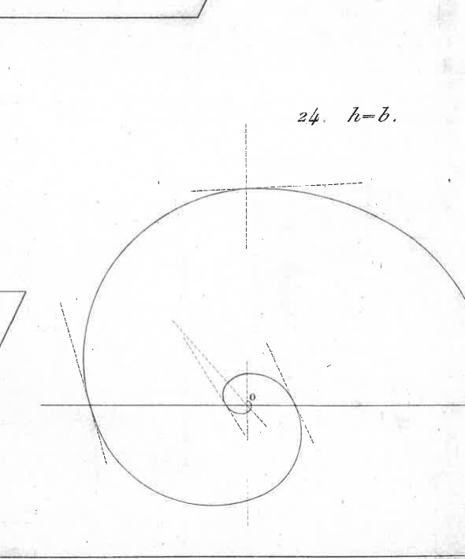

for the polar equation of the double spiral `σ` described by the instantaneous pole (Fig. 24, `h = b`) in absolute space; which perfectly agrees with what had already been found in the second part of this Memoir.

II. — Particular cases relating to the type of body.
The central ellipsoid of the body can be an elongated elliptical spheroid, or flattened towards the poles, which suits all bodies of revolution, and to a

### Page 113

infinity of others where the body has two of its three principal moments of inertia equal to each other; and, finally, the central ellipsoid can be a perfect sphere, which is suitable not only for spherical or regular bodies, but also for an infinity of others.

19. Let us first consider the case of an elongated spheroid, that is, the case where
`b = c;`

we then find
`u^2 = β^2 = γ^2 = { (a^2 + b^2) h^2 - a^2 b^2 } over {h^2} = constante ,`

and, consequently,
`v^2 = β^2 - h^2 = { (a^2 - h^2) (h^2 - b^2) } over {h^2} = constante :`

from which we first see that the angular velocity `θ` of the body around the instantaneous radius `u`, and the angular velocity `θ sin i` around the radius `ρ`, are both constant, and respectively equal to
`θ = { β } over {k} , θ sin i = { sqrt{ β^2 - h^2 } } over {k}`

We then find, 1°. that the polhode `s` is a circle described around the axis of the spheroid, with a radius `ρ` expressed by
`ρ = { b^2 . sqrt{a^2 - h^2} } over { h . sqrt{a^2 - b^2} } ,`

and that its circumference is traversed by the instantaneous pole I with a uniform velocity `ds over dt` whose value is
`ds over dt = { b^2 } over {hk} . { sqrt{a^2 - h^2} . sqrt{h^2 - b^2} } over {h} ;`

from which, by dividing `ds over dt` by the radius `ρ`, results the value
`{ sqrt{a^2 - b^2} . sqrt{h^2 - b^2} } over {hk}`

for the angular velocity of this pole around the axis of the spheroid.
2°. That the herpolhode `σ` is another circle with a radius
`v = sqrt{ β^2 - h^2 } ,`

or
`v = { sqrt{a^2 - h^2} . sqrt{h^2 - b^2} } over {h} ,`

and that the circumference of this circle described around the fixed axis of the impulse couple is traversed with a uniform velocity `dσ over dt` perfectly equal

### Page 114

107

to the preceding `{ds} over {dt}`, from which it results, by dividing `{dσ} over {dt}` or `{ds} over {dt}` by the radius `v`, the quotient `{b^2} over {hk}` for the angular velocity of pole I around the fixed axis in absolute space: a value that perfectly agrees, as it should, with that given by the general expression of `{dφ} over {dt}` if one were to set `b = c`.

It is therefore seen that here everything is uniform and circular, and that, so to speak, no integration is needed; for we immediately have
`u = β`, `v = sqrt{β^2 - h^2}`, `s = σ = {b^2} over {hk} sqrt{β^2 - h^2} . t`, `φ = {b^2} over {hk} . t`
by making the angle `φ` and the arcs `s` and `σ` start with time `t`.

**20.** In the particular case of `b = a`, which corresponds to the case of a central spheroid flattened towards the poles, one would find, *mutatis mutandis*, expressions entirely similar to the preceding ones.

**21.** Finally, if the extreme radii `a` and `c` were equal to each other, which would entail the equality of the three radii `a, b, c` and of the line `h`, there would be nothing left that was not, so to speak, self-evident. The body would constantly rotate around the same diameter `2a` with an angular velocity `θ = a : k`.

It must be remembered, however, that this very particular case of
`a = b = c = h`
is suitable, not only for homogeneous bodies that are spherical or regular, but also for an infinity of others of any constitution.

**CHAPTER II. — NEW IMAGE OF THE ROTATION OF BODIES.**

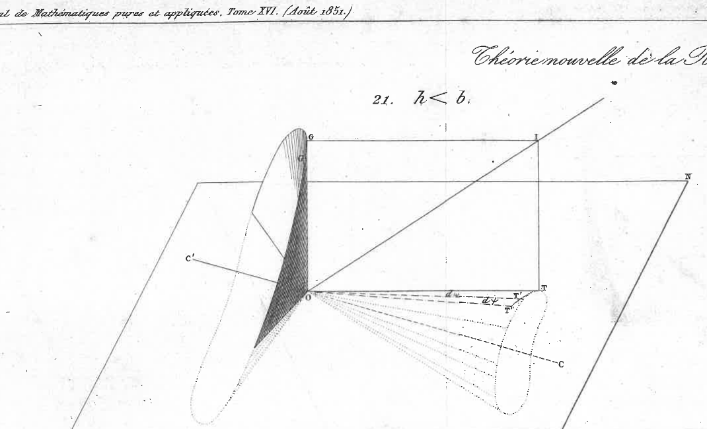

**22.** Let `O` always be the center of the body; `OG` the axis of the impulse couple; `OI` the instantaneous axis of rotation `θ`, and `i` the mutual inclination of these two axes (Fig. 21, for `h < b`, and Fig. 22, for `h > b`).

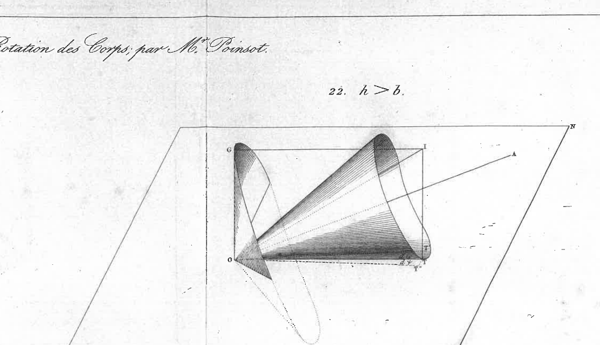

It can always be assumed that at each instant `dt` the rotation `θ` is decomposed into two: one around the axis `OG` of the couple, and the other around a straight line `OT` perpendicular to `OG`, in the plane of the two axes `OG` and `OI`.

Now, by the first rotation `θ cos i` around `OG`, this axis `OG` remains immobile in the body and in space; but by the second `θ sin i` around `OT`, there is a certain line `OG'` of the body that comes to lie on `OG` in space: so that `OG`, which is actually fixed in space, appears to describe an angle `GOG'` within the body. Now it is the plane of this infinitely small angle, and whose value is evidently
`GOG' = θ sin i . dt`

### Page 115

which forms the element of the conical surface traced by the axis OG of the couple within the body.

23. The line OT, which is perpendicular to the plane of this angle, is therefore normal to the surface of this cone. The set of normals OT corresponding to all positions of the generator OG thus forms, within the body, another conical surface, with the same vertex, normal to the first. And it is evident that these two cones, which I represent, for brevity, by (OG) and (OT), are, in a way, reciprocal to each other: for the generators of one can be regarded as the set of normals to the surface of the other.

24. It is easily found (second part, n° 76, corollary VII) that the conical surface, described by the axis OG of the couple, has the equation
`(h^2 - a^2) x^2 + (h^2 - b^2) y^2 + (h^2 - c^2) z^2 = 0`
we can therefore conclude that the other conical surface, described by OT always normal to the first, has the equation
`{x^2} over {h^2 - a^2} + {y^2} over {h^2 - b^2} + {z^2} over {h^2 - c^2} = 0`

25. We thus see:
That these surfaces are those of two right cones, with elliptical bases, around a common axis which is either the major axis a or the minor axis c of the central ellipsoid, depending on whether we have `h > b` or `h < b`;
That, in the singular case of `h = b`, the first cone (OG), described by the axis of the couple, reduces to one of the two planes represented by the equation
`z = x sqrt{ {a^2 - h^2} over {h^2 - c^2} }`
and the second cone (OT), to a simple line OT perpendicular to this plane;
And finally, that in the case where the central ellipsoid of the body is of revolution, the two cones are right cones with circular bases around the axis of the spheroid.

26. Let us now see, with the help of these images, how the movement of a body that has received the impulse of a couple in any given direction is executed in space.
To better fix the ideas and simplify the discourse, we can consider the plane MON of the couple (which remains fixed in space) as the horizontal plane, and, consequently, the axis OG of this couple as the vertical.
This being established, it is clear that, throughout the movement, the surface of the first cone (OG) must pass through the vertical OG, and that the surface of the second (OT) must be in contact with the horizontal plane MN. For, the line OG being always normal to the surface of the cone (OT), and perpendicu-

### Page 116

to the plane MN, this horizontal plane MN can be nothing other than the plane tangent to the surface. Therefore, *during the movement of the body, the cone (OT) remains perpetually in contact with the fixed plane of the applied couple*.

27. Currently, it is quite easy to represent the movement of the body by that of this inner cone (OT), which is attached to the body and carries it along in absolute space.

Indeed, by the rotation `θ sin i` around the generator OT, this cone rolls Fig. 21. on the horizontal plane MN and brings into contact, after an instant `dt`, a certain infinitely close generator `OT'`: by the second rotation `θ cos i` around the vertical OG, this generator `OT'` slides on the same plane, turning by an infinitely small angle `T' OT''`. Thus, by the two component rotations of `θ`, the generator OT, or the line of contact of the cone with the plane MN, has described on this plane, after an instant `dt`, an angle `TOT'` composed of the two angles `TOT'`, `T' OT''` which we have just discussed.

To represent the movement of the body, it must therefore be conceived that at each instant `dt`, the cone (OT) is rolled on the fixed plane MN, by the angle

{TOT' = dω}

due to the rotation `θ sin i` around the line of contact OT, and then, that it is made to slide, on the same plane, by the angle

{T' OT'' = dψ}

due to the rotation `θ cos i` around the vertical OG: and by these two movements, executed one after the other, we have the position of the body after this instant `dt`.

28. In nature, these two movements are not executed one after the other; they are simultaneous, or rather they form only one, which is the compound of these two. But, as we only consider an infinitely small time `dt`, the two spaces that any point of the body tends to describe by virtue of the two rotations `θ sin i` and `θ cos i` are considered rectilinear, like the two sides of a parallelogram: and this point being carried first along one of these sides, and then along a line equal and parallel to the other, it is then found at the end of the diagonal, that is to say, at the same place in space where it would have arrived by its natural movement following this diagonal. If we therefore imagine that this double operation, which I have just described, is repeated for each infinitely small part `dt` of time `t`, we will have the sequence of places where the body passes during its rotation, or the faithful image of its movement in space.

But, if one were simply asked to mark the place where the body will be after any given time, without concerning oneself with the path that the body

### Page 117

110

to achieve this, there would be no need to assume that the double operation in question is repeated at every instant. We could, in one go, make the cone (OT) roll by a finite angle `ω` equal to the sum of all the angles TOT', which the generator OT traces on the surface of this cone during the given time `t`; and then make it slide by rotating around the vertical OG by an angle `ψ` equal to the sum of all the angles T'OT" which are due to the rotation of the body around this vertical during the same time `t`. By these two operations, executed one after the other, and in any order desired, the body, it is true, would not have followed the movement it has in nature, but it would actually be placed in the same location in space where it arrives by its natural movement at the end of time `t`. From this, we see that the problem of determining the location of the body at the end of any time reduces to finding the two sums or integrals
`ω = f(TOT')`, `ψ = f(T'OT")`

as a function of time `t`.

29. As for the second integral `ψ`, it is found immediately; for it is evident that we have
`T'OT" = dψ = θ cos i . dt;`

and we found
`θ cos i = const. = {h} over {k};`

so we have
`dψ = {h} over {k} . dt,`

from which we derive
`ψ = {h} over {k} . t,`

by starting the angle `ψ` with time `t`.
But the other integral
`ω = f(TOT')`

is not found as easily: we must begin by finding the differential expression for the angle TOT'.

For this, I note that this angle TOT', added to the angle T'OT", forms the angle TOT" that the projection of the instantaneous axis OI describes around the axis of the couple; for point T is the continuous projection of pole I onto the plane of this couple. We therefore have, by naming `dφ` this last angle,
`dω + dψ = dφ;`

and we previously found
`dφ = θ cos i . dt + {(h^2 - a^2) (h^2 - b^2) (h^2 - c^2)} over {h^3 . k^3 . θ^2 sin^2 i} . dt;`

### Page 118

we thus have, by comparing the two expressions for `d φ`,
`d ω = {(h^2 - a^2) (h^2 - b^2) (h^2 - c^2)} over {h^3 k^2 θ^2 sin^2 i} dt`
from which we derive
`ω = ∫ {(h^2 - a^2) (h^2 - b^2) (h^2 - c^2)} over {h^3 k^2 θ^2 - h^2} dt`

To obtain `ω`, it will therefore be necessary first to substitute the value of `θ^2` as a function of `t`, and then integrate the expression `∫ dt over {k^2 θ^2 - h^2}`; but this integral still requires the use of elliptic functions.

30. It should be noted that since the lines `h` and `k` are essentially positive, and `d ψ` is equal to `h/k dt`, this angle `d ψ` can always be considered to have the same `+` sign; but the angle `d ω` sometimes has the `+` sign and sometimes the `—` sign, depending on whether `h < b` or `h > b`.

If `h < b`, the cone (OT) encloses the minor axis `c` of the central ellipsoid, and, in this case, the angle `d ω`, having the same sign as `d ψ`, is added to this angle to form the angle `d φ` that the projection of the instantaneous axis describes around the couple's axis.
If `h > b`, the cone (OT) encloses the major axis `a`; and, in this case, the angle `d ω`, having the opposite sign to `d ψ`, must be subtracted to form the angle `d φ`.

31. Finally, in the singular case where `h = b`, the cone (OT) reduces to a straight line OT located in the plane of the extreme axes `a` and `c`, and inclined to `a` by an angle whose tangent is `sqrt{{b^2 - c^2} over {a^2 - b^2}}`: the angle `d ω` is zero, and `d φ` simply reduces to the angle
`d ψ = h/k dt`

Thus, in the case where `h = b`, there exists in the body a singular axis OT which has the property of uniformly describing the fixed plane MON of the couple, with a constant velocity `h/k = b/{k'}`.

while the body rotates around this singular axis with a variable velocity `θ sin i = sqrt{θ^2 - {b^2} over {k^2}}`.

In this case, only the ordinary rules of integral calculus are needed to determine the position of the body after a given time `t`. For, to bring the body into this position, it would suffice to first rotate it around the couple's axis by an angle `ψ = b/k t`;

### Page 119

and then, to rotate it around its singular axis `OT`, by an angle `τ` equal to `∫ from {0} to {t} sin i dt`. Now, in the case of `h = b`, we found, for the expression of `θ sin i` as a function of `t`,
`θ sin i = {{2 n} over {k}} cdot {{e^{{nt} over {k}}} over {1 + e^{{2nt} over {k}}}}`

where `e` denotes the base of Naperian logarithms, and `n` the value of the radical `sqrt{B^2 - b^2}`. Multiplying this expression of `θ sin i` by `dt`, integrating, and making the arc `τ` start with time `t`, we have
`τ = 2 (arc tang e^{{nt} over {k}} - {π} over 4)`

32. The case of `h = a` presents no difficulty; for the axes OI, OG coincide with each other and with the axis `a` of the body; and everything reduces to a simple constant rotation `α : k`, around this axis, which remains immobile in absolute space. The same applies to the case of `h = c`.

33. If the central ellipsoid has two of its axes equal to each other, the cone (OT) is a right circular cone around the axis of revolution of this spheroid. Then `θ sin i` is constant, and, consequently, `d ω` is constant, as well as `d ψ` and `d φ`, and we immediately have the value of these angles for any time `t`.

If the central ellipsoid has its three axes equal and becomes a sphere, everything reduces to a simple rotation around the diameter which forms the axis of the applied couple `G`.

All these particular cases present no difficulty and resolve themselves: the only remarkable thing is the singular case of `h = b` which is resolved by the integration of the differential `∫ from {0} to {t} sin i dt`, which depends only on exponential and circular functions.

Remark I.

34. I found above the expression for the angle `d ω` by that of the angle `d φ`, which was already known to us (no. 13). But this angle `d ω`, which the cone (OT) traces by rolling on the plane of the couple, can also be found directly, as we will see in the following article, which will serve to confirm our analysis.

At point `T` on the surface of this cone (OT), the line of least curvature is obviously the generatrix `OT`; and, consequently, the line of greatest curvature is perpendicular to this generatrix.

Let us consider on this line of curvature the infinitely small arc `ds` which

### Page 120

113

layer in an instant `dt` on the plane `MN` when the cone rolls on this plane by virtue of the rotation `θ sin i` it has on its current generatrix `OT`. It is evident that `θ sin i cdot dt` is the angle of contingency, that is to say, the angle formed by the two tangents drawn at the extremities of the arc `ds`, or, which amounts to the same, the angle formed by the two normals drawn to the surface of the cone at these two points. Now this angle is expressed by `{ds} over {R}`, naming `R` the radius of curvature. We therefore have

`θ sin i cdot dt = {ds} over {R}`

But the angle formed by the two neighboring generatrices `OT` and `OT'` which go from point `O` to the two ends of the same arc `ds`, and which we have named `d ω`, is obviously expressed by

`d ω = {ds} over {OT} = {ds} over {k θ sin i}`

we therefore have, for the expression of `d ω`,

`d ω = {R} over {k} dt`

where `R` denotes the radius of the greatest curvature on the surface of the cone (`OT`), at point `T` extremity of the generatrix

`OT = k θ sin i`

Now, the equation of the conical surface (`OT`) being

`{x^2} over {h^2 - a^2} + {y^2} over {h^2 - b^2} + {z^2} over {h^2 - c^2} = 0`

the radius `R` of the curvature at any point whose coordinates would be `x, y, z`, is expressed by

`R = { (h^2 - a^2) (h^2 - b^2) sqrt{ {x^2} over {(h^2 - c^2)^2} + {y^2} over {(h^2 - b^2)^2} + {z^2} over {(h^2 - a^2)^2} } } over { (h^2 - c^2) (x^2 + y^2 + z^2) }`

and, as the point `T` in question is not just any point on the surface of the cone, but a point which must also be on the surface of the ellipsoid whose equation is (see page 117)

`{x^2} over {(h^2 - a^2)^2} + {y^2} over {(h^2 - b^2)^2} + {z^2} over {(h^2 - c^2)^2} = {1} over {h^2}`

the trinomial under the radical reduces here to the constant `{(h^2 - c^2)^2} over {h^2}`.

By substituting this value, we have, for the expression of `R`,

`R = { (h^2 - a^2) (h^2 - b^2) (h^2 - c^2) } over { h^3 (x^2 + y^2 + z^2) }`

8

### Page 121

Now we have `x^2 + y^2 + z^2 = OT^2 = h^2 θ^2 sin^2 i;`

it follows then, for the expression of `dω = {R} over {k} dt`,

`dω = {(h^2 - a^2) (h^2 - b^2) (h^2 - c^2)} over {h^4 k^2 θ^2 sin^2 i} dt,`

which perfectly agrees with what we had found earlier by a different method.

Remark II.

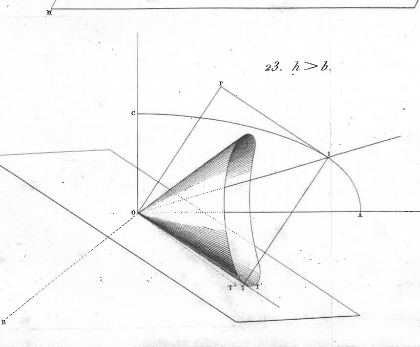

33. I will make another important remark here to show how, in the case of `h > b`, the angular motion `dφ` of the instantaneous pole I of rotation is equal to the difference `dψ - dω` of the angle `dψ` by which the cone (OT) slides on the plane of the couple, to the angle `dω` by which this cone rolls on the same plane; while, in the case of `h < b`, the angle `dφ` is equal to the sum `dψ + dω` of these two angles.

For more clarity, let us consider things at the moment when the instantaneous pole I crosses the mean ellipse (ac) of the central ellipsoid. If we draw the tangent to this ellipse at I, drop the perpendicular OP onto it, and complete the rectangle IPOT, we see that OP will be the direction of the impulse couple's axis, and OT the current generator of the cone (OT); and as OI is situated in the right angle COA of the extreme axes `c` and `a`, it is clear that the perpendicular OP to the tangent at I will also be situated in the same right angle; therefore OT perpendicular to OP will fall below the OA axis relative to the OI and OP axes which I consider to be above.

Now, if `h > b`, we know that the cone described by OT has for its axis the major axis `OA = a` of the central ellipsoid: therefore, if we draw the tangent plane to this cone along OT, which will be the very plane of the impulse couple, the cone (OT) will be situated above this plane on the same side as points I and P. If, then, by virtue of the rotation `θ cos i` around OP, this cone slides in an instant `dt`, by an angle `dψ` on this tangent plane, it is clear that by virtue of the rotation `θ sin i` around OT, it rolls on the same plane by an angle `dω` of opposite sign to `dψ`: so that the angular motion `dφ` of the generator OT is expressed by the difference `dψ - dω` of these two angles.

**Fig. 24.** But if `h < b`, the cone (OT) is no longer described around the major axis OA, but around the minor axis OC. And then this cone, instead of being situated above the plane that touches it at OT, on the same side as pole I and point P, is situated below, on the opposite side. If, therefore, this cone, by rotation around OP, slides on the plane by an angle `dψ`, it is clear that by the other rotation around OT, it rolls on this plane by an angle

### Page 122

dω has the same sign as dψ: so that, in this case, the angular motion dφ of point T is expressed by the sum dψ + dω of these two angles.
36. It is thus seen how it happens that, in the singular case of h = b, we simply have
`dφ = dψ = θ cos i cdot dt = {h} over {k} dt`

for, the case of h = b being able to be considered as belonging to both of the two preceding cases, the angle dω should also have the + sign and the — sign; which cannot be here, unless we have dω = 0: this is, in fact, what happens, and then reduces dφ to dψ; that is to say, in this singular case, the angular velocity of the instantaneous pole, around the fixed axis of the couple, is constant and measured by `{b} over {k}` throughout the movement.

Summary of our theory.

37. We can therefore consider, inside the body, three cones of the second order, namely:
1°. The cone (OI) described by the instantaneous axis OI;
2°. The cone (OT) described by the continuous projection of OI onto the fixed plane MN of the impulse couple;
3°. The cone (OG) described by the fixed axis OG of this couple inside the moving body.

These three cones are right, with elliptical bases, and all three described around the same axis, which is either the major axis a, or the minor axis c of the central ellipsoid, depending on whether h > or < the mean axis b of this ellipsoid.
In the singular case of h = b, the cone OI reduces to a plane passing through the mean axis. The cone (OG) reduces to another plane passing through this same axis, and the cone (OT) reduces to a straight line perpendicular to this latter plane.
The surfaces of these cones are all three described and completed in the same time.

The OG axis of the couple traces its own with an angular velocity
`θ sin i = sqrt { {θ^2 - h^2} over {k^2} }`

The OT axis traces its own with an angular velocity
`{dω} over {dt} = { (h^2 - a^2) (h^2 - b^2) (h^2 - c^2) } over { h^3 k (k^2 θ^2 - h^2) }`

The OI axis traces its own with an angular velocity equal to
`sqrt { (Q - H) k^2 θ^2 - R } over { k^3 θ^2 }`

8.

### Page 123

expression where we have
`Q - H = { (a^2 b^2 + b^2 c^2 + c^2 a^2) h^2 - 2 a^2 b^2 c^2 } over {h^2}`
and
`R = a^2 β^2 γ^2`

38. But, instead of these three cones, we can consider only three curved lines, and thus simplify the images. For, I being the instantaneous pole on the surface of the central ellipsoid, T the projection of this point onto the couple's plane, and P its projection onto the axis OG, we can consider the three elliptical orbits, of double curvature, s, τ, and π described by points I, T, and P within the body, and view these orbits as the bases of our three conical surfaces whose common vertex is at the center O. Therefore, abstracting from all the rest, to see only this center O and one of these three types of wheels s, τ, π, which I have just defined, the body's movement could be depicted in the following three ways:

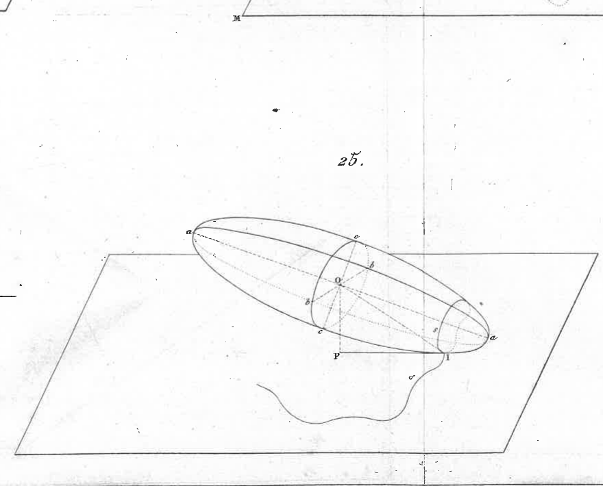

I. If we assume that orbit s, placed in contact with the fixed plane MIN parallel to the couple's plane, rolls without slipping on this plane (Fig. 25), and in such a way that it constantly rotates on its radius OI with an angular velocity θ proportional to this radius, we will have the precise movement of the body in space: this is the clearest image of this movement.

II. If, on the couple's plane MON (which we assume here passes through the center O), we roll orbit τ with the angular velocity `{d ω} over {dt}` found above, and at the same time make it slide with the constant angular velocity `{h} over {k}`, we will likewise have the exact representation of the body's movement: this is another image of this movement, but a little less simple than the previous one.

III. Finally, if we imagine that orbit π, whose radius OP is constant and of length h, slides along its tangent at point P with an angular velocity `{sqrt {k^2 ω^2 - h^2}} over {k}`, and rotates on its radius OP with a constant angular velocity `{h} over {k}`, we will have a third image of the body's movement; but perhaps even less simple than the second. We could therefore discard both; but, in such a difficult subject, this variety of demonstrations can only shed more light on the essence of things, and I did not believe I should suppress them. Moreover, of all these demonstrations, the best, I mean the one where the mind finds the most natural and sensible support, is that of the central ellipsoid, whose center is kept immobile at the same point in space, and which is made to roll on the fixed plane of the couple, without any scraping movement on this plane.

### Page 124

Equations of the three orbits s, τ, π, that we have just considered.

39. We have already seen that the orbit s, described on the surface of the central ellipsoid, by the instantaneous pole I, is given by the intersection of this ellipsoid, whose equation is
(1) `{x'}^2 over {a^2} + {y'}^2 over {b^2} + {z'}^2 over {c^2} = 1`

with the surface of another ellipsoid, whose equation is
(2) `{h^2 x'^2} over {a'^4} + {h^2 y'^2} over {b'^4} + {h^2 z'^2} over {c'^4} = 1`

x', y', z' being the coordinates of pole I parallel to the respective axes a, b, c of the central ellipsoid.

We have seen that the couple's plane, assumed to pass through the center O of this ellipsoid, has the equation
(3) `{xx'} over {a^2} + {yy'} over {b^2} + {zz'} over {c^2} = 0`

Thus, if from pole I a perpendicular IT is dropped onto this plane, we will have, for the equations of this line,
(4) `a^2 z' (x - x') - c^2 x' (z - z') = 0`
(5) `a^2 y' (x - x') - b^2 x' (y - y') = 0`

Now, if from these last three equations we derive the values of x, y, z coordinates of the foot T of the perpendicular, we will find [by making the reductions that come from the first two equations (1) and (2)], these very simple expressions,
`x = {h^2 - a^2} over {a^2} x'`, `y = {h^2 - b^2} over {b^2} y'`, `z = {h^2 - c^2} over {c^2} z'`

from which we derive
`x' = {a^2 x} over {h^2 - a^2}`, `y' = {b^2 y} over {h^2 - b^2}`, `z' = {c^2 z} over {h^2 - c^2}`

Thus, by substituting these values of x', y', z' into equations (1) and (2), we will have in x, y, z the two equations
`{a^2 x^2} over {(h^2 - a^2)^2} + {b^2 y^2} over {(h^2 - b^2)^2} + {c^2 z^2} over {(h^2 - c^2)^2} = 1`
`{h^2 x^2} over {(h^2 - a^2)^2} + {h^2 y^2} over {(h^2 - b^2)^2} + {h^2 z^2} over {(h^2 - c^2)^2} = 1`

which belong to two new ellipsoids whose intersection gives the orbit τ described by point T, which is the continuous projection of pole I onto the couple's plane.

### Page 125

118

Remark I.

40. If we subtract these two equations from each other, we get
(OT) `{x^2} over {h^2 - a^2} + {y^2} over {h^2 - b^2} + {z^2} over {h^2 - c^2} = 0,`
the equation of the conical surface described by the line OT inside the body. And this perfectly agrees with what we found in another way, by seeking this conical surface as the locus of the normals OT to the surface of the cone described by the OG axis of the couple inside the moving body. And, indeed, this latter surface described by OG has for its equation
(OG) `(h^2 - a^2) x^2 + (h^2 - b^2) y^2 + (h^2 - c^2) z^2 = 0.`
Now it is clear that one of these two conical surfaces can be regarded as the locus of the normals to the surface of the other: from which it is seen that it is sufficient to know one to have both.

41. In the singular case of `h = b`, the cone (OG) reduces to a plane passing through the mean axis `b`, and whose equation is
`{z} over {x} = - {c} over {a} sqrt{{a^2 - b^2} over {b^2 - c^2}};`
and the cone (OT) to a simple straight line perpendicular to this plane, and whose equation is
`{z} over {x} = - {c} over {a} sqrt{{b^2 - c^2} over {a^2 - b^2}}`

Consequently, the orbit `τ` described by point T can only be a line segment OT, extending from the center O to the point T which corresponds to the maximum distance `sqrt{b^2 - c^2}` from this point to the center O.

42. In the two particular cases of `h = a`, or `h = c`, the orbit `τ` reduces to a point which is the center O of the central ellipsoid.

Remark II.

43. If we combined only equations (1), (2), (4) and (5) to eliminate `x', y', z'`, and did not use equation (3) of the couple's plane, we would obtain in `x, y, z` an equation corresponding to the surface traced by the locus of the normals IT that would be drawn to the surface of the central ellipsoid, along the orbit `s` described by the instantaneous pole I; and if we then carried along each normal IT, from its foot I, and on the same side as the ellipsoid, a length IT equal to the line `h`, the locus of the extremities of all these lines would still form the orbit `τ` described by point T.

### Page 126

119

Instead of equation (3), we could therefore use the following equation:
(P) `(x-x')^2 + (y-y')^2 + (z-z')^2 = h^2`
which expresses that the line IT has constant length `h`. But since this equation would also express that the line IT can be carried to the other side of the tangent plane, the combination of the five equations (1), (2), (4), (5) and (P) would give, not only the orbit `τ` described by the foot of the perpendicular IT to the plane of the couple, but another orbit `τ prime` described by the point T' located at the same distance IT' outside the ellipsoid: a completely different curve in relative space, and which is extraneous to the question here; but, in absolute space, the path of point T' would be perfectly equal and parallel to the path of point T.

Remark III.
44. The combination of the five equations (1), (2), (4), (5) and (P) may be even easier than that of the first four with equation (3). For, by deriving the values of `(z-z')`, `(y-y')` from equations (4) and (5) and substituting them into equation (P), we immediately get
`(x-x')^2 [1 + {a^4} over {h^2} ({y'^2} over {b^4} + {z'^2} over {c^4})] = h^2`
whence, by substituting for `{y'^2} over {b^4} + {z'^2} over {c^4}` its value `{1} over {h^2} - {x'^2} over {a^4}` derived from equation (2), we have
`(x-x')^2 {a^4} over {h^2 x'^2} = h^2`
which gives
`x' = {a^2 x} over {h^2 pm a^2}`
and it is evident that we would similarly have
`y' = {b^2 y} over {h^2 pm b^2}`
`z' = {c^2 z} over {h^2 pm c^2}`

expressions all similar to those of no. 39, but where of the two signs `pm` only the sign `-` should be taken, if one wishes to consider, on the normal IT, only the point T which falls on the same side as the surface of the central ellipsoid with respect to the tangent plane at I: for, by taking the signs `pm`, one would have a point T located on the other side of this tangent plane, and the line OT, drawn from the center O, would no longer be perpendicular to the normal IT, as desired in the proposed question.
45. Furthermore, to remove any ambiguity, it is evident that the coordinates of point T, which are `x, y, z`, must be such that they satisfy

### Page 127

The equation of the couple's plane, which is
`(xx') over {a^2} + (yy') over {b^2} + (zz') over {c^2} = 0.`

Now, by substituting for `x, y, z` the double values
`x = {(h^2 +- a^2)x'} over {a^2}, y = {(h^2 +- b^2)y'} over {b^2}, z = {(h^2 +- c^2)z'} over {c^2},`

we would have
`{(x')^2} over {a^4} (h^2 +- a^2) + {(y')^2} over {b^4} (h^2 +- b^2) + {(z')^2} over {c^4} (h^2 +- c^2) = 0,`

or, according to equation (2),
`+- {(x')^2} over {a^2} +- {(y')^2} over {b^2} +- {(z')^2} over {c^2} + 1 = 0;`

but this, because of equation (1), is evidently only possible by adopting all three lower signs —, which brings us back to the simple expressions for `x, y, z` found by the first analysis.

Finally, as for the orbit `π` described by point P, taken at a distance `OP = h` on the OG axis of the impulse couple, it is very easy to find its equations. It is evident that this curve `π` is nothing other than the intersection of the sphere whose equation is
`x^2 + y^2 + z^2 = h^2,`

with the conical surface described by OG, and whose equation is
`(h^2 - a^2)x^2 + (h^2 - b^2)y^2 + (h^2 - c^2)z^2 = 0.`

From this, we see that this curve `π` is a spherical orbit, with double curvature, like the elliptical orbits `τ` and `s`, and that it is described around the same axis.

46. Considering the two cones (OP) and (OT) terminated by these orbits `π` and `τ`, which serve as their bases, the body's movement occurs in such a way that the body rotates, at each instant `dt`, on the generatrices OP and OT of these two cones, with angular velocities proportional to the very lengths of these generatrices: so that the first velocity `θ cos i` is constant like the line OP, and the second `θ sin i` is variable like the line OT.

CHAPTER III. — ANGULAR MOVEMENTS OF THE PRINCIPAL AXES OF THE BODY IN ABSOLUTE SPACE.

I.

We have only considered so far the movement of the instantaneous axis, because it is sufficient to know it, both in the body and in space, to have

### Page 128

The movement of the body itself, and, consequently, the movements of the three principal axes that the body carries with it in absolute space.
But it may not be useless to briefly indicate these corollaries, and to show, for each of these principal axes a, b, c, the movement it has to rotate around the fixed axis of the impulse couple, to alternately lower and raise itself on the plane of this couple: which corresponds to the movements called, in Astronomy, the *precession of the nodes*, the *nutation of the axis*; quantities analogous to those which, in the preceding analysis (relative to the axis and the *instantaneous* equator), are designated by `di over dt` and `dφ over dt`, and whose values as a function of `θ`, and, consequently, of time `t`, are expressed by

`dφ over dt = h over k + sqrt{Δ} over {k(k^2 θ^2 - h^2)}`
`di over dt = dθ over dt cdot h over {θ sqrt{k^2 θ^2 - h^2}}`

47. Let `λ`, `μ`, `ν` be the three angles that the principal radii `a, b, c` make with the fixed axis of the impulse couple, and let us use the letters `x, y, z` to designate the lines `kp, kq, kr`; it is easy to see that we have the following three equations:

`(1) cos λ = {hx} over {a^2}, cos μ = {hy} over {b^2}, cos ν = {hz} over {c^2}`

and, consequently, these:

`(2) sin^2 λ = {a^4 - h^2 x^2} over {a^4}, sin^2 μ = {b^4 - h^2 y^2} over {b^4}, sin^2 ν = {c^4 - h^2 z^2} over {c^4}`

From which one can conclude in passing that, if the radii `a, b, c` are extended to points `A', B', C'`, where they will meet the plane of the impulse couple (which is at distance `h` from the center `O`), one will have, by making the lines variable

`OA' = pa, OB' = pb, OC' = pc,`

the equations

`a^4 over {p^2 x^2} = b^4 over {p^2 y^2} = c^4 over {p^2 z^2};`

which gives these two rather remarkable properties,

`1 over {p_a^2} + 1 over {p_b^2} + 1 over {p_c^2} = "constante" = 1 over {h^2},`
`a^2 over {p_a^2} + b^2 over {p_b^2} + c^2 over {p_c^2} = "constante" = 1.`

### Page 129

122

48. Now, let `d π_a over dt`, `d π_b over dt`, `d π_c over dt`, or simply `π_a`, `π_b`, `π_c` be the angular velocities of the projections of the three axes `a, b, c` onto the plane of the couple; I say that we will have the following three equations:
`π_a = {h (a^2 - x^2)} over {k a^2 sin^2 λ}`
`π_b = {h (b^2 - y^2)} over {k b^2 sin^2 μ}`
`π_c = {h (c^2 - z^2)} over {k c^2 sin^2 ν}`

whose direct demonstration is very easy.

And, in fact, it is clear that `π_a dt` denotes nothing other than the angle described by the projection of radius `a` onto the plane of the couple during the instant `dt`. Now, the projection of `a` is `a sin λ`, and, consequently, the expression `a^2 sin^2 λ . π_a dt` represents the area described by this projection of `a`: but the area described on a plane by the projection of a line is nothing other than the projection of the area described in space by the line itself. We therefore only need to find the area described by radius `a` in space, project it onto the plane of the couple, and equate it to the expression `a^2 sin^2 λ . π_a dt`.

Now, in an instant `dt`, the body rotates around `a` by an angle `p dt`; but, by this first rotation, line `a` remains immobile and produces no area in space: it therefore only remains to consider the other two rotations `q dt`, `r dt` which occur in the same instant around the other two axes `b` and `c`.

By the first, the body rotates around `b` by an angle `q dt`; and, consequently, radius `a` describes a sector `a^2 q dt` in a plane perpendicular to `b`, which, when projected onto the plane of the couple, gives the area
`a^2 q dt cos μ`.

By the last rotation, the body rotates around `c` by an angle `r dt`, and radius `a` describes a sector `a^2 r dt` perpendicular to `c`, which, projected onto the plane of the couple, gives the area
`a^2 r dt cos ν`.

We therefore have the equation
`a^2 sin^2 λ . π_a dt = (a^2 q cos μ + a^2 r cos ν) dt`,

or, by dividing both sides by `a^2 dt`, and substituting, instead of `q` and `r`, their values `x over k` and `y over k`,
`sin^2 λ . π_a = {h over k} ( {y^2 over b^2} + {z^2 over c^2} ) = {h over k} (1 - {x^2 over a^2});`

### Page 130

which is the first of our three equations. And it is evident that we would similarly obtain the second, by changing a to b, x to y, and λ to μ; and then the third, by changing a to c, x to z, and λ to ν. Thus we will have
(II)
`π_a = {h over k} {a^2 - x^2 over a^2 sin^2 λ}`
`π_b = {h over k} {b^2 - y^2 over b^2 sin^2 μ}`
`π_c = {h over k} {c^2 - z^2 over c^2 sin^2 ν}`

which was to be demonstrated.

49. If we multiply the first of these three equations by sin^2 λ, the second by sin^2 μ, the third by sin^2 ν, and add them, we get
`sin^2 λ . π_a + sin^2 μ . π_b + sin^2 ν . π_c = {h over k} (3-1) = 2 {h over k}`

Now, if we take three lines equal to unity on the principal axes, starting from the center, we can see sin λ, sin μ, sin ν as the three projections of these lines onto the fixed plane of the couple; and sin^2 λ . π_a, sin^2 μ . π_b, sin^2 ν . π_c as the fluxions of the three areas described by these projections on the same plane. Therefore, considering the sum of these three areas, we will have, for this sum, the very simple expression
`2 {h over k} t`

where it can be noted that `{h over k}` is the constant angular velocity θ cos i of the system around the fixed axis of the impulse couple G.

50. If, considering the same equations (II), we multiply the first by `{sin^2 λ} over {a^2}`, the second by `{sin^2 μ} over {b^2}`, the third by `{sin^2 ν} over {c^2}`, we get
`{1 over a^2} sin^2 λ . π_a = {h over k a^2} - {h x^2 over k a^4}`
`{1 over b^2} sin^2 μ . π_b = {h over k b^2} - {h y^2 over k b^4}`
`{1 over c^2} sin^2 ν . π_c = {h over k c^2} - {h z^2 over k c^4}`

from which, by adding, we derive this remarkable equation,
`{1 over a^2} sin^2 λ . π_a + {1 over b^2} sin^2 μ . π_b + {1 over c^2} sin^2 ν . π_c = {h over k} ( {1 over a^2} + {1 over b^2} + {1 over c^2} - {1 over h^2} )`

### Page 131

Now `1 over a`, `1 over b`, `1 over c` are nothing other than the arms of inertia of the body around the principal axes: if, therefore, from the center O, one draws on the axes three lines equal to the respective arms of inertia around the same axes, one can consider `1 over a sin λ`, `1 over b sin μ`, `1 over c sin ν` as the three projections of these lines onto the plane of the couple, and `1 over {a^2} sin^2 λ . π a`, `1 over {b^2} sin^2 μ . π b`, `1 over {c^2} sin^2 ν . π c` as the fluxions of the three areas that these projections describe on the same plane during the body's movement; therefore, by multiplying by `dt` and integrating, we will have, for the sum of these areas described in time `t`,
`h over k ( 1 over {a^2} + 1 over {b^2} + 1 over {c^2} - 1 over {h^2} ) . t`

51. Here then are two new properties of the movement of a free body rotating about its center of gravity:
1°. If, from this center, one draws on the principal axes of the body three lines equal to each other, and of any length `R`, the sum of the areas described by their three projections onto the fixed plane of the impulse couple will be proportional to time; and it will be expressed by `2 over k n^2 t`;
2°. If one draws on the same principal axes three lines proportional to the three arms of inertia of the body around the same axes, the sum of the three areas described by their projections onto the plane of the couple will also be proportional to time; and this sum will be expressed by
`j^2 . h over k ( 1 over {a^2} + 1 over {b^2} + 1 over {c^2} - 1 over {h^2} ) . t`

`j` being the common ratio of the three lines to the three arms of inertia; which forms two very remarkable theorems in the theory of the rotation of a free body under no external action: theorems in some way geometrical, and which should not be confused with those concerning the ordinary principle of the conservation of areas, although they fundamentally depend on it, and their expressions can be brought closer, as can be seen in the following article.

52. And, in fact, if one considers all the radius vectors drawn from the center to all the equal molecules of the body, and the average of all the areas that their projections trace on the fixed plane of the couple, one will evidently have, for this average area, the expression `G over m`; `G` being the magnitude of the

### Page 132

125

impulse couple, and `m` the mass of the body, or the number of all its molecules. Thus, as `G` has been represented by `m over {hk}`, we will have, for the expression of this average area, described in time `t`,

`1 over {hk} . t`

53. If we wanted the preceding area `2 {h over k} r^2 . t`, due to the movements of the three equal radii `r`, taken on the three axes of the body, to be equal to this average area `1 over {kh} . t` of the system of all the radius vectors drawn to the particles of the body, we would have to choose the length of the radius `r` such that

`2 {h over k} r^2 = 1 over {kh}`

which gives, for `r`, the expression

`r = 1 over {h sqrt{2}}`

Thus, by taking, on the principal axes of the body, three lines equal to `1 over {h sqrt{2}}`, we can say that, during the movement of the body, these three lines projected onto the plane of the couple `y` describe three areas whose sum is equal to the average area of the system: so that by multiplying this area by the mass `m` of the body, we obtain the total area due to the impulse couple `G`.
54. We could similarly seek the unequal radii `r_a, r_b, r_c`, but proportional to the respective arms of inertia `1 over a, 1 over b, 1 over c`, which would have to be taken on the axes, so that the area described is equal to the average area of the system.
By designating, as above, by `j` the unknown ratio of `r_a` to `1 over a`, of `r_b` to `1 over b`, of `r_c` to `1 over c`, we would have, to determine `j`, the equation

`j^2 . {h over k} (1 over {a^2} + 1 over {b^2} + 1 over {c^2} - 1 over {h^2}) = 1 over {kh}`

from which we derive

`j^2 = {a^2 b^2 c^2} over {h^2 (a^2 b^2 + b^2 c^2 + a^2 c^2) - a^2 b^2 c^2}`

### Page 133

and, consequently, by setting `{a'} ^ {2} {b'} ^ {2} + {b'} ^ {2} {c'} ^ {2} + {a'} ^ {2} {c'} ^ {2} = B` and `{a'} ^ {2} {b'} ^ {2} {c'} ^ {2} = C`,
`R_a = {bc} over {sqrt{B h^2 - C}}`
`R_b = {ac} over {sqrt{B h^2 - C}}`
`R_c = {ab} over {sqrt{B h^2 - C}}`

Thus, by taking the areas described by the projections of these three lines, one would have in sum an area equal to the average area of the system.

II. — Properties of the nutation movements of the three principal axes towards the fixed axis of the impulse couple.

55. The three equations (2) from no. 47 give:
`a^2 sin^2 λ = a^2 - {h^2 x^2} over {a^2}`
`b^2 sin^2 μ = b^2 - {h^2 y^2} over {b^2}`
`c^2 sin^2 ν = c^2 - {h^2 z^2} over {c^2}`

therefore, by adding, we get the equation
(A) `a^2 sin^2 λ + b^2 sin^2 μ + c^2 sin^2 ν = a^2 + b^2 + c^2 - h^2 =` constant.

The same equations (2) give
`sin^2 λ = 1 - {h^2 x^2} over {a^4}`
`sin^2 μ = 1 - {h^2 y^2} over {b^4}`
`sin^2 ν = 1 - {h^2 z^2} over {c^4}`

therefore, by adding, we get
(B) `sin^2 λ + sin^2 μ + sin^2 ν = 3 - 1 = 2 =` constant,

which leads to the known equation
`cos^2 λ + cos^2 μ + cos^2 ν = 1`,

as it should be.

Therefore, if we consider the three poles A, B, C of the central ellipsoid, it follows from the preceding equation (A) that the sum of the squares of their distances to the fixed axis of the impulse couple is constant throughout the motion.

We can view `sin^2 λ` as `a^2 sin^2 λ times {1} over {a^2}`, that is, as being

### Page 134

equal to the product of the square of the distance from pole A to the axis of the couple, by the square of the arm `{1} over {a}` of the body's inertia around the principal radius. From equation (B) therefore results this other theorem:
The sum of the squares of the arms of the body's inertia respectively multiplied by the squares of the variable distances of the poles to the axis of the couple, is constant throughout the entire course of the movement.

III. — On the curves `{σ} sub {a}`, `{σ} sub {b}`, `{σ} sub {c}` described on the couple's plane by the projections of the three poles A, B, C of the central ellipsoid.

56. If we consider the three curves `{σ} sub {a}`, `{σ} sub {b}`, `{σ} sub {c}` described by the three poles A, B, C projected onto the couple's plane, we see that these three curves, whose path is infinite, and which, in general, do not close, are of the same type as the herpolhode `{σ}` described on the same plane by the instantaneous pole of rotation.
If `{h} > {b}` for example, and if `{a}` is thus the axis that the elliptical orbit `{s}` of the instantaneous pole surrounds like an axle, the curve `{σ} sub {a}`, described on the couple's plane by the projection of pole A, will be, like the herpolhode `{σ}`, formed by a series of equal and regular waves around the same center P. And even, as the maximum of the radius vector `{v} sub {a}` `{==}` `{a} sin λ` corresponds to the minimum of `{x}`, and this minimum to the minimum of the radius vector `{v}` of the curve `{σ}`, we see that the upper vertices of the waves of curve `{σ} sub {a}` correspond to the lower vertices of curve `{σ}`, and the lower ones to the upper ones.

57. Meanwhile, the projections of poles B and C also describe, around the same center P, curves `{σ} sub {b}`, `{σ} sub {c}` which have alternating maximum and minimum vertices, where these two poles pass at the same times, but one B passing through an upper vertex when the other C passes through a lower vertex, and vice versa: and this, at a right angle of distance between the radius vector `{v} sub {b}` of one and the radius vector `{v} sub {c}` of the other.
If `{h} < {b}`, in which case the elliptical orbit `{s}` surrounds the minor axis `{c}` as its axle, we will have the same properties for the curves described by the projections of the three poles.
What can be observed in both cases is that the curve `{σ} sub {b}`, described by the mean pole B, is the only one whose vertices always correspond to vertices of the same name in the herpolhode `{σ}`, and that the opposite always holds true for the other two curves `{σ} sub {a}`, `{σ} sub {c}`.

Singular case of `{h} = {b}`.

58. Finally, if `{h} = {b}`, in which singular case the orbit `{s}` is an ellipse passing through the mean axis `{b}`, and the curve `{σ}` a spiral around the center P, 1° the pole

### Page 135

mean B will likewise describe a spiral around the same center, approaching this point ceaselessly like the spiral `σ`, without ever being able to reach it; 2° pole A will also describe a spiral, but one that will ceaselessly move away from the same center, from its minimum distance `a sqrt({a^2 - b^2} over {a^2 - c^2})` to its maximum distance `a` which it can never reach: this spiral, described by pole A, will therefore ceaselessly expand towards a circle circumference of radius `a`, which acts as its asymptote; 3° finally, the same will apply to the spiral described by pole C, whose smallest radius will be `c sqrt({b^2 - c^2} over {a^2 - c^2})` and the largest = `c`.

Case where the central ellipsoid is one of revolution.

59. If the central ellipsoid is one of revolution, the orbit `s` is a circle around the axis of revolution, the curve `σ` is a circle on the plane of the couple, and the projection of the pole of the figure also describes a concentric circle. In this case, there is, strictly speaking, no other pole of the figure than the one which makes up the extremity of the axis of revolution. But if one were to arbitrarily mark two others on the equator of the spheroid, taken at a right angle of distance from each other, and consider the two curves that their projections describe, one would have two perfectly equal curves, which would not be circular, but which would form regular undulations around the same center: the vertices of different names on the two curves always being at a right angle of angular distance from each other.

Remark I.

60. We found for the angular velocity `d φ over dt` of the instantaneous pole I around the axis of the couple,

`d φ over dt = h over k + {(h^2 - a^2)(h^2 - b^2)(h^2 - c^2)} over {h^3 k ν^2}`

`ν` being the radius vector of the herpolhode `σ`. Let's see what is, as a function of its radius vector `ν_a`, the expression for the angular velocity `d π_a over dt` of pole A of the ellipsoid around the same fixed axis.

This angular velocity is expressed, as seen above, by

`d π_a over dt = h over k {a^2 - z^2} over {a^2 sin^2 λ}`

Now, `a^2 sin^2 λ` being the square of the radius vector `ν_a` of the curve `σ_a`, we have

### Page 136

firstly:
`d π_e over dt = {h a^2 - x^2} over {k v_e^2}`

but, from
`v_e^2 = a^2 sin^2 λ = {a^4 - h^2 x^2} over {a^2}`

we obtain
`a^2 - x^2 = {a^2} over {h^2} (v_e^2 + h^2 - a^2)`

we therefore have, by substituting this value for `a^2 - x^2`,
`d π_e over dt = {a^2} over {kh} + {a^2 (h^2 - a^2)} over {kh v_e^2}`

from which it is seen that the expression for the angular velocity `d π_e over dt` of pole A in the figure is similar to that for the angular velocity `d φ over dt` of instantaneous pole I, both being composed of a constant part and a part reciprocal to the square of the radius vector.

And it is evident that the same can be said for the other two poles B and C, since their angular movements are given by the same expression as the preceding one, simply by changing `a` to `b`, and `a` to `c`.

Remark II.
61. If the body were a body of revolution, around the principal axis `a` for example, it is certain that the angular velocity `d π_e over dt` of pole A would be equal to that of instantaneous pole I. We must therefore find, in the case where `b = c`,
`d π_e over dt = d φ over dt`

This is indeed the case, for it is easy to see that, in the case where `b = c`, the square of the radius vector `v` of the herpolhode `σ` is constant and has the value
`v^2 = {(a^2 - h^2) (h^2 - b^2)} over {h^2}`

on the other hand, for the square of the radius vector `v_e` of the curve `σ_a`,
`v_e^2 = {h^2 (a^2 - h^2)} over {h^2 - b^2}`

Now, by substituting these values of `v^2` and `v_e^2` into the respective expressions for `d φ over dt`

9

### Page 137

and `{d π_a} over {dt}`, we first find
`{d φ} over {dt} = {h} over {k} + { (h^2 - a^2) (h^2 - b^2)^2 . h } over {h^2 k (a^2 - h^2) (h^2 - b^2)} = {h} over {k} - {h^2 (h^2 - b^2)} over {h^3 k} = {b^2} over {kh}`
and then
`{d π_a} over {dt} = {h} over {k} + {h} over {k} . { (h^2 - b^2) } over {h^2 (a^2 - h^2)} = {h} over {k} - {h^2 - b^2} over {h k} = {b^2} over {kh}`
the same value as the previous one, as it should be.

Remark III.

62. As in our analysis the quantity `1 over {hk}` expresses the magnitude of the impulse couple, we derive from the preceding expression,
`{d π_a} over {dt} = {b^2} over {hk'}`
which contains only the product `hk` and the square of `b`, this remarkable consequence: that, in a body whose central ellipsoid is of revolution, the movement `{d π_a} over {dt}` of the nodes of the equator on the fixed plane of the couple depends solely on the magnitude of this couple, and not at all on its direction; that this movement also does not depend on the moment of inertia around the axis `a` of the body, but only on the moment of inertia around the radius `b` of the equator. Thus, whatever the position of the couple relative to the axis, and the value of the moment of inertia `1 over {a^2}` around this axis, the pole `A` of the body will always rotate with the same angular velocity `{d π_a} over {dt}` around the fixed axis of the impulse couple.

Now it is not difficult to see that, even without changing the mass of a body, its shape could be changed in an infinite number of ways such that the central spheroid would always have an equator of the same radius `b`, but with an axis `a` that would differ from one to another. It can therefore be said that the same couple, being applied as desired to any of these bodies, would produce exactly the same precession, that is to say, the same angular movement of the line of nodes of the equator on the fixed plane of this couple.

IV. — Differential equations of the curves `σ_a`, `σ_b`, `σ_c`.

63. If one wanted to have the polar equation of one of the curves `σ_a`, between its radius vector `ρ_a` and the angle `π_a` it describes on the fixed plane, it would suffice to

### Page 138

to find the expression for `d v_a over dt` as a function of `v_a`, and to compare it to that of `d π_a over dt` which is already known to us.

Thus, as we have
`a^2 - v_a^2 = {h^2} over {a^2} x^2`

and furthermore
`x^2 = {a^4} over {(a^2 - b^2)(a^2 - c^2)} (u^2 - a^2)`

we will have, by setting, for brevity,
`{a^2 h^2} over {(a^2 - b^2)(a^2 - c^2)} = n`

equation (1) from which we derive
`a^2 - v_a^2 = n (u^2 - a^2)`
`- {v_a d v_a} over {d t} = n {u d u} over {d t}`

Now we previously found (no. 8)
`{d u} over {d t} = {1} over {k} sqrt{(u^2 - a^2)(β^2 - u^2)(u^2 - γ^2)}`

and we have, according to equation (1) above,
`u^2 - a^2 = {a^2 - v_a^2} over {n}`
`β^2 - u^2 = {n (β^2 - a^2) - (a^2 - v_a^2)} over {n}`
`u^2 - γ^2 = {n (a^2 - γ^2) + (a^2 - v_a^2)} over {n}`

therefore, by substituting these values, we will have
`v_a {d v_a} over {d t} = - {1} over {k sqrt{n}} sqrt{(a^2 - v_a^2) [n (β^2 - a^2) - (a^2 - v_a^2)] [(a^2 - v_a^2) + n (a^2 - γ^2)]}`

Now, as we have for the expression of `d π_a over dt`,
`{{d π_a} over {dt}} = {{a^2} over {k h}} cdot {{h^2 - (a^2 - v_a^2)} over {v_a^2}}`

we will have, by dividing this equation by the preceding one,
`{{d π_a} over {d v_a}} = - {{a^2 sqrt{n}} over {h}} cdot {{v_a^2 - a^2 + h^2} over {v_a sqrt{(v_a^2 - a^2) [v_a^2 - a^2 + n (β^2 - a^2)] [v_a^2 - a^2 + n (γ^2 - a^2)]}}}`

### Page 139

132

which is, between the radius vector `v_a` and the angle `π_a` it describes on the fixed plane of the impulse couple, the sought equation of the curve `σ_a`.
Similarly, one would find the polar equations of the other two curves `σ_b`, `σ_c`, described on the same plane by the projections of the two poles B and C of the central ellipsoid: it would suffice to change `a` to `b`, and `a` to `c` in the preceding equation, but with the caution of making the same change in the expression for the number `n`, which being here,

for `σ_a`,

`n = {a^2 h^2} over {(a^2 - b^2) (a^2 - c^2)}`

would be for `σ_b`,

`n = {b^2 h^2} over {(a^2 - b^2) (b^2 - c^2)}`

and for `σ_c`,

`n = {c^2 h^2} over {(b^2 - c^2) (a^2 - c^2)}`

Of the three curves `σ_a`, `σ_b`, `σ_c` described on the fixed plane by the three points where the axes of the body will intersect this plane.

64. If, instead of the curve `σ_a`, described by the projection of pole A, one wanted to consider the curve `σ_a'` traced by the point A' where the extended axis `a` intersects the plane of the couple, it is clear that by naming `v_a'` the radius vector of this new curve `σ_a'`, one would first have, between `v_a` and `v_a'`, this relation

(R)

`v_a^2 = {a^2 v_a'^2} over {h^2 + v_a'^2}`

Now, these two radius vectors `v_a` and `v_a'` always being in the same direction, it is evident that the angular motion of the radius `v_a'` is perfectly equal to that of the radius `v_a`, and that, consequently, to obtain the angular velocity `{{d π_a'} over {dt}}` of the radius `v_a'`, it suffices to substitute, in the preceding expression for `{{d π_a} over {dt}}`, instead of `v_a`, its value in `v_a'` given above. We will thus immediately have the equation

`{{d π_a'} over {dt}} = {{h} over {k}} cdot {{v_a^2 + h^2 - a^2} over {v_a^2}}`

Now, to obtain the polar equation of this new herpolhode `σ_a'`, one would have to find the expression for `{{d v_a'} over {dt}}` as a function of `v_a'`. Now, differentiating equation (R) first gives

`{{d v_a'} over {dt}} = {{(h^2 + v_a'^2)^{3/2}} over {a h^2}} cdot {{d v_a} over {dt}}`

it only remains to find the factor `{{d v_a} over {dt}}` as a function of the radius `v_a'`.

### Page 140

We found earlier that `{{d v_a} over {dt}}` is a function of the radius `{v_a}`; and this, by equation (R), is given in `{v_a}'`: thus, by making these substitutions, we will have the expression for `{{d v_a'} over {dt}}` as a function of the radius vector `{v_a}'`.
So finally, if we divide the expression `{d π_a} over {dt}` by that of `{{d v_a'} over {dt}}`, we will get
`{d π_a} over {dv_a'} =` function of `{v_a}'`,
which will give the polar equation of the curve `{σ_a}'`.

The other two curves `{σ_b}`, `{σ_c}` would be found by simply changing `{a}` to `{b}`, and `{a}` to `{c}` in the preceding one.

65. A rather notable difference can be observed between these new curves and the first ones. Each of the first three curves `{σ_a}`, `{σ_b}`, `{σ_c}` is, like the herpolhode `{σ}`, always enclosed between two circles of finite radii, whose circumference it alternately touches. But, of the three curves `{σ_a}'`, `{σ_b}'`, `{σ_c}'`, only one circulates thus between two limited circumferences; and this curve is either `{σ_a}'` or `{σ_d}'`, depending on whether we have
`h > b` or `h < b`.

For each of the other two, it does indeed touch, by the lower vertices of its waves, a circle circumference of finite radius, but it will carry its upper vertices onto a circle of infinite radius. This is easy to recognize by simply comparing the radius vector `{v_a}` to the radius vector `{v_a}'`.

66 By the two variables `{ π_a}` and `{v_a}`, determined as functions of time `{t}`, we would have the projection of pole `{A}` onto the fixed plane, and as the height of this point above the plane is expressed by `sqrt{a^2 - v_a^2}`, we would know the position of pole `{A}` in absolute space: and similarly for the other two poles `{B}` and `{C}` of the body. But the integration of these expressions `{d π_a} over {dt}` and `{{d v_a} over {dt}}` has the same difficulties and requires the use of the same elliptic functions as the preceding `{{d φ} over {dt}}`, `{{d θ} over {dt}}`, relative to the instantaneous pole `{I}` of rotation. Etc. Etc.

67. But I will not go further into these details: our main goal here was to clearly demonstrate our new theory of the rotation of bodies, and to elevate it, if possible, to a degree of clarity that would place it among elementary theories. And it seems to me that, by the new theorems and the varied images that precede, this important objective has been entirely fulfilled.

### Page 141

I will only add, regarding the nature of the rotational motion of a free body, this last corollary: that the central ellipsoid of the body is perpetually cut by the fixed plane of the impulse couple along an ellipse whose shape varies, but whose area is constant.

This is almost immediately apparent if one considers that all rhomboids constructed on three conjugate diameters of the ellipsoid are equal in volume, and that the same applies to all cylinders inscribed in these rhomboids; that, consequently, from this infinity of equal cylinders, those which have the same height have equivalent bases. And this is precisely what happens for cylinders whose two parallel bases touch the central ellipsoid at the two ends of the instantaneous axis of rotation; for the mutual distance of these two tangent planes remains the same throughout the course of the rotation.

This demonstration suffices for the particular case where the couple lies in a diametral plane of the ellipsoid. If this couple lies in a parallel plane, which also remains fixed in absolute space, the ellipsoid is cut along another ellipse similar to the first and varying in shape with it. Now, if one compares the areas of these two ellipses, one finds, by a very simple calculation, that they are in a ratio that does not change, I mean, that remains the same, at whatever point in the motion one wishes to make this comparison. Therefore, since the area of the first ellipse is constant, that of the second is also, as it is always the same fraction of the first.

---

## PLATES

### Planche I (Figures 1–20)
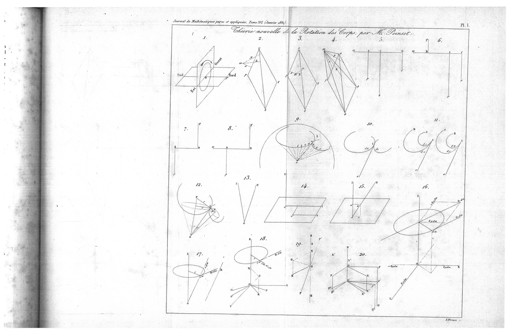

### Planche II (Figures 21–25)
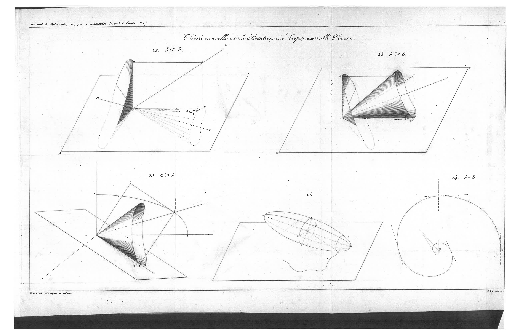
